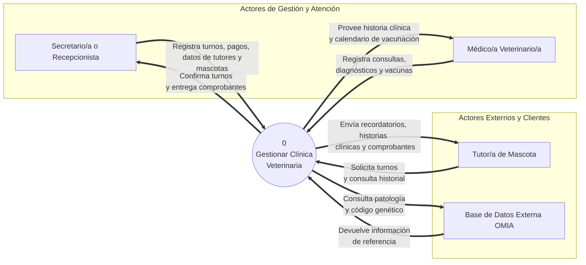
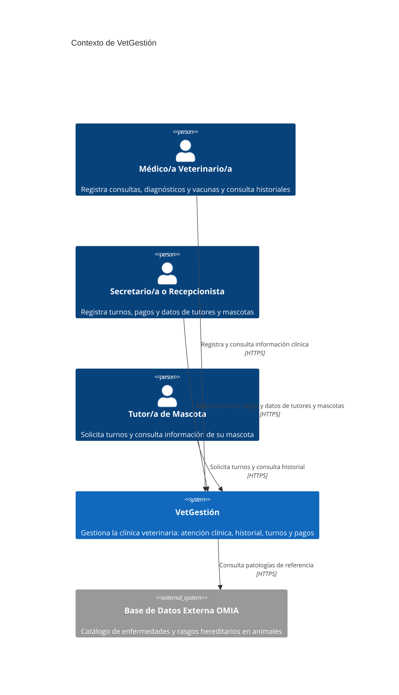
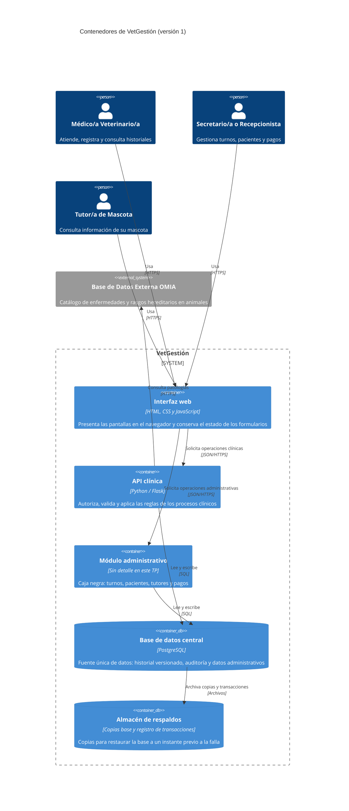
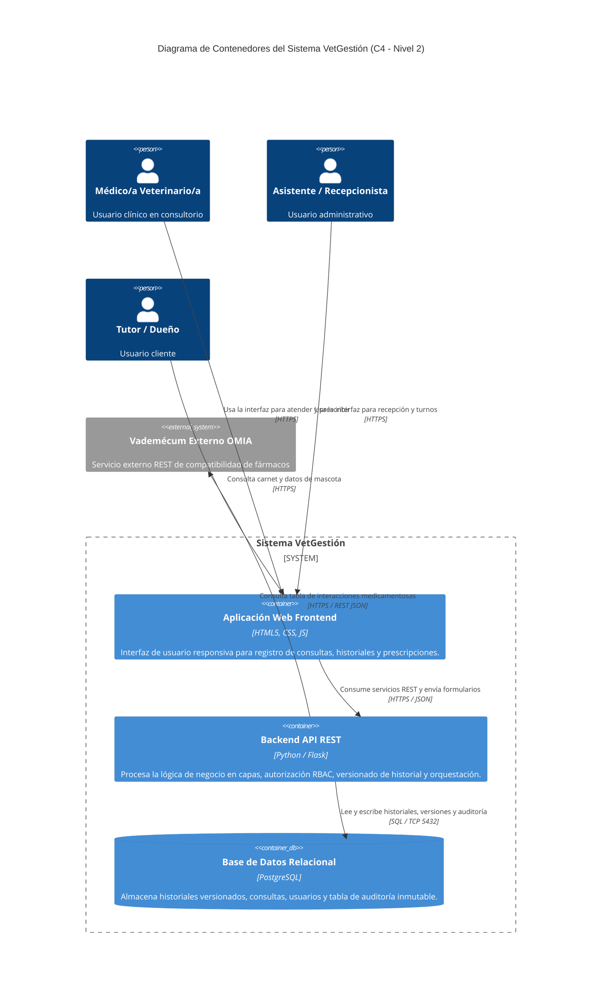
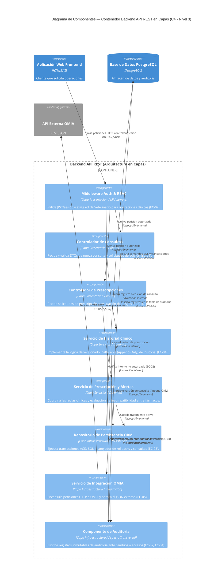

# Especificación de Arquitectura — Sistema de Gestión Clínica Veterinaria 

## 1. Introducción

### 1.1 Propósito
El propósito de este documento es especificar la arquitectura de software del **Sistema de Gestión Clínica Veterinaria (VetGestión)**. La arquitectura aquí descripta establece la estructura global del sistema, la división en contenedores y componentes, la selección de estilos y patrones arquitectónicos, las tácticas para satisfacer los requerimientos no funcionales (atributos de calidad) y las decisiones de diseño fundamentales que condicionan el desarrollo.

### 1.2 Alcance
La guía indica que la arquitectura se define para el o los procesos elegidos en el TP1 y que el resto del sistema se representa como caja negra. El proceso elegido es **Gestión Clínica e Historial** (`docs/requirements/RF.md` y `slices.md`). En el DFD (diagrama de flujo de datos) de Nivel 1 del TP1 (`docs/architecture/diagrama-de-contexto-dfd.md`) corresponde a los procesos 2 y 4:

| Proceso del DFD Nivel 1 | ¿En alcance? | Tratamiento en la arquitectura | Requerimientos |
|---|---|---|---|
| 1. Gestionar Turnos y Pacientes | No | Caja negra: contenedor «Módulo administrativo» | Fuera del proceso elegido |
| 2. Registrar Atención Clínica | **Sí** | Se detalla: «Interfaz web» y «API clínica» | RF-01 a RF-08, RF-10 a RF-12 · CU-01, CU-02, CU-03 · HU-01, HU-02, HU-03 |
| 3. Gestionar Pagos | No | Caja negra: contenedor «Módulo administrativo» | Fuera del proceso elegido |
| 4. Consultar Referencia OMIA | **Sí** | Componente «Adaptador de OMIA» dentro de la API clínica y sistema externo OMIA | RF-09 · CU-01, slice A3 |

### 1.3 Audiencia
Este documento está diseñado para los siguientes roles organizacionales y técnicos:
- **Arquitectos de Software y Líderes Técnicos:** Para evaluar la coherencia de las decisiones de diseño estructural, el equilibrio entre atributos de calidad y la evolución futura del sistema.
- **Desarrolladores (Frontend y Backend):** Como especificación normativa de la división en capas, responsabilidades de componentes, contratos de API y reglas de dependencia.
- **Equipo de Operaciones / DevOps:** Para comprender la topología de contenedores, la estrategia de persistencia, réplicas WAL y procedimientos de restauración.
- **Equipo de Calidad (QA / Testing):** Para diseñar casos de prueba de integración y verificar la cobertura de los escenarios de atributo de calidad (EC-01 a EC-05).
- **Evaluadores y Docentes:** Para auditar el proceso de derivación desde los atributos de calidad hasta los diagramas C4 y decisiones de arquitectura.

### 1.4 Siglas y Acrónimos
Las siglas se aclaran la primera vez que se usan y se reúnen en el glosario (sección 11). Las principales: **TP** (trabajo práctico), **RF** (requerimiento funcional), **CU** (caso de uso), **HU** (historia de usuario), **EC** (escenario de calidad), **DA** (decisión de arquitectura), **DFD** (diagrama de flujo de datos), **C4** (modelo de documentación en cuatro niveles: contexto, contenedores, componentes y código), **OMIA** (*Online Mendelian Inheritance in Animals*: catálogo de rasgos y enfermedades hereditarias en animales).

---

## 2. Restricciones

Las siguientes restricciones limitan y condicionan las decisiones arquitectónicas del proyecto:

### 2.1 Restricciones Técnicas
- **R1 (Navegador y Dispositivos):** El cliente web debe funcionar en navegadores modernos (Chrome, Firefox, Edge, Safari) sin requerir plug-ins adicionales y ser operable desde tablets de consultorio.
- **R2 (Tecnología Backend y Persistencia):** El servidor debe implementarse en Python utilizando el framework Flask para la API REST, y PostgreSQL como motor de base de datos relacional.
- **R3 (Sistemas Externos):** la consulta a OMIA es de solo lectura (RF-09). No se asume una API de integración estable.

### 2.2 Restricciones del Equipo y Tecnología
- **R4 (Tamaño y Experiencia del Equipo):** Proyecto desarrollado por un equipo reducido (3 integrantes) con alta familiaridad en arquitecturas web tradicionales (Cliente-Servidor / Capas) y tiempo acotado.
- **R5 (Simplicidad Operativa):** Se descartan soluciones con alta sobrecarga de configuración o indirección excesiva (como microservicios o patrones de indirección compleja) para evitar sobreingeniería y garantizar la mantenibilidad del código.

### 2.3 Restricciones de Tiempo y Entorno
- **R6 (Ciclo de Entrega):** La arquitectura debe completarse y ser demostrable dentro del plazo del cuatrimestre.
- **R7 (Entorno de Despliegue):** El despliegue inicial se realiza en un servidor único o contenedorizado con Docker, sin infraestructura distribuida multi-región.

### 2.4 Restricciones de Proceso
- **R8(Ciclo de Vida)**: Se ha seleccionado un ciclo de vida incremental, así los módulos se entregarán por etapas, pudiendo agregar módulos sin reescribir los anteriores

### 2.5 Restricciones Legales y Éticas
- **R9 (Protección de Datos)**: Se exige confidencialidad de los datos personales de los tutores bajo las Leyes argentinas y el código de ética de la IEEE/ACR

---

## 3. Contexto

E### 3.1 Diagrama de contexto del TP1 (DFD Nivel 0)

Se reproduce sin cambios el diagrama de `docs/architecture/diagrama-de-contexto-dfd.md`:

### 3.2 El mismo contexto en notación C4 (nivel 1)

Mismos actores y mismo sistema externo, con los mismos nombres:

### 3.3 Coherencia con el DFD del TP1

| Elemento del DFD Nivel 0 | Elemento C4 | Observación |
|---|---|---|
| Proceso 0 «Gestionar Clínica Veterinaria» | Sistema «VetGestión» | El proceso único del DFD es el sistema completo |
| Secretario/a o Recepcionista | Persona con el mismo nombre | Igual |
| Médico/a Veterinario/a | Persona con el mismo nombre | Igual |
| Tutor/a de Mascota | Persona con el mismo nombre | Igual |
| Base de Datos Externa OMIA | Sistema externo con el mismo nombre | Igual |
| Flujos de respuesta del sistema (confirmaciones, historia clínica, recordatorios) | No se dibujan | En C4 solo se dibuja la flecha de quien inicia la comunicación (secc. 4.6 de la guía) |

---

## 4. Drivers Arquitectónicos

### 4.1 Escenarios del TP2 con identificador

Cada escenario de `docs/requirements/quality-scenarios.md` recibe un identificador `EC-xx` (EC: escenario de calidad). En ISO/IEC 25010:2023 el atributo elegido es la subcaracterística; la columna «Atributo (libro)» aplica la Tabla 1 de la guía, que lo relaciona con los atributos de Bass, Clements y Kazman.

| ID | Escenario del TP2 | Subcaracterística ISO/IEC 25010:2023 (característica) | Atributo (libro) | Medida de la respuesta |
|---|---|---|---|---|
| `EC-01` | 1.1 Registro de una consulta en una urgencia clínica | Operabilidad (Capacidad de interacción) | Usabilidad | ≤ 45 s y ≤ 8 interacciones; 0 pérdidas de datos ante un error de validación |
| `EC-02` | 2.1 Petición de modificación clínica que saltea la interfaz | Integridad (Seguridad de la información) | Seguridad | 100 % de peticiones no autorizadas rechazadas; 0 registros modificados; evento registrado en ≤ 1 s |
| `EC-03` | 3.1 Caída de la base de datos en plena jornada | Capacidad de recuperación (Fiabilidad) | Disponibilidad | RTO ≤ 4 h; RPO ≤ 15 min; 0 registros huérfanos; restauración de prueba por etapa |
| `EC-04` | 4.1 Corrección de una entrada histórica | Responsabilidad (Seguridad de la información) | Seguridad | 100 % de las ediciones reconstruibles; 0 ediciones sin motivo; auditoría inalterable |
| `EC-05` | 5.1 OMIA cambia su formato o debe reemplazarse | Modificabilidad (Mantenibilidad) | Modificabilidad | ≤ 2 días y 1 persona; 0 módulos modificados fuera del adaptador; regresión de CU-01 sin cambios |

RTO (*recovery time objective*) es el tiempo máximo tolerable para restablecer el servicio; RPO (*recovery point objective*) es la máxima pérdida de datos confirmados tolerable, medida en tiempo.

### 4.2 Criterio para decidir si un escenario es driver

Un escenario es un **driver arquitectónico** si su cumplimiento obliga a decidir sobre la estructura. Se aplican tres preguntas:

1. ¿Condiciona la elección del **estilo** del sistema?
2. ¿Obliga a dividir o crear **contenedores o componentes**?
3. ¿Obliga a incorporar un **mecanismo** estructural (transacciones, copias, un adaptador, una separación de permisos)?

Un escenario que se resuelve dentro de un solo componente o solo en la interfaz de usuario, sin afectar la estructura, no es un driver.

| ID | ¿Estilo? | ¿Contenedores o componentes? | ¿Mecanismo? | Conclusión | Nivel de decisión que condiciona |
|---|---|---|---|---|---|
| `EC-01` | No | Sí: un componente cliente que conserve el estado del formulario y un contrato de errores por campo entre la interfaz y el servidor | No | **Driver** | Patrón (MVC en la interfaz web) |
| `EC-02` | Sí: control centralizado en el servidor (cliente-servidor) | Sí: componente de autorización; la base no accesible desde el cliente | Sí: separación de acceso | **Driver** | Estilo y aspecto transversal |
| `EC-03` | Sí: repositorio (transacciones sobre un almacén central) | Sí: contenedor «Almacén de respaldos» y componentes de excepciones y salud | Sí: transacciones, copias, restauración | **Driver** | Estilo y contenedor |
| `EC-04` | Sí: repositorio (permisos y auditoría centralizados) | Sí: componente de auditoría | Sí: historial versionado y esquema de auditoría separado | **Driver** | Estilo, modelo de datos y aspecto transversal |
| `EC-05` | No | Sí: componente adaptador y regla de dependencias | Sí: encapsulamiento de la integración | **Driver** | Patrón (capas) |

**Qué quedó afuera de esta clasificación.** Dentro de `EC-01`, lo que corresponde solo a la interfaz (orden de los campos, teclado numérico, colores, textos de error) pertenece al TP2 y no es un driver. Los cinco escenarios son drivers, pero con distinto nivel de impacto: `EC-02`, `EC-03` y `EC-04` condicionan el estilo; `EC-01` y `EC-05` condicionan patrones dentro de un contenedor.

### 4.3 Qué mira la arquitectura además de los escenarios

| Fuente | Qué aporta |
|---|---|
| RF y HU del TP1 | RF-08 («validación exclusiva de rol») y HU-02 («de su autoría») fijan qué debe autorizar el servidor; HU-01 («sin perder la información cargada») respalda `EC-01`; HU-03 y CU-03 definen el servicio de alertas |
| Restricciones (sección 2) | R4 y R5 inclinan hacia cliente-servidor con capas y descartan microservicios; R9 pide poder agregar el módulo administrativo sin tocar el clínico |
| DFD Nivel 1 | Los procesos 1, 2, 3 y 4 se relacionan solo a través de almacenes de datos (D1 a D4), sin flujos directos entre procesos: es la base del estilo repositorio |

### 4.4 Prioridad entre drivers

Criterio del grupo: cuando dos drivers entran en conflicto, se prioriza la **integridad y trazabilidad de los datos clínicos** (`EC-02`, `EC-03`, `EC-04`) sobre la comodidad de carga (`EC-01`) y sobre la facilidad de cambio (`EC-05`). La razón es que un dato clínico corrompido o sin autoría no se puede reconstruir después, mientras que una carga incómoda o un cambio que cuesta un día más sí se pueden corregir.

| ID | Importancia para el negocio | Dificultad técnica | Comentario |
|---|---|---|---|
| `EC-03` | Alta | Alta | Requiere un contenedor nuevo y práctica operativa |
| `EC-04` | Alta | Media | Afecta el modelo de datos |
| `EC-02` | Alta | Media | Es un mecanismo conocido, pero debe valer en todas las operaciones |
| `EC-05` | Media | Media | Riesgo técnico declarado en el SRS |
| `EC-01` | Media | Baja | Gran parte se resuelve en la interfaz |

---

## 5. Estrategia de Solución

### 5.1 Tácticas por driver

Una **táctica** es una decisión de diseño elemental que influye en el logro de la respuesta de un escenario de calidad (Bass et al.). Las de las tablas siguientes salen de la Tabla 2 de la guía; cuando se usa una que no está allí, se aclara. Una táctica es una decisión, no una tecnología.

#### EC-01 — Operabilidad (atributo del libro: Usabilidad)

| Grupo | Táctica seleccionada | Cómo contribuye a la medida | Dónde se implementa |
|---|---|---|---|
| Iniciativa del sistema | Mantener modelos de tarea, de usuario y del sistema | El cliente conserva lo ingresado y el contexto del paciente (por ejemplo, el último peso); ante un error de validación no se pierde nada → «0 pérdidas de datos» | Modelo de formulario |
| Controlar la demanda (atributo Desempeño, usada aquí por su efecto en el tiempo de carga) | Reducir sobrecarga | El servidor valida todos los campos en una sola pasada y devuelve todos los errores juntos, en lugar de uno por vez → menos interacciones y menos tiempo | Validación de registros clínicos |

| Táctica descartada | Motivo |
|---|---|
| Cancelar | Aporta control, pero no contribuye a la medida; ya está resuelta como decisión de interfaz en el TP2 (botón «Cancelar») sin impacto estructural |
| Deshacer | No hay un requerimiento de revertir un guardado: la corrección se hace con una edición versionada (RF-08) |
| Pausar y reanudar | «Completar después» se logra editando una entrada ya guardada (RF-08), no con borradores persistidos en el servidor, que agregarían estado y complejidad |
| Agregar (acciones sobre varios elementos) | Ninguna HU pide operar sobre varios elementos a la vez |
| Acotar tiempos de ejecución | La medida es el tiempo humano de carga, no el tiempo de ejecución del sistema; fijar un máximo de ejecución no acerca el valor esperado |
| Introducir concurrencia / Aumentar recursos | No hay demanda que lo justifique: hay un usuario clínico por consulta |

#### EC-02 — Integridad (atributo del libro: Seguridad)

| Grupo | Táctica seleccionada | Cómo contribuye a la medida | Dónde se implementa |
|---|---|---|---|
| Resistir ataques | Identificar, autenticar y autorizar actores | Cada operación de escritura se atribuye a un usuario autenticado y el servidor verifica rol y autoría antes de ejecutarla → 100 % de rechazos | Autenticación y autorización |
| Resistir ataques | Limitar acceso | La base de datos solo es accesible desde los contenedores servidor: no hay camino para modificar datos que evite la verificación → «0 registros modificados» | Base de datos central |
| Resistir ataques | Limitar exposición | Hacia afuera solo se expone la interfaz HTTPS del sistema, no la base ni los respaldos | Despliegue (TP4) |
| Resistir ataques | Cifrar datos | HTTPS protege credenciales y sesión; sin eso un tercero podría suplantar un rol clínico | Relaciones entre contenedores |
| Recuperarse | Registro de auditoría | Cada rechazo genera un evento con usuario, acción y recurso en ≤ 1 s | Auditoría |

| Táctica descartada | Motivo |
|---|---|
| Detectar intrusión, Detectar negación de servicio, Revocar acceso, Informar actores | La medida se refiere a una petición individual, no a patrones de ataque repetidos. El registro de auditoría deja la base para sumarlas en un incremento posterior; hoy exigirían un componente de análisis y alertas fuera de R4 y R5 |
| Separar entidades (zonas de red) | Lo esencial se obtiene con «Limitar acceso»; la separación por redes se define en el despliegue (TP4) |

#### EC-03 — Capacidad de recuperación (atributo del libro: Disponibilidad)

| Grupo | Táctica seleccionada | Cómo contribuye a la medida | Dónde se implementa |
|---|---|---|---|
| Detectar fallos | Detección de excepciones | Un fallo de conexión o de consulta se reconoce como tal y activa el modo degradado | Gestión de excepciones |
| Detectar fallos | Ping y eco | Una ruta de estado comprueba que la base responde; acorta el tiempo hasta detectar la caída, que cuenta dentro del RTO | Chequeo de salud |
| Recuperarse | Redundancia de repuesto | Copia base más archivo continuo del registro de transacciones en un almacén aparte; ante la falla se levanta una instancia de reemplazo y se restaura al instante previo → RPO ≤ 15 min y RTO ≤ 4 h | Almacén de respaldos |
| Prevenir fallos | Transacciones | Cada operación clínica (consulta, peso, vacunas) se guarda completa o no se guarda → «0 registros huérfanos» | Acceso a datos |
| Recuperarse | Rollback | Si un paso falla, la transacción se deshace y no quedan datos parciales | Acceso a datos |
| Recuperarse | Manejo de excepciones | Los fallos de la base se traducen en una respuesta controlada y comprensible | Gestión de excepciones |
| Recuperarse | Degradación controlada | Con la base caída se informa mantenimiento y no se aceptan escrituras que se perderían; la interfaz conserva lo cargado (`EC-01`) | Gestión de excepciones y Modelo de formulario |
| Detectar fallos | Comprobación de consistencia posterior a la restauración (*sanity checking* en Bass et al.; no figura en la Tabla 2) | Tras restaurar se verifican claves e integridad de las cadenas de versiones → «0 registros huérfanos» | Procedimiento de restauración y Acceso a datos |

| Táctica descartada | Motivo |
|---|---|
| Redundancia activa o pasiva (réplica en caliente con conmutación automática) | Un RTO de 4 h no la exige; duplicaría infraestructura y operación (R5, R7) |
| Latido y Monitoreo continuo | No hay un proceso separado que emita latidos; «Ping y eco» alcanza para detectar |
| Reintento | No resuelve una falla total de la base, solo las pasajeras |

#### EC-04 — Responsabilidad (atributo del libro: Seguridad)

| Grupo | Táctica seleccionada | Cómo contribuye a la medida | Dónde se implementa |
|---|---|---|---|
| Recuperarse | Registro de auditoría | Cada corrección guarda autor, fecha y hora, versión previa, versión nueva y motivo → 100 % reconstruibles | Auditoría |
| Resistir ataques | Identificar, autenticar y autorizar actores | Cada acción se atribuye a una cuenta individual y solo el autor veterinario corrige (RF-08) | Autenticación y autorización |
| Resistir ataques | Separar entidades | La auditoría vive en un esquema aparte, con permisos de solo inserción para la aplicación → no se puede editar ni borrar desde la aplicación | Base de datos central |
| **Propia del grupo** (no está en la Tabla 2) | Versionado inmutable: solo se agregan versiones | Una corrección crea una versión nueva enlazada a la anterior y nunca sobrescribe → «conserva la versión original» | Servicio de registro clínico y Acceso a datos |
| Prevenir fallos (atributo Disponibilidad) | Transacciones | La versión nueva y el registro de auditoría se confirman juntos: no hay corrección sin rastro ni rastro sin corrección | Acceso a datos |

| Táctica descartada | Motivo |
|---|---|
| Firma digital con certificado por registro | Costo y complejidad desproporcionados para el equipo (R4); el escenario no la pide |
| Cifrar la auditoría en reposo con clave separada | Es una protección válida, pero el escenario exige inalterabilidad, no confidencialidad; se difiere |
| Enviar los registros a un servicio externo de logs | Sumaría un contenedor sin que ningún escenario lo exija |

#### EC-05 — Modificabilidad (atributo del libro: Modificabilidad)

| Grupo | Táctica seleccionada | Cómo contribuye a la medida | Dónde se implementa |
|---|---|---|---|
| Reducir acoplamiento | Encapsular | El adaptador expone una interfaz estable («buscar patología») y oculta formato y protocolo de OMIA → un cambio de formato no sale del adaptador | Adaptador de OMIA |
| Reducir acoplamiento | Usar un intermediario | El adaptador media entre el servicio de referencias y OMIA | Adaptador de OMIA |
| Reducir acoplamiento | Restringir dependencias | Solo el adaptador conoce el cliente y el formato de OMIA; los servicios no importan nada de OMIA → «0 módulos fuera del adaptador» | Reglas de dependencia de las capas |
| Aumentar cohesión | Dividir módulos | La integración es un módulo separado del servicio de referencias | Adaptador de OMIA |
| Capacidad de prueba (otro atributo) | Abstraer fuentes de datos | Los servicios se prueban con un adaptador simulado, de modo que la regresión de CU-01 no depende de OMIA | Servicio de referencias |

| Táctica descartada | Motivo |
|---|---|
| Diferir el enlace (plug-ins, parametrización) | Hay un único proveedor; reemplazar OMIA equivale a escribir otro adaptador con la misma interfaz (≤ 2 días). Un mecanismo de plug-ins costaría más de lo que ahorra |
| Abstraer servicios comunes | No hay otra integración externa que comparta funciones |
| Redistribuir responsabilidades | No hay una función mal ubicada que corregir |

---

### 5.2 Estilos Arquitectónicos

### 5.2 Estilos arquitectónicos (decisión global)

Un **estilo** es un conjunto de principios que da un marco abstracto para una familia de sistemas: define el vocabulario de componentes y conectores y las restricciones sobre cómo se combinan (Shaw y Garlan). Responde a «¿cómo se organiza el sistema en su conjunto?» y se hace visible sobre todo en la vista de contenedores.

#### 5.2.1 Estilos evaluados

| Estilo | ¿Adoptado? | Motivo |
|---|---|---|
| Cliente-servidor | **Sí: estilo base** | `EC-02` pide control centralizado de la autorización en el servidor; R1, R2, R4 y R5 favorecen una estructura con pocas piezas que el equipo ya conoce |
| Repositorio | **Sí: estilo adicional, solo para la zona de datos** | `EC-03` (transacciones sobre un almacén central) y `EC-04` (permisos y auditoría centralizados). Además, en el DFD Nivel 1 los procesos solo se comunican a través de almacenes de datos, y R9 pide agregar el módulo administrativo sin tocar el clínico |
| Tuberías y filtros | No | El sistema no es un flujo de transformación de datos en etapas. La cadena de verificaciones de una petición dentro de la API es un mecanismo del framework, no el estilo del sistema; declararlo sería combinar por acumulación |
| Orientada a eventos | No | Ningún escenario exige tareas lentas, picos de carga ni procesamiento diferido. La interrupción de red al guardar (CU-01, slice E1) se resuelve con una transacción atómica y con la conservación de lo cargado en el cliente |
| Microservicios | No | R4 y R5; ningún escenario exige escalar o desplegar por separado, y `EC-05` se resuelve con encapsulamiento. Sumaría complejidad operativa y consistencia entre bases |
| Monolítica | No se declara | La API clínica se despliega como una sola unidad, pero eso es una consecuencia y no un objetivo; su estructura interna se rige por el patrón de capas |
| Microkernel, SOA y entre pares (*peer-to-peer*) | No | No hay núcleo con extensiones, ni bus de integración, ni nodos iguales |

SOA es arquitectura orientada a servicios.

#### 5.2.2 Estilo base: cliente-servidor

- **Principio:** el servidor presta servicios a clientes que los solicitan.
- **Dónde aplica:** a todo el sistema. El cliente es la «Interfaz web»; los servidores son la «API clínica» y el «Módulo administrativo».
- **Qué mejora:** seguridad (control centralizado, `EC-02`), simplicidad de operación y de prueba (`EC-05`).
- **Qué sacrifica:** el servidor es un punto único de falla; la carga se centraliza; el cliente depende de la red.
- **Comprobación de restricciones (Tabla 4 de la guía), sobre la vista de contenedores v1:**

| Restricción o regla del estilo | ¿Se cumple? | Evidencia en el diagrama |
|---|---|---|
| Los clientes no se comunican entre sí | Sí | Hay un único cliente |
| El servidor no inicia la comunicación con el cliente | Sí | Ninguna flecha va del servidor a la interfaz |
| El cliente no accede directamente a la base de datos | Sí | La interfaz web solo se conecta con las dos aplicaciones servidor |
| El cliente inicia siempre la comunicación | Sí | Todas las flechas salen de la interfaz hacia los servidores |
| El servidor expone una interfaz definida | Sí | La API clínica expone una interfaz REST con datos JSON |
| La lógica y los datos compartidos viven en el servidor | Sí | Las reglas están en la API clínica y los datos en la base central |

#### 5.2.3 Estilo adicional: repositorio

- **Principio:** los datos compartidos viven en un almacén central que varias aplicaciones consultan y actualizan, y las aplicaciones solo se comunican entre sí a través de ese almacén.
- **Dónde aplica:** solo a la **zona de datos**: la «Base de datos central» y las dos aplicaciones que la usan, «API clínica» y «Módulo administrativo».
- **Por qué responde a escenarios:** `EC-03` y `EC-04` necesitan un único lugar donde se apliquen transacciones, permisos y auditoría. Las dos aplicaciones comparten datos reales (el proceso 2 lee los pacientes y los turnos que escribe el proceso 1, según el DFD Nivel 1), y el almacén central evita que se llamen directamente.
- **Qué mejora:** consistencia e integridad (transacciones), permisos y auditoría en un único punto, y desacople entre módulos, lo que permite agregar el módulo administrativo en otra etapa (R9).
- **Qué sacrifica:** el almacén es un punto único de falla; el esquema de datos acopla a quienes lo usan; la base puede volverse un cuello de botella al escalar.
- **Cómo se conectan las zonas:** el estilo cliente-servidor y el repositorio se conectan por la conexión SQL de cada servidor a la base. Es el único punto de integración entre las dos aplicaciones servidor.
- **No confundir** con el «patrón repositorio» de diseño (clases que encapsulan consultas): acá se habla del estilo, es decir, de un almacén central compartido.
- **Comprobación de restricciones (Tabla 4):**

| Restricción o regla del estilo | ¿Se cumple? | Evidencia en el diagrama |
|---|---|---|
| Las aplicaciones no se comunican directamente entre sí | Sí | No hay flecha entre «API clínica» y «Módulo administrativo» |
| El almacén es la fuente única de los datos | Sí | El «Almacén de respaldos» es una copia pasiva, no una fuente |
| El acceso concurrente se controla (transacciones) | Sí | `EC-03`: transacciones en «Acceso a datos» |
| El esquema de datos es conocido por todos los que lo usan | Sí, a documentar | Modelo de dominio del TP1 (`modelo_de_dominio_inicial.md`) |

#### 5.2.4 Primera versión de la vista de contenedores

Los archivos estáticos de la interfaz web los sirve el mismo servidor web que expone la API (detalle de despliegue: TP4). Cada contenedor que existe por una táctica o un estilo se rastrea a una decisión: «Almacén de respaldos» (`DA-05`), «Base de datos central» (`DA-04`) y «Módulo administrativo» (`DA-04`). El catálogo definitivo y la verificación de las reglas 4.4, 4.6 y 4.7 son parte de la Parte B.

---

### 5.3 Patrones Arquitectónicos y Aspectos Transversales

#### Patrón por Contenedor (Backend API REST): Arquitectura en Capas (Layered Architecture)
El contenedor Backend API se organiza internamente con una **Arquitectura en Capas tradicional**, limpia y sin sobreingeniería:

1. **Capa de Presentación / Controladores (Controllers & Middleware):** Recibe solicitudes HTTP/REST, autentica el token, verifica permisos por rol (RBAC) y valida el formato del DTO enviado desde el cliente.
2. **Capa de Servicios / Dominio (Application Services):** Modela la lógica clínica de negocio (orquestación de consultas, reglas de versionado inalterable y validación de prescripciones).
3. **Capa de Infraestructura / Persistencia e Integración (Data Access & Integration):** Maneja las consultas SQL transaccionales hacia PostgreSQL y encapsula las peticiones HTTP externas hacia la API de OMIA.

- **Por qué se eligió Capas:** Encaja perfectamente con la experiencia del equipo (Restricción R4), simplifica la implementación y el mantenimiento, y cumple estrictamente todos los drivers del proyecto (`EC-01` a `EC-05`) sin introducir interfaces ni indirecciones innecesarias.
- **Regla estricta de Capas:** Las dependencias van en un solo sentido, de arriba hacia abajo (Presentación -> Servicios -> Infraestructura/Persistencia). Ninguna capa inferior depende de una superior.

#### Aspectos Transversales (Cross-Cutting Concerns):
1. **Autenticación y Autorización (RBAC):** Middleware que intercepta todas las peticiones para validar credenciales y restringir acciones clínicas solo al rol de Veterinario (EC-02).
2. **Auditoría Inmutable (Audit Logging):** Módulo transversal que registra automáticamente autor, fecha/hora, recurso y motivo ante cada creación o modificación (EC-02, EC-04).
3. **Manejo Global de Excepciones y Transacciones:** Interceptor que captura fallos no controlados, ejecuta rollback de transacciones SQL y retorna respuestas estandarizadas con pantallas de mantenimiento degradado (EC-03).

---

### 5.4 Tabla de Cobertura de Drivers y Sacrificios

| Driver (TP2) | Atributo | Cómo lo cubre la arquitectura | Qué sacrifica |
| :--- | :--- | :--- | :--- |
| **EC-01** (Operabilidad) | Usabilidad | DTOs de consulta atómicos, conservación de estado de formulario en el cliente y respuestas de error con enlaces directos (`#id`). | Ligero incremento de código de validación duplicado entre cliente y servidor. |
| **EC-02** (Integridad) | Seguridad | Middleware de autorización RBAC en la Capa de Presentación del Backend que valida rol y recurso en cada solicitud. | Latencia adicional en cada petición HTTP por la comprobación de permisos. |
| **EC-03** (Recuperación) | Fiabilidad | Transacciones SQL ACID en la Capa de Persistencia, manejador global de excepciones con rollback y esquema WAL/PITR. | Sobrecosto de almacenamiento en disco por conservación de logs de transacciones. |
| **EC-04** (Responsabilidad) | Seguridad | Modelo de datos de consulta inalterable (versionado append-only) y módulo de auditoría en la Capa de Persistencia. | Mayor volumen de filas en la base de datos (se conservan todas las versiones). |
| **EC-05** (Modificabilidad) | Mantenibilidad | Componente de integración aislado (`ServicioIntegracionOMIA`) en la Capa de Infraestructura. | Ligera duplicación de DTOs para adaptar las respuestas JSON externas al modelo interno. |

---

## 6. Vista de Contenedores (C4 - Nivel 2)

### 6.1 Diagrama de Contenedores

### 6.2 Catálogo de Contenedores

| Contenedor | Tecnología | Responsabilidad |
| :--- | :--- | :--- |
| **Aplicación Web Frontend** | HTML5, CSS3, JavaScript | Renderizar la interfaz de usuario, validar campos locales, conservar estado de borradores y presentar alertas. |
| **Backend API REST** | Python / Flask | Centralizar la seguridad (RBAC), coordinar la arquitectura en capas, orquestar el versionado de atenciones y consultar OMIA. |
| **Base de Datos Relacional** | PostgreSQL | Garantizar la persistencia inalterable (append-only) de consultas, aplicar transacciones ACID y resguardar la auditoría. |

### 6.3 Catálogo de Relaciones entre Contenedores

| Origen | Destino | Qué se comunica | Protocolo |
| :--- | :--- | :--- | :--- |
| Usuarios (Vet/Sec/Tutor) | Aplicación Web Frontend | Clics, carga de formularios y visualización de pantallas | HTTPS |
| Aplicación Web Frontend | Backend API REST | Solicitudes de consulta, edición e historial | HTTPS / REST JSON |
| Backend API REST | Base de Datos Relacional | Consultas SQL, inserción de versiones e inserción en auditoría | SQL / TCP Port 5432 |
| Backend API REST | Vademécum OMIA | Consulta de compatibilidad de fármacos | HTTPS / REST JSON |

---

## 7. Vista de Componentes (C4 - Nivel 3)

Hacemos zoom sobre el contenedor principal que implementa los procesos elegidos: **Backend API REST**, organizado bajo una **Arquitectura en Capas**.

### 7.1 Diagrama de Componentes del Backend API REST

### 7.2 Catálogo de Componentes del Backend API REST

| Componente | Capa | Responsabilidad |
| :--- | :--- | :--- |
| **Middleware Auth & RBAC** | Presentación | Intercepta todas las peticiones, valida JWT y verifica si el rol es `Veterinario` antes de permitir operaciones de modificación (EC-02). |
| **Controlador de Consultas** | Presentación | Recibe las peticiones HTTP de la UI, valida DTOs de entrada y retorna respuestas con referencias de error (`#id`) (EC-01). |
| **Controlador de Prescripciones** | Presentación | Recibe datos de fármacos a prescribir y reenvía las solicitudes de alerta a la capa de servicios. |
| **Servicio de Historial Clínico** | Servicios / Dominio | Ejecuta la regla del historial inalterable: no sobrescribe, sino que asigna un nuevo ID y enlaza la versión previa con motivo obligatorio (EC-04). |
| **Servicio de Prescripción y Alertas** | Servicios / Dominio | Evalúa las incompatibilidades médicas combinando datos locales con las respuestas de OMIA. |
| **Repositorio de Persistencia ORM** | Infraestructura | Abstrae la base de datos PostgreSQL, ejecuta bloques transaccionales ACID y gestiona el versionado (EC-03). |
| **Servicio de Integración OMIA** | Infraestructura | Encapsula las llamadas HTTP externas a la API de OMIA y traduce los formatos JSON para proteger al dominio de cambios en el proveedor (EC-05). |
| **Componente de Auditoría** | Aspecto Transversal | Registra automáticamente en la tabla de auditoría inmutable todo evento de edición, intento de acceso no autorizado o acción crítica (EC-02, EC-04). |

### 7.3 Catálogo de Relaciones entre Componentes

| Origen | Destino | Qué se comunica | Tipo / Protocolo |
| :--- | :--- | :--- | :--- |
| Aplicación Web Frontend | Middleware Auth & RBAC | Solicitud HTTP con token de sesión | HTTPS / JSON |
| Middleware Auth & RBAC | Controladores | Redirección de petición una vez autorizada | Invocación Interna |
| Controladores | Servicios de Dominio | Invocación de operaciones de negocio con DTOs validados | Invocación Interna |
| Servicio Prescripción | Servicio Integración OMIA | Consulta de compatibilidad enviando códigos de fármacos | Invocación Interna |
| Servicio Integración OMIA | API Externa OMIA | Petición REST de tabla de interacciones | HTTPS / REST JSON |
| Servicios de Dominio | Repositorio Persistencia | Guardado de versiones y consultas SQL | Invocación Interna |
| Repositorio Persistencia | Base de Datos PostgreSQL | Sentencias SQL transaccionales | SQL / TCP 5432 |
| Componente Auditoría | Base de Datos PostgreSQL | Inserción de logs en tabla de auditoría | SQL / TCP 5432 |

---

## 8. Historias de Usuario sobre las Vistas

A continuación se demuestra la ejecución de las Historias de Usuario principales del TP1 a través de los contenedores y componentes de la arquitectura:

### 8.1 HU-01: Manejo de Datos Obligatorios Incompletos o Inválidos
- **Given (Dado que):** El/la veterinario/a está en la `Aplicación Web Frontend` registrando una nueva consulta y deja el peso en blanco o con formato texto.
- **When (Cuando):** Selecciona la opción "Guardar Consulta".
- **Then (Entonces):**
  1. El cliente valida localmente los tipos de datos básicos.
  2. Si pasa la UI, se envía el DTO al `Controlador de Consultas` vía HTTPS.
  3. El controlador detecta el campo faltante, interrumpe el procesamiento antes de invocar a la capa de servicios y responde HTTP 400 Bad Request con la lista de errores.
  4. La `Aplicación Web Frontend` captura la respuesta y muestra el banner con enlaces `#id` al campo inválido, **conservando intactos todos los datos tipeados** por el usuario.

### 8.2 HU-02: Edición de Entradas Previas en el Historial Clínico
- **Given (Dado que):** Un/a veterinario/a requiere corregir el diagnóstico de una atención previa y el usuario logueado es el autor original (RF-08).
- **When (Cuando):** Ingresa la modificación, escribe el motivo obligatorio y presiona "Confirmar Edición".
- **Then (Entonces):**
  1. La petición llega al `Middleware Auth & RBAC`, que verifica que el token corresponda al rol de `Veterinario`.
  2. Pasa al `Controlador de Consultas` y de allí al `Servicio de Historial Clínico`.
  3. El servicio verifica la regla de negocio: no ejecuta un `UPDATE`, sino que crea un nuevo registro con el diagnóstico actualizado, asigna un nuevo ID y referencia la versión previa.
  4. Invoca al `Componente de Auditoría` para registrar el autor, timestamp, motivo e IDs en la tabla inmutable.
  5. El `Repositorio de Persistencia ORM` ejecuta todo dentro de una transacción SQL ACID en `PostgreSQL`.

### 8.3 HU-03: Notificación de Alerta por Interacción Medicamentosa
- **Given (Dado que):** El/la veterinario/a selecciona un fármaco (ej. *Meloxicam*) para un paciente que ya tiene un tratamiento activo registrado (*Prednisolona*).
- **When (Cuando):** Solicita prescribir el medicamento.
- **Then (Entonces):**
  1. La solicitud llega al `Controlador de Prescripciones` e invoca al `Servicio de Prescripción y Alertas`.
  2. El servicio llama al `Servicio de Integración OMIA` en la capa de infraestructura.
  3. `ServicioIntegracionOMIA` realiza la consulta HTTPS REST a la API de `OMIA`.
  4. `OMIA` retorna el JSON con la incompatibilidad de Nivel Crítico.
  5. El servicio detecta la alerta y retorna una respuesta de advertencia hacia la `Aplicación Web Frontend`, desplegando el modal de color coral que exige ingresar una justificación profesional antes de autorizar el guardado.

---

## 9. Decisiones de Arquitectura (ADRs / DAs)

### DA-01 — Guardado por Etapas y Preservación de Estado de Formulario en Cliente
- **Escenario que la motiva:** `EC-01` (Operabilidad en Urgencia Clínica).
- **Contexto:** En urgencias con tablets, un error de validación que borre el formulario obliga a cargar todo de nuevo, perdiendo tiempo crítico.
- **Decisión:**
  - *Tácticas:* Iniciativa del sistema / Mantener modelo de tarea; Acotar tiempos de ejecución.
  - *Estilo/Patrón:* Arquitectura en Capas / Manejo de DTOs en Cliente y Controlador.
  - *Dónde aplica:* `Aplicación Web Frontend` y `Controlador de Consultas`.
- **Alternativas Descartadas:** Guardado automático continuo en servidor vía WebSockets (descartado por sobrecargas de red y complejidad innecesaria).
- **Consecuencias:**
  - *Positivas:* 0% de pérdida de datos ante error de validación, carga rápida en ≤ 45 s.
  - *Negativas / Sacrificios:* Duplicación ligera de validaciones en cliente y servidor.

### DA-02 — Autorización Centralizada en Servidor mediante RBAC
- **Escenario que la motiva:** `EC-02` (Petición de Modificación que Saltea la Interfaz).
- **Contexto:** Ocultar botones en la interfaz no impide que usuarios no clínicos envíen peticiones HTTP directas con herramientas como Postman.
- **Decisión:**
  - *Tácticas:* Identificar, autenticar y autorizar actores; Limitar acceso; Registro de auditoría.
  - *Estilo/Patrón:* Tuberías y Filtros (Middleware RBAC en Capa de Presentación).
  - *Dónde aplica:* `Middleware Auth & RBAC` en `Backend API REST`.
- **Alternativas Descartadas:** Validar permisos dentro de procedimientos almacenados de base de datos (descartado por acoplar la seguridad al motor de persistencia).
- **Consecuencias:**
  - *Positivas:* 100% de peticiones no autorizadas rechazadas en el punto de entrada del Backend.
  - *Negativas / Sacrificios:* Pequeña latencia adicional en cada petición HTTP.

### DA-03 — Persistencia Transaccional con Estrategia de Respaldos WAL y PITR
- **Escenario que la motiva:** `EC-03` (Caída de la Base de Datos en Plena Jornada).
- **Contexto:** La pérdida de datos por corrupción o falla de hardware paraliza la clínica y destruye historiales legales.
- **Decisión:**
  - *Tácticas:* Transacciones ACID; Rollback; Manejo de excepciones; Redundancia pasiva.
  - *Estilo/Patrón:* Repositorio Relacional (PostgreSQL ORM).
  - *Dónde aplica:* `Repositorio de Persistencia ORM` y `Base de Datos PostgreSQL`.
- **Alternativas Descartadas:** Base de datos NoSQL sin soporte de transacciones complejas ACID.
- **Consecuencias:**
  - *Positivas:* Garantiza RPO ≤ 15 min y 0 registros huérfanos tras la restauración.
  - *Negativas / Sacrificios:* Sobrecosto de espacio en disco para almacenar logs de transacciones WAL.

### DA-04 — Modelo de Historial Clínico Inalterable (Append-Only) y Log de Auditoría Separado
- **Escenario que la motiva:** `EC-04` (Corrección de una Entrada Histórica).
- **Contexto:** Las historias clínicas son documentos médico-legales. Sobrescribir registros invalida la responsabilidad profesional.
- **Decisión:**
  - *Tácticas:* Registro de auditoría; Separar entidades / Versionado Inalterable.
  - *Estilo/Patrón:* Modelo de Persistencia Versionada + Componente Transversal de Auditoría.
  - *Dónde aplica:* `Servicio de Historial Clínico`, `Componente de Auditoría` y `PostgreSQL`.
- **Alternativas Descartadas:** Sobrescribir el registro con `UPDATE` y guardar una copia plana en texto.
- **Consecuencias:**
  - *Positivas:* 100% de las ediciones son auditables y reconstruibles cronológicamente.
  - *Negativas / Sacrificios:* Incremento constante en el volumen de filas guardadas en la base de datos.

### DA-05 — Encapsulamiento de Servicios Externos en la Capa de Infraestructura
- **Escenario que la motiva:** `EC-05` (Cambio de Formato o Reemplazo de OMIA).
- **Contexto:** OMIA es un servicio de terceros cuyo formato JSON o disponibilidad puede cambiar sin control del equipo.
- **Decisión:**
  - *Tácticas:* Encapsular; Restringir dependencias.
  - *Estilo/Patrón:* Arquitectura en Capas (Componente dedicado en Capa de Infraestructura).
  - *Dónde aplica:* `ServicioIntegracionOMIA` en la Capa de Infraestructura/Integración.
- **Alternativas Descartadas:**
  1. Patrón Hexagonal con abstracción de Puertos/Adaptadores (descartado por recomendación del equipo/docentes para evitar abstracciones complejas innecesarias para un solo vademécum).
  2. Invocaciones HTTP directas a OMIA desde los servicios de aplicación (descartado por acoplar el dominio al JSON externo).
- **Consecuencias:**
  - *Positivas:* Cambios en la API de OMIA se resuelven en ≤ 2 días modificando un único módulo de integración, manteniendo la lógica simple y directa.
  - *Negativas / Sacrificios:* Requiere mapear la respuesta externa al objeto de datos interno.

---

## 10. Trazabilidad

### 10.1 Matriz de Trazabilidad Arquitectónica

| Escenario (TP2) | Atributo | Tácticas | Estilo / Patrón | Decisión | Elementos C4 Afectados |
| :--- | :--- | :--- | :--- | :--- | :--- |
| **EC-01** (Urgencia clínica) | Usabilidad / Operabilidad | Mantener estado; Acotar tiempos | Capas / Validaciones DTO | **DA-01** | `Aplicación Web Frontend`, `Controlador de Consultas` |
| **EC-02** (Petición manipulada) | Seguridad / Integridad | Autenticar y autorizar (RBAC); Limitar acceso | Capas / Pipe & Filter Middleware | **DA-02** | `Middleware Auth & RBAC`, `Componente de Auditoría` |
| **EC-03** (Caída de BD) | Fiabilidad / Recuperación | Transacciones; Rollback; WAL Backups | Repositorio / Persistencia ORM | **DA-03** | `Repositorio de Persistencia`, `Base de Datos PostgreSQL` |
| **EC-04** (Edición histórica) | Seguridad / Responsabilidad | Auditoría; Versionado Append-Only | Capas / Componente Transversal | **DA-04** | `Servicio Historial`, `Componente Auditoría`, `Base de Datos PostgreSQL` |
| **EC-05** (Cambio en OMIA) | Mantenibilidad / Modificabilidad | Encapsular; Restringir dependencias | Capas / Módulo de Integración Aislado | **DA-05** | `ServicioIntegracionOMIA`, `Servicio Prescripción` |

### 10.2 Trazabilidad de Historias de Usuario a Elementos C4

| Historia de Usuario (TP1) | Contenedores Involucrados | Componentes Clave del Backend |
| :--- | :--- | :--- |
| **HU-01** (Validación de Consulta) | `Aplicación Web Frontend`, `Backend API REST` | `Controlador de Consultas`, `Servicio Historial`, `PersistenciaRepo` |
| **HU-02** (Edición de Historial) | `Aplicación Web Frontend`, `Backend API REST`, `PostgreSQL` | `Middleware Auth & RBAC`, `Servicio Historial`, `AuditLogger`, `PersistenciaRepo` |
| **HU-03** (Alerta de Interacción) | `Aplicación Web Frontend`, `Backend API REST`, `OMIA` | `Controlador Prescripción`, `Servicio Prescripcion`, `ServicioIntegracionOMIA` |

---

## 11. Glosario y Bibliografía

### 11.1 Glosario
- **Append-Only:** Modelo de datos en el que las operaciones de modificación no sobrescriben registros existentes, sino que insertan un nuevo registro con el estado actualizado.
- **Arquitectura en Capas:** Patrón de arquitectura que organiza los componentes de software en niveles jerárquicos de responsabilidad (Presentación, Servicios/Dominio, Infraestructura/Persistencia), donde cada capa solo depende de las capas inferiores.
- **Driver Arquitectónico:** Requerimiento funcional, restricción o escenario de calidad que condiciona de manera determinante la estructura y diseño del sistema.
- **Táctica Arquitectónica:** Decisión de diseño focalizada que afecta la respuesta ante un escenario de atributo de calidad determinado.

### 11.2 Bibliografía
1. **Bass, L., Clements, P., & Kazman, R. (2021).** *Software Architecture in Practice* (4th ed.). Addison-Wesley Professional.
2. **Brown, S. (2020).** *The C4 Model for Visualising Software Architecture*. Structurizr.
3. **ISO/IEC/IEEE 25010:2023.** *Systems and software engineering — Systems and software Quality Requirements and Evaluation (SQuaRE) — Product quality model*.
4. **Fowler, M. (2002).** *Patterns of Enterprise Application Architecture*. Addison-Wesley.
