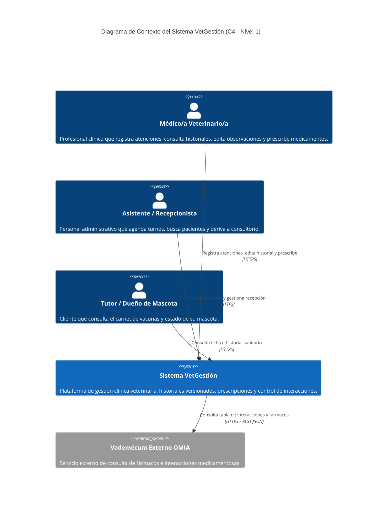
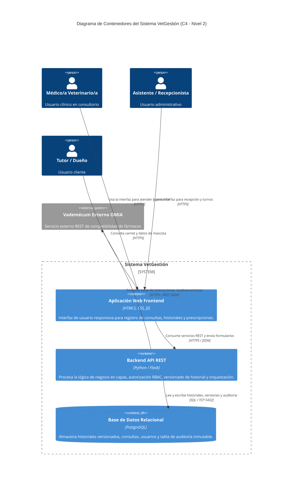
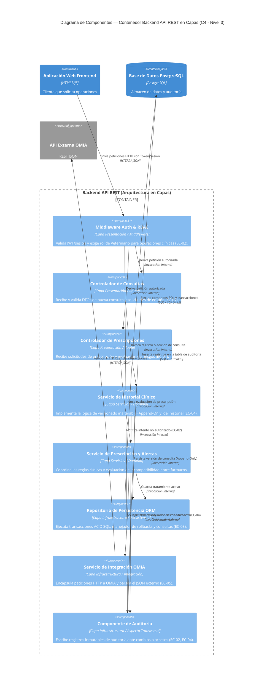

# Especificación de Arquitectura — Sistema de Gestión Clínica Veterinaria 

## 1. Introducción

### 1.1 Propósito
El propósito de este documento es especificar la arquitectura de software del **Sistema de Gestión Clínica Veterinaria (VetGestión)**. La arquitectura aquí descripta establece la estructura global del sistema, la división en contenedores y componentes, la selección de estilos y patrones arquitectónicos, las tácticas para satisfacer los requerimientos no funcionales (atributos de calidad) y las decisiones de diseño fundamentales que condicionan el desarrollo.

### 1.2 Alcance
El alcance de esta especificación se centra en los procesos transaccionales centrales seleccionados en el TP1 y refinados en el TP2:
- **CU-01:** Registrar atención y evolución clínica.
- **CU-02:** Consultar e interrogar el historial clínico de un paciente.
- **CU-03:** Gestionar tratamientos, prescribir medicamentos y validar alertas por interacciones medicamentosas.

El resto de los módulos del sistema (como la agenda de turnos o el registro administrativo de pacientes) se representan como cajas negras o subsistemas externos que interactúan con el núcleo clínico.

### 1.3 Audiencia
Este documento está diseñado para los siguientes roles organizacionales y técnicos:
- **Arquitectos de Software y Líderes Técnicos:** Para evaluar la coherencia de las decisiones de diseño estructural, el equilibrio entre atributos de calidad y la evolución futura del sistema.
- **Desarrolladores (Frontend y Backend):** Como especificación normativa de la división en capas, responsabilidades de componentes, contratos de API y reglas de dependencia.
- **Equipo de Operaciones / DevOps:** Para comprender la topología de contenedores, la estrategia de persistencia, réplicas WAL y procedimientos de restauración.
- **Equipo de Calidad (QA / Testing):** Para diseñar casos de prueba de integración y verificar la cobertura de los escenarios de atributo de calidad (EC-01 a EC-05).
- **Evaluadores y Docentes:** Para auditar el proceso de derivación desde los atributos de calidad hasta los diagramas C4 y decisiones de arquitectura.

### 1.4 Siglas y Acrónimos
- **ACID:** Atomicidad, Consistencia, Aislamiento y Durabilidad (Atomicity, Consistency, Isolation, Durability).
- **ADR / DA:** Record de Decisión de Arquitectura / Decisión de Arquitectura (Architecture Decision Record).
- **API:** Interfaz de Programación de Aplicaciones (Application Programming Interface).
- **C4:** Modelo de arquitectura *Context, Containers, Components, Code*.
- **DTO:** Objeto de Transferencia de Datos (Data Transfer Object).
- **EC:** Escenario de Calidad.
- **HU:** Historia de Usuario.
- **JSON:** Notación de Objetos de JavaScript (JavaScript Object Notation).
- **JWT:** JSON Web Token.
- **OMIA:** Catálogo de enfermedades hereditarias, solo consulta opcional.
- **ORM:** Mapeo Objeto-Relacional (Object-Relational Mapping).
- **PITR:** Recuperación a un Punto en el Tiempo (Point-In-Time Recovery).
- **RBAC:** Control de Acceso Basado en Roles (Role-Based Access Control).
- **REST:** Transferencia de Estado Representacional (Representational State Transfer).
- **RPO:** Objetivo de Punto de Recuperación (Recovery Point Objective).
- **RTO:** Objetivo de Tiempo de Recuperación (Recovery Time Objective).
- **SPA:** Aplicación de Página Única (Single Page Application).
- **WAL:** Registro de Escritura Adelantada (Write-Ahead Logging).

---

## 2. Restricciones

Las siguientes restricciones limitan y condicionan las decisiones arquitectónicas del proyecto:

### 2.1 Restricciones Técnicas
- **R1 (Navegador y Dispositivos):** El cliente web debe funcionar en navegadores modernos (Chrome, Firefox, Edge, Safari) sin requerir plug-ins adicionales y ser operable desde tablets de consultorio.
- **R2 (Tecnología Backend y Persistencia):** El servidor debe implementarse en Python 3.12 utilizando el framework Flask para la API REST, y PostgreSQL 16 como motor de base de datos relacional.
- **R3 (Sistemas Externos):** La consulta de interacciones medicamentosas debe integrarse obligatoriamente con la API REST externa de OMIA vía HTTPS/JSON.

### 2.2 Restricciones del Equipo y Tecnología
- **R4 (Tamaño y Experiencia del Equipo):** Proyecto desarrollado por un equipo reducido (3 integrantes) con alta familiaridad en arquitecturas web tradicionales (Cliente-Servidor / Capas) y tiempo acotado.
- **R5 (Simplicidad Operativa):** Se descartan soluciones con alta sobrecarga de configuración o indirección excessive (como microservicios o patrones de indirección compleja) para evitar sobreingeniería y garantizar la mantenibilidad del código.

### 2.3 Restricciones de Tiempo y Entorno
- **R6 (Ciclo de Entrega):** La arquitectura debe completarse y ser demostrable dentro del plazo del cuatrimestre.
- **R7 (Entorno de Despliegue):** El despliegue inicial se realiza en un servidor único o contenedorizado con Docker, sin infraestructura distribuida multi-región.

---

## 3. Contexto

El sistema interactúa con tres actores humanos principales y un sistema externo de referencia médica.

### 3.1 Diagrama de Contexto (C4 - Nivel 1)

### 3.2 Catálogo del Contexto

#### Elementos
| Nombre | Tipo | Responsabilidad |
| :--- | :--- | :--- |
| **Médico/a Veterinario/a** | Persona | Registrar atenciones clínicas, consultar y rectificar historiales, prescribir tratamientos. |
| **Asistente / Recepcionista** | Persona | Recepción de pacientes, gestión administrativa y búsqueda en el sistema. |
| **Tutor / Dueño de Mascota** | Persona | Consulta pasiva de información sanitaria de su mascota. |
| **Sistema VetGestión** | Sistema | Software de gestión clínica, registro de consultas, historiales inalterables y validaciones. |
| **Vademécum Externo OMIA** | Sistema Externo | Provee datos estandarizados de fármacos e incompatibilidades medicamentosas. |

#### Relaciones
| Origen | Destino | Qué se comunica | Protocolo |
| :--- | :--- | :--- | :--- |
| Médico/a Veterinario/a | Sistema VetGestión | Registro de consultas, edita entradas, prescribe fármacos | HTTPS |
| Asistente / Recepcionista | Sistema VetGestión | Búsqueda de pacientes y turnos | HTTPS |
| Tutor / Dueño de Mascota | Sistema VetGestión | Consulta de ficha de mascota | HTTPS |
| Sistema VetGestión | Vademécum OMIA | Consulta de compatibilidad de fármacos | HTTPS / REST JSON |

---

## 4. Drivers Arquitectónicos

Los siguientes cinco escenarios seleccionados en el TP2 condicionan estructuralmente la arquitectura del sistema:

### EC-01: Operabilidad en Urgencia Clínica (Usabilidad - Operabilidad)
- **Atributo ISO/IEC 25010:** Capacidad de Interacción / Operabilidad.
- **Escenario:** El/la veterinario/a registra peso, síntomas y prescripción durante una urgencia con una sola mano libre, presión de tiempo y en una tablet.
- **Medida de respuesta:** Registro de datos críticos en ≤ 45 s y ≤ 8 interacciones; 0% de pérdida de datos ante un error de validación.
- **Por qué es Driver:** Exige una arquitectura con separación clara entre campos obligatorios y opcionales, diseño de DTOs atómicos en el Backend y conservación de estado en la UI sin bloquear la atención.

### EC-02: Petición de Modificación que Saltea la Interfaz (Seguridad - Integridad)
- **Atributo ISO/IEC 25010:** Seguridad de la Información / Integridad.
- **Escenario:** Un usuario autenticado con rol no clínico (Secretario/Tutor) envía una petición HTTP directa al servidor intentando alterar un diagnóstico clínico.
- **Medida de respuesta:** 100% de las peticiones no autorizadas rechazadas; 0 registros modificados; evento registrado en ≤ 1 s con usuario, acción y recurso.
- **Por qué es Driver:** Exige que la lógica de autorización (RBAC) esté strictly centralizada en el Backend (Capa de Servicios/Middleware) y no delegada a la interfaz cliente.

### EC-03: Caída de la Base de Datos en Plena Jornada (Fiabilidad - Capacidad de Recuperación)
- **Atributo ISO/IEC 25010:** Fiabilidad / Capacidad de Recuperación.
- **Escenario:** Falla de hardware o corrupción del motor de base de datos relacional durante el horario de atención clínica.
- **Medida de respuesta:** RTO ≤ 4 h; RPO ≤ 15 min; 0 registros huérfanos tras la restauración.
- **Por qué es Driver:** Exige organizar la persistencia con transacciones ACID, respaldos continuos (WAL / PITR) y un componente de manejo global de excepciones que ponga el sistema en modo degradado controlado (aviso de mantenimiento) sin corromper datos.

### EC-04: Corrección de una Entrada Histórica (Seguridad - Responsabilidad / Accountability)
- **Atributo ISO/IEC 25010:** Seguridad de la Información / Responsabilidad.
- **Escenario:** Un/a veterinario/a corrige el diagnóstico de una consulta registrada semanas atrás.
- **Medida de respuesta:** 100% de las ediciones reconstruibles (autor, fecha/hora, versión previa, versión nueva, motivo); 0 ediciones sin motivo obligatorio.
- **Por qué es Driver:** Modela la base de datos como un almacén inmutable (Append-Only / Versionado), donde las consultas no se sobrescriben, y requiere un componente dedicado a la Bitácora de Auditoría en la capa de persistencia.

### EC-05: Cambio de Formato o Reemplazo de OMIA (Mantenibilidad - Modificabilidad)
- **Atributo ISO/IEC 25010:** Mantenibilidad / Modificabilidad.
- **Escenario:** El proveedor externo OMIA modifica el formato JSON de sus respuestas o debe ser reemplazado por otro vademécum.
- **Medida de respuesta:** Cambio implementado y desplegado por 1 persona en ≤ 2 días; 0 módulos modificados fuera del componente de integración.
- **Por qué es Driver:** Exige aislar la dependencia externa dentro de un componente exclusivo de Integración/Infraestructura en la capa correspondiente, evitando que los detalles de la API de OMIA se propaguen al dominio o a la interfaz.

---

## 5. Estrategia de Solución

### 5.1 Tácticas Seleccionadas y Descartadas por Driver

#### EC-01 (Operabilidad)
- **Tácticas Seleccionadas:**
  1. *Iniciativa del usuario / Cancelar:* Opción explícita para abortar operaciones en curso.
  2. *Iniciativa del sistema / Mantener modelo de tarea y estado:* Conservar los datos tipeados en el cliente cuando ocurre un error de validación.
  3. *Acotar tiempos de ejecución:* Agrupar la validación en una sola pasada de DTO atómico.
- **Tácticas Descartadas:**
  - *Pausar y reanudar sesiones complejas en background multi-dispositivo:* Aporta complejidad innecesaria para el flujo de consultorio local.

#### EC-02 (Integridad)
- **Tácticas Seleccionadas:**
  1. *Identificar, autenticar y autorizar actores:* Verificación de sesión/token JWT y rol (RBAC) en la capa de presentación/middleware del Backend antes de ejecutar cualquier comando de escritura.
  2. *Limitar acceso:* La base de datos es únicamente accesible por el contenedor Backend API, no desde la red externa ni desde el cliente.
  3. *Registro de auditoría:* Guardar log inmutable de intentos de acceso indebidos.
- **Tácticas Descartadas:**
  - *Cifrado asimétrico de payload en el cliente:* Sobrecosto computacional sin beneficio directo en una red privada protegida por HTTPS.

#### EC-03 (Capacidad de Recuperación)
- **Tácticas Seleccionadas:**
  1. *Transacciones:* Agrupar operaciones de escritura en bloques ACID atómicos.
  2. *Rollback:* Deshacer cambios parciales si falla un paso de la transacción.
  3. *Manejo de excepciones y Degradación controlada:* Interceptores de error que muestran pantallas amigables de mantenimiento si cae la BD.
  4. *Redundancia pasiva (WAL / Backups):* Respaldo continuo de logs de transacciones para garantizar RPO ≤ 15 min.
- **Tácticas Descartadas:**
  - *Redundancia activa multi-región con clustering síncrono:* Inviable por costos y complejidad de infraestructura para la escala del proyecto.

#### EC-04 (Responsabilidad / Accountability)
- **Tácticas Seleccionadas:**
  1. *Registro de auditoría (Audit Logging):* Componente que escribe en un almacén de auditoría inmodificable los cambios de versión.
  2. *Separar entidades / Versionado Inalterable:* Diseñar la entidad `Consulta` como un historial append-only mediante referencias a versiones anteriores (`parent_version_id`).
- **Tácticas Descartadas:**
  - *Firma digital con certificado criptográfico PKI individual por cada consulta:* Innecesario y complejo según el marco normativo actual.

#### EC-05 (Modificabilidad)
- **Tácticas Seleccionadas:**
  1. *Encapsular / Dividir módulos:* Aislar la comunicación HTTP y el parseo del JSON de OMIA en un componente exclusivo de integración (`ServicioIntegracionOMIA`).
  2. *Restringir dependencias:* La capa de servicios/dominio invoca el servicio de integración a través de contratos simples, sin conocer los detalles de red ni la estructura externa de OMIA.
- **Tácticas Descartadas:**
  - *Descomponer en microservicios la llamada a OMIA:* Introduce latencia de red y complejidad operativa innecesaria para un equipo reducido.

---

### 5.2 Estilos Arquitectónicos

#### Estilo Base: Cliente-Servidor (Web Application / REST API)
- **Principio:** El cliente (Navegador Web / SPA / Templates) inicia las peticiones HTTP/HTTPS hacia un Servidor Backend (API REST) que procesa la lógica y accede al Repositorio de Datos.
- **Justificación:** Otorga un punto centralizado para aplicar seguridad y reglas de negocio (EC-02), simplifica el despliegue y minimiza la complejidad operativa para el equipo (Restricción R4).
- **Qué mejora:** Control centralizado de seguridad, bajo acoplamiento cliente-servidor.
- **Qué sacrifica:** El servidor Backend es un punto único de falla (single point of failure) si no se replica, y depende de la red.

#### Estilos Adicionales Integrados:
1. **Repositorio (Repository Pattern):** La Base de Datos Relacional actúa como almacén central inmutable para historias clínicas, consultas y logs de auditoría (EC-03, EC-04).
2. **Tuberías y Filtros (Pipe and Filter / Middleware):** El procesamiento de peticiones en el Backend sigue una cadena secuencial de filtros (autenticación -> autorización RBAC -> validación DTO -> controlador de servicio) para cortar tempranamente solicitudes inválidas (EC-02).

---

### 5.3 Patrones Arquitectónicos y Aspectos Transversales

#### Patrón por Contenedor (Backend API REST): Arquitectura en Capas (Layered Architecture)
El contenedor Backend API se organiza internamente con una **Arquitectura en Capas tradicional**, limpia y sin sobreingeniería:

1. **Capa de Presentación / Controladores (Controllers & Middleware):** Recibe solicitudes HTTP/REST, autentica el token, verifica permisos por rol (RBAC) y valida el formato del DTO enviado desde el cliente.
2. **Capa de Servicios / Dominio (Application Services):** Modela la lógica clínica de negocio (orquestación de consultas, reglas de versionado inalterable y validación de prescripciones).
3. **Capa de Infraestructura / Persistencia e Integración (Data Access & Integration):** Maneja las consultas SQL transaccionales hacia PostgreSQL y encapsula las peticiones HTTP externas hacia la API de OMIA.

- **Por qué se eligió Capas:** Encaja perfectamente con la experiencia del equipo (Restricción R4), simplifica la implementación y el mantenimiento, y cumple estrictamente todos los drivers del proyecto (`EC-01` a `EC-05`) sin introducir interfaces ni indirecciones innecesarias.
- **Regla estricta de Capas:** Las dependencias van en un solo sentido, de arriba hacia abajo (Presentación -> Servicios -> Infraestructura/Persistencia). Ninguna capa inferior depende de una superior.

#### Aspectos Transversales (Cross-Cutting Concerns):
1. **Autenticación y Autorización (RBAC):** Middleware que intercepta todas las peticiones para validar credenciales y restringir acciones clínicas solo al rol de Veterinario (EC-02).
2. **Auditoría Inmutable (Audit Logging):** Módulo transversal que registra automáticamente autor, fecha/hora, recurso y motivo ante cada creación o modificación (EC-02, EC-04).
3. **Manejo Global de Excepciones y Transacciones:** Interceptor que captura fallos no controlados, ejecuta rollback de transacciones SQL y retorna respuestas estandarizadas con pantallas de mantenimiento degradado (EC-03).

---

### 5.4 Tabla de Cobertura de Drivers y Sacrificios

| Driver (TP2) | Atributo | Cómo lo cubre la arquitectura | Qué sacrifica |
| :--- | :--- | :--- | :--- |
| **EC-01** (Operabilidad) | Usabilidad | DTOs de consulta atómicos, conservación de estado de formulario en el cliente y respuestas de error con enlaces directos (`#id`). | Ligero incremento de código de validación duplicado entre cliente y servidor. |
| **EC-02** (Integridad) | Seguridad | Middleware de autorización RBAC en la Capa de Presentación del Backend que valida rol y recurso en cada solicitud. | Latencia adicional en cada petición HTTP por la comprobación de permisos. |
| **EC-03** (Recuperación) | Fiabilidad | Transacciones SQL ACID en la Capa de Persistencia, manejador global de excepciones con rollback y esquema WAL/PITR. | Sobrecosto de almacenamiento en disco por conservación de logs de transacciones. |
| **EC-04** (Responsabilidad) | Seguridad | Modelo de datos de consulta inalterable (versionado append-only) y módulo de auditoría en la Capa de Persistencia. | Mayor volumen de filas en la base de datos (se conservan todas las versiones). |
| **EC-05** (Modificabilidad) | Mantenibilidad | Componente de integración aislado (`ServicioIntegracionOMIA`) en la Capa de Infraestructura. | Ligera duplicación de DTOs para adaptar las respuestas JSON externas al modelo interno. |

---

## 6. Vista de Contenedores (C4 - Nivel 2)

### 6.1 Diagrama de Contenedores

### 6.2 Catálogo de Contenedores

| Contenedor | Tecnología | Responsabilidad |
| :--- | :--- | :--- |
| **Aplicación Web Frontend** | HTML5, CSS3, JavaScript | Renderizar la interfaz de usuario, validar campos locales, conservar estado de borradores y presentar alertas. |
| **Backend API REST** | Python / Flask | Centralizar la seguridad (RBAC), coordinar la arquitectura en capas, orquestar el versionado de atenciones y consultar OMIA. |
| **Base de Datos Relacional** | PostgreSQL | Garantizar la persistencia inalterable (append-only) de consultas, aplicar transacciones ACID y resguardar la auditoría. |

### 6.3 Catálogo de Relaciones entre Contenedores

| Origen | Destino | Qué se comunica | Protocolo |
| :--- | :--- | :--- | :--- |
| Usuarios (Vet/Sec/Tutor) | Aplicación Web Frontend | Clics, carga de formularios y visualización de pantallas | HTTPS |
| Aplicación Web Frontend | Backend API REST | Solicitudes de consulta, edición e historial | HTTPS / REST JSON |
| Backend API REST | Base de Datos Relacional | Consultas SQL, inserción de versiones e inserción en auditoría | SQL / TCP Port 5432 |
| Backend API REST | Vademécum OMIA | Consulta de compatibilidad de fármacos | HTTPS / REST JSON |

---

## 7. Vista de Componentes (C4 - Nivel 3)

Hacemos zoom sobre el contenedor principal que implementa los procesos elegidos: **Backend API REST**, organizado bajo una **Arquitectura en Capas**.

### 7.1 Diagrama de Componentes del Backend API REST

### 7.2 Catálogo de Componentes del Backend API REST

| Componente | Capa | Responsabilidad |
| :--- | :--- | :--- |
| **Middleware Auth & RBAC** | Presentación | Intercepta todas las peticiones, valida JWT y verifica si el rol es `Veterinario` antes de permitir operaciones de modificación (EC-02). |
| **Controlador de Consultas** | Presentación | Recibe las peticiones HTTP de la UI, valida DTOs de entrada y retorna respuestas con referencias de error (`#id`) (EC-01). |
| **Controlador de Prescripciones** | Presentación | Recibe datos de fármacos a prescribir y reenvía las solicitudes de alerta a la capa de servicios. |
| **Servicio de Historial Clínico** | Servicios / Dominio | Ejecuta la regla del historial inalterable: no sobrescribe, sino que asigna un nuevo ID y enlaza la versión previa con motivo obligatorio (EC-04). |
| **Servicio de Prescripción y Alertas** | Servicios / Dominio | Evalúa las incompatibilidades médicas combinando datos locales con las respuestas de OMIA. |
| **Repositorio de Persistencia ORM** | Infraestructura | Abstrae la base de datos PostgreSQL, ejecuta bloques transaccionales ACID y gestiona el versionado (EC-03). |
| **Servicio de Integración OMIA** | Infraestructura | Encapsula las llamadas HTTP externas a la API de OMIA y traduce los formatos JSON para proteger al dominio de cambios en el proveedor (EC-05). |
| **Componente de Auditoría** | Aspecto Transversal | Registra automáticamente en la tabla de auditoría inmutable todo evento de edición, intento de acceso no autorizado o acción crítica (EC-02, EC-04). |

### 7.3 Catálogo de Relaciones entre Componentes

| Origen | Destino | Qué se comunica | Tipo / Protocolo |
| :--- | :--- | :--- | :--- |
| Aplicación Web Frontend | Middleware Auth & RBAC | Solicitud HTTP con token de sesión | HTTPS / JSON |
| Middleware Auth & RBAC | Controladores | Redirección de petición una vez autorizada | Invocación Interna |
| Controladores | Servicios de Dominio | Invocación de operaciones de negocio con DTOs validados | Invocación Interna |
| Servicio Prescripción | Servicio Integración OMIA | Consulta de compatibilidad enviando códigos de fármacos | Invocación Interna |
| Servicio Integración OMIA | API Externa OMIA | Petición REST de tabla de interacciones | HTTPS / REST JSON |
| Servicios de Dominio | Repositorio Persistencia | Guardado de versiones y consultas SQL | Invocación Interna |
| Repositorio Persistencia | Base de Datos PostgreSQL | Sentencias SQL transaccionales | SQL / TCP 5432 |
| Componente Auditoría | Base de Datos PostgreSQL | Inserción de logs en tabla de auditoría | SQL / TCP 5432 |

---

## 8. Historias de Usuario sobre las Vistas

A continuación se demuestra la ejecución de las Historias de Usuario principales del TP1 a través de los contenedores y componentes de la arquitectura:

### 8.1 HU-01: Manejo de Datos Obligatorios Incompletos o Inválidos
- **Given (Dado que):** El/la veterinario/a está en la `Aplicación Web Frontend` registrando una nueva consulta y deja el peso en blanco o con formato texto.
- **When (Cuando):** Selecciona la opción "Guardar Consulta".
- **Then (Entonces):**
  1. El cliente valida localmente los tipos de datos básicos.
  2. Si pasa la UI, se envía el DTO al `Controlador de Consultas` vía HTTPS.
  3. El controlador detecta el campo faltante, interrumpe el procesamiento antes de invocar a la capa de servicios y responde HTTP 400 Bad Request con la lista de errores.
  4. La `Aplicación Web Frontend` captura la respuesta y muestra el banner con enlaces `#id` al campo inválido, **conservando intactos todos los datos tipeados** por el usuario.

### 8.2 HU-02: Edición de Entradas Previas en el Historial Clínico
- **Given (Dado que):** Un/a veterinario/a requiere corregir el diagnóstico de una atención previa y el usuario logueado es el autor original (RF-08).
- **When (Cuando):** Ingresa la modificación, escribe el motivo obligatorio y presiona "Confirmar Edición".
- **Then (Entonces):**
  1. La petición llega al `Middleware Auth & RBAC`, que verifica que el token corresponda al rol de `Veterinario`.
  2. Pasa al `Controlador de Consultas` y de allí al `Servicio de Historial Clínico`.
  3. El servicio verifica la regla de negocio: no ejecuta un `UPDATE`, sino que crea un nuevo registro con el diagnóstico actualizado, asigna un nuevo ID y referencia la versión previa.
  4. Invoca al `Componente de Auditoría` para registrar el autor, timestamp, motivo e IDs en la tabla inmutable.
  5. El `Repositorio de Persistencia ORM` ejecuta todo dentro de una transacción SQL ACID en `PostgreSQL`.

### 8.3 HU-03: Notificación de Alerta por Interacción Medicamentosa
- **Given (Dado que):** El/la veterinario/a selecciona un fármaco (ej. *Meloxicam*) para un paciente que ya tiene un tratamiento activo registrado (*Prednisolona*).
- **When (Cuando):** Solicita prescribir el medicamento.
- **Then (Entonces):**
  1. La solicitud llega al `Controlador de Prescripciones` e invoca al `Servicio de Prescripción y Alertas`.
  2. El servicio llama al `Servicio de Integración OMIA` en la capa de infraestructura.
  3. `ServicioIntegracionOMIA` realiza la consulta HTTPS REST a la API de `OMIA`.
  4. `OMIA` retorna el JSON con la incompatibilidad de Nivel Crítico.
  5. El servicio detecta la alerta y retorna una respuesta de advertencia hacia la `Aplicación Web Frontend`, desplegando el modal de color coral que exige ingresar una justificación profesional antes de autorizar el guardado.

---

## 9. Decisiones de Arquitectura (ADRs / DAs)

### DA-01 — Guardado por Etapas y Preservación de Estado de Formulario en Cliente
- **Escenario que la motiva:** `EC-01` (Operabilidad en Urgencia Clínica).
- **Contexto:** En urgencias con tablets, un error de validación que borre el formulario obliga a cargar todo de nuevo, perdiendo tiempo crítico.
- **Decisión:**
  - *Tácticas:* Iniciativa del sistema / Mantener modelo de tarea; Acotar tiempos de ejecución.
  - *Estilo/Patrón:* Arquitectura en Capas / Manejo de DTOs en Cliente y Controlador.
  - *Dónde aplica:* `Aplicación Web Frontend` y `Controlador de Consultas`.
- **Alternativas Descartadas:** Guardado automático continuo en servidor vía WebSockets (descartado por sobrecargas de red y complejidad innecesaria).
- **Consecuencias:**
  - *Positivas:* 0% de pérdida de datos ante error de validación, carga rápida en ≤ 45 s.
  - *Negativas / Sacrificios:* Duplicación ligera de validaciones en cliente y servidor.

### DA-02 — Autorización Centralizada en Servidor mediante RBAC
- **Escenario que la motiva:** `EC-02` (Petición de Modificación que Saltea la Interfaz).
- **Contexto:** Ocultar botones en la interfaz no impide que usuarios no clínicos envíen peticiones HTTP directas con herramientas como Postman.
- **Decisión:**
  - *Tácticas:* Identificar, autenticar y autorizar actores; Limitar acceso; Registro de auditoría.
  - *Estilo/Patrón:* Tuberías y Filtros (Middleware RBAC en Capa de Presentación).
  - *Dónde aplica:* `Middleware Auth & RBAC` en `Backend API REST`.
- **Alternativas Descartadas:** Validar permisos dentro de procedimientos almacenados de base de datos (descartado por acoplar la seguridad al motor de persistencia).
- **Consecuencias:**
  - *Positivas:* 100% de peticiones no autorizadas rechazadas en el punto de entrada del Backend.
  - *Negativas / Sacrificios:* Pequeña latencia adicional en cada petición HTTP.

### DA-03 — Persistencia Transaccional con Estrategia de Respaldos WAL y PITR
- **Escenario que la motiva:** `EC-03` (Caída de la Base de Datos en Plena Jornada).
- **Contexto:** La pérdida de datos por corrupción o falla de hardware paraliza la clínica y destruye historiales legales.
- **Decisión:**
  - *Tácticas:* Transacciones ACID; Rollback; Manejo de excepciones; Redundancia pasiva.
  - *Estilo/Patrón:* Repositorio Relacional (PostgreSQL ORM).
  - *Dónde aplica:* `Repositorio de Persistencia ORM` y `Base de Datos PostgreSQL`.
- **Alternativas Descartadas:** Base de datos NoSQL sin soporte de transacciones complejas ACID.
- **Consecuencias:**
  - *Positivas:* Garantiza RPO ≤ 15 min y 0 registros huérfanos tras la restauración.
  - *Negativas / Sacrificios:* Sobrecosto de espacio en disco para almacenar logs de transacciones WAL.

### DA-04 — Modelo de Historial Clínico Inalterable (Append-Only) y Log de Auditoría Separado
- **Escenario que la motiva:** `EC-04` (Corrección de una Entrada Histórica).
- **Contexto:** Las historias clínicas son documentos médico-legales. Sobrescribir registros invalida la responsabilidad profesional.
- **Decisión:**
  - *Tácticas:* Registro de auditoría; Separar entidades / Versionado Inalterable.
  - *Estilo/Patrón:* Modelo de Persistencia Versionada + Componente Transversal de Auditoría.
  - *Dónde aplica:* `Servicio de Historial Clínico`, `Componente de Auditoría` y `PostgreSQL`.
- **Alternativas Descartadas:** Sobrescribir el registro con `UPDATE` y guardar una copia plana en texto.
- **Consecuencias:**
  - *Positivas:* 100% de las ediciones son auditables y reconstruibles cronológicamente.
  - *Negativas / Sacrificios:* Incremento constante en el volumen de filas guardadas en la base de datos.

### DA-05 — Encapsulamiento de Servicios Externos en la Capa de Infraestructura
- **Escenario que la motiva:** `EC-05` (Cambio de Formato o Reemplazo de OMIA).
- **Contexto:** OMIA es un servicio de terceros cuyo formato JSON o disponibilidad puede cambiar sin control del equipo.
- **Decisión:**
  - *Tácticas:* Encapsular; Restringir dependencias.
  - *Estilo/Patrón:* Arquitectura en Capas (Componente dedicado en Capa de Infraestructura).
  - *Dónde aplica:* `ServicioIntegracionOMIA` en la Capa de Infraestructura/Integración.
- **Alternativas Descartadas:**
  1. Patrón Hexagonal con abstracción de Puertos/Adaptadores (descartado por recomendación del equipo/docentes para evitar abstracciones complejas innecesarias para un solo vademécum).
  2. Invocaciones HTTP directas a OMIA desde los servicios de aplicación (descartado por acoplar el dominio al JSON externo).
- **Consecuencias:**
  - *Positivas:* Cambios en la API de OMIA se resuelven en ≤ 2 días modificando un único módulo de integración, manteniendo la lógica simple y directa.
  - *Negativas / Sacrificios:* Requiere mapear la respuesta externa al objeto de datos interno.

---

## 10. Trazabilidad

### 10.1 Matriz de Trazabilidad Arquitectónica

| Escenario (TP2) | Atributo | Tácticas | Estilo / Patrón | Decisión | Elementos C4 Afectados |
| :--- | :--- | :--- | :--- | :--- | :--- |
| **EC-01** (Urgencia clínica) | Usabilidad / Operabilidad | Mantener estado; Acotar tiempos | Capas / Validaciones DTO | **DA-01** | `Aplicación Web Frontend`, `Controlador de Consultas` |
| **EC-02** (Petición manipulada) | Seguridad / Integridad | Autenticar y autorizar (RBAC); Limitar acceso | Capas / Pipe & Filter Middleware | **DA-02** | `Middleware Auth & RBAC`, `Componente de Auditoría` |
| **EC-03** (Caída de BD) | Fiabilidad / Recuperación | Transacciones; Rollback; WAL Backups | Repositorio / Persistencia ORM | **DA-03** | `Repositorio de Persistencia`, `Base de Datos PostgreSQL` |
| **EC-04** (Edición histórica) | Seguridad / Responsabilidad | Auditoría; Versionado Append-Only | Capas / Componente Transversal | **DA-04** | `Servicio Historial`, `Componente Auditoría`, `Base de Datos PostgreSQL` |
| **EC-05** (Cambio en OMIA) | Mantenibilidad / Modificabilidad | Encapsular; Restringir dependencias | Capas / Módulo de Integración Aislado | **DA-05** | `ServicioIntegracionOMIA`, `Servicio Prescripción` |

### 10.2 Trazabilidad de Historias de Usuario a Elementos C4

| Historia de Usuario (TP1) | Contenedores Involucrados | Componentes Clave del Backend |
| :--- | :--- | :--- |
| **HU-01** (Validación de Consulta) | `Aplicación Web Frontend`, `Backend API REST` | `Controlador de Consultas`, `Servicio Historial`, `PersistenciaRepo` |
| **HU-02** (Edición de Historial) | `Aplicación Web Frontend`, `Backend API REST`, `PostgreSQL` | `Middleware Auth & RBAC`, `Servicio Historial`, `AuditLogger`, `PersistenciaRepo` |
| **HU-03** (Alerta de Interacción) | `Aplicación Web Frontend`, `Backend API REST`, `OMIA` | `Controlador Prescripción`, `Servicio Prescripcion`, `ServicioIntegracionOMIA` |

---

## 11. Glosario y Bibliografía

### 11.1 Glosario
- **Append-Only:** Modelo de datos en el que las operaciones de modificación no sobrescriben registros existentes, sino que insertan un nuevo registro con el estado actualizado.
- **Arquitectura en Capas:** Patrón de arquitectura que organiza los componentes de software en niveles jerárquicos de responsabilidad (Presentación, Servicios/Dominio, Infraestructura/Persistencia), donde cada capa solo depende de las capas inferiores.
- **Driver Arquitectónico:** Requerimiento funcional, restricción o escenario de calidad que condiciona de manera determinante la estructura y diseño del sistema.
- **Táctica Arquitectónica:** Decisión de diseño focalizada que afecta la respuesta ante un escenario de atributo de calidad determinado.

### 11.2 Bibliografía
1. **Bass, L., Clements, P., & Kazman, R. (2021).** *Software Architecture in Practice* (4th ed.). Addison-Wesley Professional.
2. **Brown, S. (2020).** *The C4 Model for Visualising Software Architecture*. Structurizr.
3. **ISO/IEC/IEEE 25010:2023.** *Systems and software engineering — Systems and software Quality Requirements and Evaluation (SQuaRE) — Product quality model*.
4. **Fowler, M. (2002).** *Patterns of Enterprise Application Architecture*. Addison-Wesley.
