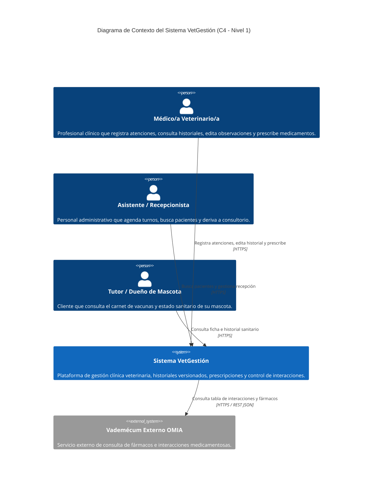
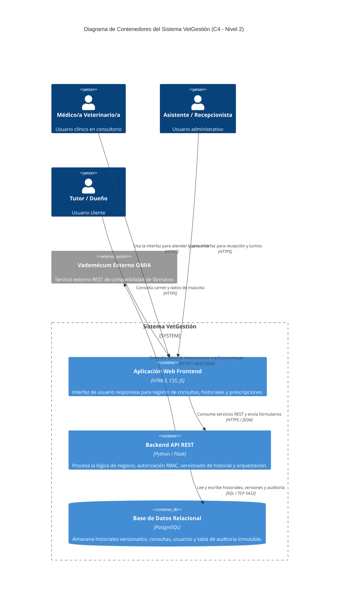
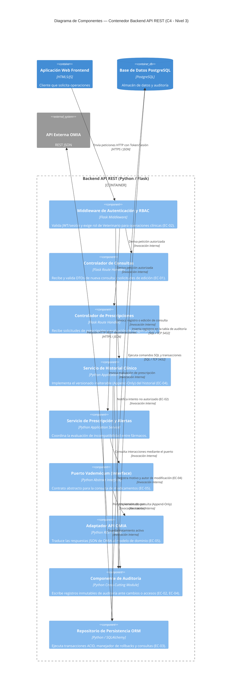

# Especificación de Arquitectura — Sistema de Gestión Clínica Veterinaria 

## 1. Introducción

### 1.1 Propósito
El propósito de este documento es especificar formalmente la arquitectura de software del **Sistema de Gestión Clínica Veterinaria**. La arquitectura aquí definida establece la estructura global del sistema, la división en contenedores y componentes, la selección y justificación de estilos y patrones arquitectónicos, las tácticas seleccionadas para satisfacer los requerimientos no funcionales (atributos de calidad) y el registro trazable de las decisiones de diseño (ADRs / DAs).

### 1.2 Alcance
El alcance de esta especificación se centra en los procesos transaccionales centrales seleccionados en el TP1 y refinados en el TP2:
- **CU-01:** Registrar atención y evolución clínica.
- **CU-02:** Consultar e interrogar el historial clínico de un paciente.
- **CU-03:** Gestionar tratamientos, prescribir medicamentos y validar alertas por interacciones medicamentosas.

El resto de los módulos de soporte (agenda de turnos, facturación, registro administrativo) se representan como cajas negras o subsistemas externos que interactúan con el núcleo clínico a través de contratos de interfaz estables.

### 1.3 Audiencia
Este documento está estructurado para servir como guía técnica normativa a los diferentes roles involucrados en el ciclo de vida del software:
- **Arquitectos de Software y Líderes Técnicos:** Para evaluar la consistencia estructural, la gestión de trade-offs y la evolución futura de la plataforma.
- **Desarrolladores (Frontend y Backend):** Para guiar la implementación de los componentes, garantizar el respeto a las restricciones de diseño (capas y patrón hexagonal) y aplicar las decisiones de arquitectura (DA-xx).
- **Equipo de Operaciones y DevOps:** Para planificar el despliegue de contenedores, la topología de la base de datos relacional y las estrategias de respaldo continuo (WAL/PITR).
- **Equipo de Calidad y Testing (QA):** Para diseñar planes de pruebas de integración y carga basados en los escenarios de atributo de calidad (`EC-01` a `EC-05`).
- **Docentes y Cátedra:** Para verificar la trazabilidad y la correcta aplicación de los contenidos teóricos de la asignatura.

### 1.4 Siglas y Acrónimos
- **ACID:** Atomicidad, Consistencia, Aislamiento y Durabilidad (*Atomicity, Consistency, Isolation, Durability*).
- **ADR / DA:** Registro de Decisión de Arquitectura / Decisión de Arquitectura (*Architecture Decision Record*).
- **API:** Interfaz de Programación de Aplicaciones (*Application Programming Interface*).
- **C4:** Modelo de arquitectura *Context, Containers, Components, Code*.
- **DTO:** Objeto de Transferencia de Datos (*Data Transfer Object*).
- **EC:** Escenario de Calidad.
- **HU:** Historia de Usuario.
- **JSON:** Notación de Objetos de JavaScript (*JavaScript Object Notation*).
- **JWT:** Token Web JSON (*JSON Web Token*).
- **OMIA:** Vademécum e Índice de Medicamentos Veterinarios Externo.
- **ORM:** Mapeo Objeto-Relacional (*Object-Relational Mapping*).
- **PITR:** Recuperación a un Punto en el Tiempo (*Point-In-Time Recovery*).
- **RBAC:** Control de Acceso Basado en Roles (*Role-Based Access Control*).
- **REST:** Transferencia de Estado Representacional (*Representational State Transfer*).
- **RPO:** Objetivo de Punto de Recuperación (*Recovery Point Objective*).
- **RTO:** Objetivo de Tiempo de Recuperación (*Recovery Time Objective*).
- **SRS:** Especificación de Requerimientos de Software (*Software Requirements Specification*).
- **WAL:** Registro de Escritura Adelantada (*Write-Ahead Logging*).
- **WCAG:** Directrices de Accesibilidad para el Contenido Web (*Web Content Accessibility Guidelines*).

---

## 2. Restricciones

Las decisiones arquitectónicas tomadas en este documento están condicionadas por el siguiente conjunto de restricciones reales del proyecto:

1. **Restricciones Técnicas (R1 - R3):**
   - **R1:** El sistema debe implementarse como una aplicación web responsiva (SaaS) ejecutable en navegadores modernos sin requerir complementos propietarios.
   - **R2:** El almacenamiento persistente de datos clínicos debe utilizar una base de datos relacional con soporte nativo para transacciones ACID (PostgreSQL) para garantizar integridad estricta.
   - **R3:** Las integraciones externas (OMIA) deben realizarse sobre protocolos estándar de la Web (HTTP/HTTPS) con intercambio de payloads en JSON.

2. **Restricciones del Equipo y Tecnología (R4 - R5):**
   - **R4 (Tamaño y experiencia del equipo):** El equipo de desarrollo es acotado (3-4 integrantes) y cuenta con dominio previo en el stack Python/Flask para el Backend y HTML5/CSS3/JavaScript estandarizado para el Frontend.
   - **R5 (Mantenibilidad operativa):** La arquitectura debe evitar el sobrecosto de infraestructura y orquestación de arquitecturas altamente distribuidas (como microservicios o mallas de servicios) que excedan la capacidad operativa del equipo.

3. **Restricciones de Tiempo y Proceso (R6 - R7):**
   - **R6:** El tiempo de desarrollo está acotado al calendario académico del cuatrimestre, exigiendo priorizar componentes modulares y patrones conocidos.
   - **R7:** Todo el modelo arquitectónico debe representarse mediante el estándar C4 en sintaxis Mermaid dentro del repositorio de control de versiones.

---

## 3. Contexto

El sistema interactúa con tres actores humanos principales y un sistema externo de referencia médica. El diagrama de contexto mantiene coherencia total con el DFD de Nivel 0 elaborado en el TP1.

### 3.1 Diagrama de Contexto (C4 - Nivel 1)

### 3.2 Catálogo del Contexto

#### Elementos
| Nombre | Tipo | Responsabilidad |
| :--- | :--- | :--- |
| **Médico/a Veterinario/a** | Persona | Registrar atenciones clínicas, consultar y rectificar historiales, prescribir tratamientos. |
| **Asistente / Recepcionista** | Persona | Recepción de pacientes, gestión administrativa de turnos y búsqueda en el sistema. |
| **Tutor / Dueño de Mascota** | Persona | Consulta pasiva del carnet de vacunación e historial de su mascota. |
| **Sistema VetGestión** | Sistema | Software de gestión clínica, registro de consultas, historiales inalterables y validaciones sanitarias. |
| **Vademécum Externo OMIA** | Sistema Externo | Provee datos estandarizados de fármacos e incompatibilidades medicamentosas. |

#### Relaciones
| Origen | Destino | Qué se comunica | Protocolo |
| :--- | :--- | :--- | :--- |
| Médico/a Veterinario/a | Sistema VetGestión | Registro de consultas, edición de entradas y prescripción de fármacos | HTTPS |
| Asistente / Recepcionista | Sistema VetGestión | Búsqueda de pacientes, citas y recepción | HTTPS |
| Tutor / Dueño de Mascota | Sistema VetGestión | Consulta de ficha e historial de su mascota | HTTPS |
| Sistema VetGestión | Vademécum OMIA | Consulta de compatibilidad de fármacos | HTTPS / REST JSON |

---

## 4. Drivers Arquitectónicos

Los siguientes cinco escenarios seleccionados en el TP2 condicionan estructuralmente la arquitectura del sistema:

### EC-01: Operabilidad en Urgencia Clínica (Usabilidad - Operabilidad)
- **Atributo ISO/IEC 25010:** Capacidad de Interacción / Operabilidad.
- **Escenario:** El/la veterinario/a registra peso, síntomas y prescripción durante una urgencia con una sola mano libre, presión de tiempo y en una tablet.
- **Medida de respuesta:** Registro de datos críticos en $\le 45$ s y $\le 8$ interacciones; $0\%$ de pérdida de datos ante un error de validación.
- **Por qué es Driver:** Exige una arquitectura con separación clara entre campos obligatorios y opcionales, DTOs atómicos en el Backend y conservación de estado en la UI.

### EC-02: Petición de Modificación que Saltea la Interfaz (Seguridad - Integridad)
- **Atributo ISO/IEC 25010:** Seguridad de la Información / Integridad.
- **Escenario:** Un usuario autenticado con rol no clínico (Secretario/Tutor) envía una petición HTTP directa al servidor intentando alterar un diagnóstico clínico.
- **Medida de respuesta:** $100\%$ de las peticiones no autorizadas rechazadas; $0$ registros modificados; evento registrado en $\le 1$ s con usuario, acción y recurso.
- **Por qué es Driver:** Exige que la lógica de autorización (RBAC) esté estrictamente centralizada en el Backend (Middleware/Capa de Servicios) y nunca delegada a la UI.

### EC-03: Caída de la Base de Datos en Plena Jornada (Fiabilidad - Capacidad de Recuperación)
- **Atributo ISO/IEC 25010:** Fiabilidad / Capacidad de Recuperación.
- **Escenario:** Falla de hardware o corrupción del motor de base de datos relacional durante el horario de atención clínica.
- **Medida de respuesta:** $	ext{RTO} \le 4$ h; $	ext{RPO} \le 15$ min; $0$ registros huérfanos tras la restauración.
- **Por qué es Driver:** Exige organizar la persistencia con transacciones ACID, respaldos continuos (WAL / PITR) y un componente de manejo global de excepciones que ponga el sistema en modo degradado controlado.

### EC-04: Corrección de una Entrada Histórica (Seguridad - Responsabilidad / Accountability)
- **Atributo ISO/IEC 25010:** Seguridad de la Información / Responsabilidad.
- **Escenario:** Un/a veterinario/a corrige el diagnóstico de una consulta registrada semanas atrás.
- **Medida de respuesta:** $100\%$ de las ediciones reconstruibles (autor, fecha/hora, versión previa, versión nueva, motivo); $0$ ediciones sin motivo obligatorio.
- **Por qué es Driver:** Modela la base de datos como un almacén inmutable (Append-Only / Versionado), donde las consultas no se sobrescriben, y requiere un componente dedicado a la Bitácora de Auditoría.

### EC-05: Cambio de Formato o Reemplazo de OMIA (Mantenibilidad - Modificabilidad)
- **Atributo ISO/IEC 25010:** Mantenibilidad / Modificabilidad.
- **Escenario:** El proveedor externo OMIA modifica el formato JSON de sus respuestas o debe ser reemplazado por otro vademécum.
- **Medida de respuesta:** Cambio implementado y desplegado por $1$ persona en $\le 2$ días; $0$ módulos modificados fuera del adaptador de integración.
- **Por qué es Driver:** Exige aislar la dependencia externa mediante el Patrón Hexagonal (Puertos y Adaptadores), desacoplando el núcleo de dominio de la infraestructura de red.

---

## 5. Estrategia de Solución

### 5.1 Tácticas Seleccionadas y Descartadas por Driver

#### EC-01 (Operabilidad)
- **Tácticas Seleccionadas:**
  1. *Iniciativa del usuario / Cancelar:* Opción explícita para abortar operaciones en curso.
  2. *Iniciativa del sistema / Mantener modelo de tarea y estado:* Conservar los datos tipeados en el cliente cuando ocurre un error de validación.
  3. *Acotar tiempos de ejecución:* Agrupar la validación en una sola pasada de DTO atómico.
- **Tácticas Descartadas:**
  - *Pausar y reanudar sesiones complejas en background multi-dispositivo:* Aporta complejidad innecesaria para el flujo de consultorio local.

#### EC-02 (Integridad)
- **Tácticas Seleccionadas:**
  1. *Identificar, autenticar y autorizar actores:* Verificación de sesión/token JWT y rol (RBAC) en el Backend antes de ejecutar cualquier comando de escritura.
  2. *Limitar acceso:* La base de datos es únicamente accesible por el contenedor Backend API, no desde la red externa ni desde el cliente.
  3. *Registro de auditoría:* Guardar log inmutable de intentos de acceso indebidos.
- **Tácticas Descartadas:**
  - *Cifrado asimétrico de payload en el cliente:* Sobrecosto computacional sin beneficio directo en una red privada protegida por HTTPS.

#### EC-03 (Capacidad de Recuperación)
- **Tácticas Seleccionadas:**
  1. *Transacciones:* Agrupar operaciones de escritura en bloques ACID atómicos.
  2. *Rollback:* Deshacer cambios parciales si falla un paso de la transacción.
  3. *Manejo de excepciones y Degradación controlada:* Interceptores de error que muestran pantallas amigables de mantenimiento si cae la BD.
  4. *Redundancia pasiva (WAL / Backups):* Respaldo continuo de logs de transacciones para garantizar $	ext{RPO} \le 15$ min.
- **Tácticas Descartadas:**
  - *Redundancia activa multi-región con clustering síncrono:* Inviable por costos y complejidad de infraestructura para la escala del proyecto.

#### EC-04 (Responsabilidad / Accountability)
- **Tácticas Seleccionadas:**
  1. *Registro de auditoría (Audit Logging):* Componente que escribe en un almacén de auditoría inmodificable los cambios de versión.
  2. *Separar entidades / Versionado Inalterable:* Diseñar la entidad `Consulta` como un historial append-only mediante referencias a versiones anteriores (`parent_version_id`).
- **Tácticas Descartadas:**
  - *Firma digital con certificado criptográfico PKI individual por cada consulta:* Innecesario y complejo según el marco normativo actual.

#### EC-05 (Modificabilidad)
- **Tácticas Seleccionadas:**
  1. *Encapsular:* Ocultar los detalles de red y JSON de OMIA detrás de la interfaz `PuertoVademecum`.
  2. *Usar un intermediario / Adaptar la interfaz:* Implementar `AdaptadorOMIA` que traduzca DTOs externos al modelo de dominio.
  3. *Abstraer fuentes de datos:* Posibilidad de inyectar un adaptador simulado (`OMIAMockAdapter`) para pruebas.
- **Tácticas Descartadas:**
  - *Descomponer en microservicios la llamada a OMIA:* Introduce latencia de red y complejidad operativa innecesaria.

---

### 5.2 Estilos Arquitectónicos

#### Estilo Base: Cliente-Servidor (Web Application / REST API)
- **Principio:** El cliente (Navegador Web / SPA / Templates) inicia las peticiones HTTP/HTTPS hacia un Servidor Backend (API REST) que procesa la lógica y accede al Repositorio de Datos.
- **Justificación:** Otorga un punto centralizado para aplicar seguridad y reglas de negocio (EC-02), simplifica el despliegue y minimiza la complejidad operativa para el equipo (Restricción R4).
- **Qué mejora:** Control centralizado de seguridad, bajo acoplamiento cliente-servidor.
- **Qué sacrifica:** El servidor Backend es un punto único de falla (*single point of failure*) si no se replica, y depende de la disponibilidad de red.

#### Estilos Adicionales Integrados:
1. **Repositorio (Repository Pattern):** La Base de Datos Relacional actúa como almacén central inmutable para historias clínicas, consultas y logs de auditoría (EC-03, EC-04).
2. **Tuberías y Filtros (Pipe and Filter / Middleware):** El contenedor Backend organiza la atención de peticiones en una secuencia de filtros ordenados (Autenticación $
ightarrow$ Autorización RBAC $
ightarrow$ Validación DTO $
ightarrow$ Servicio de Dominio).

---

### 5.3 Patrones Arquitectónicos y Aspectos Transversales

#### Patrones por Contenedor (En Backend API):
1. **Patrón de Capas (Layered Architecture):** Organiza el código interno en Capa de Presentación/Controladores, Capa de Servicios de Aplicación, Capa de Dominio y Capa de Persistencia/Infraestructura.
2. **Patrón Hexagonal (Puertos y Adaptadores):** Aisla la lógica de negocio central de las dependencias externas (PostgreSQL y OMIA), permitiendo reemplazar adaptadores de infraestructura sin alterar el dominio.

#### Aspectos Transversales (Cross-Cutting Concerns):
1. **Autenticación y Autorización (RBAC):** Gestionado mediante un Middleware centralizado que intercepta cada solicitud HTTP.
2. **Auditoría Inmutable:** Un componente transversal (`AuditLogger`) invocado automáticamente ante eventos de modificación o acceso a datos clínicos.
3. **Manejo Global de Excepciones:** Interceptor de errores que transforma fallas no controladas en respuestas JSON homogéneas sin exponer volcados de memoria (*stack traces*).

---

### 5.4 Tabla de Cobertura de Drivers y Sacrificios

| Escenario (Driver) | Atributo | Cómo lo cubre la arquitectura | Qué sacrifica |
| :--- | :--- | :--- | :--- |
| **EC-01** (Operabilidad) | Usabilidad | DTOs de consulta atómicos, conservación de estado de formulario en el cliente y respuestas de error con enlaces directos (`#id`). | Ligero incremento de código de validación duplicado entre cliente y servidor. |
| **EC-02** (Integridad) | Seguridad | Middleware de autorización RBAC en el Backend que valida rol y recurso en cada solicitud de escritura. | Latencia adicional en cada petición HTTP por la comprobación de permisos. |
| **EC-03** (Recuperación) | Fiabilidad | Transacciones SQL ACID, manejador global de excepciones con rollback y esquema de respaldos WAL/PITR. | Sobrecosto de almacenamiento en disco por conservación de logs de transacciones. |
| **EC-04** (Responsabilidad) | Seguridad | Modelo de datos de consulta inalterable (versionado append-only) y tabla de auditoría independiente. | Mayor volumen de filas en la base de datos (se conservan todas las versiones). |
| **EC-05** (Modificabilidad) | Mantenibilidad | Patrón Hexagonal con la interfaz `PuertoVademecum` y la clase `AdaptadorOMIA`. | Mayor cantidad de interfaces y clases DTO para desacoplar el dominio. |

---

## 6. Vista de Contenedores (C4 - Nivel 2)

### 6.1 Diagrama de Contenedores

### 6.2 Catálogo de Contenedores

| Contenedor | Tecnología | Responsabilidad |
| :--- | :--- | :--- |
| **Aplicación Web Frontend** | HTML5, CSS3, JavaScript | Renderizar la interfaz de usuario, validar campos locales, conservar estado de borradores y presentar alertas. |
| **Backend API REST** | Python / Flask | Centralizar la seguridad (RBAC), coordinar los servicios clínicos, orquestar el versionado de atenciones y consultar OMIA. |
| **Base de Datos Relacional** | PostgreSQL | Garantizar la persistencia inalterable (append-only) de consultas, aplicar transacciones ACID y resguardar la auditoría. |

### 6.3 Catálogo de Relaciones entre Contenedores

| Origen | Destino | Qué se comunica | Protocolo |
| :--- | :--- | :--- | :--- |
| Usuarios (Vet/Sec/Tutor) | Aplicación Web Frontend | Clics, carga de formularios y visualización de pantallas | HTTPS |
| Aplicación Web Frontend | Backend API REST | Solicitudes de consulta, edición e historial | HTTPS / REST JSON |
| Backend API REST | Base de Datos Relacional | Consultas SQL, inserción de versiones e inserción en auditoría | SQL / TCP Port 5432 |
| Backend API REST | Vademécum OMIA | Consulta de compatibilidad de fármacos | HTTPS / REST JSON |

---

## 7. Vista de Componentes (C4 - Nivel 3)

Hacemos zoom sobre el contenedor principal que implementa los procesos elegidos: **Backend API REST**.

### 7.1 Diagrama de Componentes del Backend API REST

### 7.2 Catálogo de Componentes del Backend API REST

| Componente | Tecnología | Responsabilidad |
| :--- | :--- | :--- |
| **Middleware de Autenticación y RBAC** | Flask Middleware | Intercepta todas las peticiones, valida JWT y verifica si el rol es `Veterinario` antes de permitir operaciones de modificación (EC-02). |
| **Controlador de Consultas** | Flask Route Handler | Recibe las peticiones de registro/edición de atenciones clínicas, valida DTOs de entrada y formatea las respuestas. |
| **Controlador de Prescripciones** | Flask Route Handler | Recibe las solicitudes de prescripción de medicamentos y coordina las respuestas de alerta de interacción. |
| **Servicio de Historial Clínico** | Python Service | Orquesta la lógica del historial, aplicando el algoritmo de versionado inalterable (append-only) y asociando los motivos de edición (EC-04). |
| **Servicio de Prescripción y Alertas** | Python Service | Ejecuta las reglas de negocio para determinar si un nuevo fármaco entra en conflicto con los medicamentos activos del paciente. |
| **Puerto Vademécum (Interface)** | Python Protocol | Interfaz abstracta que define el contrato `obtener_interacciones(fármaco_a, fármaco_b)` para aislar la infraestructura (EC-05). |
| **Adaptador API OMIA** | Python Client | Implementación concreta del puerto que realiza la llamada REST HTTP a OMIA y mapea el JSON externo a entidades internas. |
| **Componente de Auditoría** | Python Module | Registra en una tabla inmutable de auditoría cada intento de acceso no autorizado y cada modificación con su correspondiente motivo. |
| **Repositorio de Persistencia ORM** | SQLAlchemy / Python | Gestiona el mapeo objeto-relacional con PostgreSQL, encapsulando las transacciones ACID y el manejo de excepciones de BD (EC-03). |

### 7.3 Catálogo de Relaciones entre Componentes

| Origen | Destino | Qué se comunica | Tipo de Llamada |
| :--- | :--- | :--- | :--- |
| Middleware Auth & RBAC | Controlador de Consultas | Solicitud validada con contexto del usuario | Llamada interna |
| Middleware Auth & RBAC | Componente de Auditoría | Evento de acceso denegado o violatorio | Llamada interna |
| Controlador de Consultas | Servicio de Historial Clínico | DTO de la consulta a registrar o editar | Llamada interna |
| Servicio de Historial Clínico | Componente de Auditoría | Datos del autor, fecha y motivo de edición | Llamada interna |
| Servicio de Historial Clínico | Repositorio de Persistencia | Objeto entidad versión de consulta | Llamada interna |
| Servicio de Prescripción | Puerto Vademécum | Consulta de incompatibilidad entre fármacos | Llamada interna (Interfaz) |
| Adaptador API OMIA | Vademécum OMIA (Externo) | Payload JSON de consulta de fármacos | HTTPS / REST JSON |
| Repositorio de Persistencia | Base de Datos PostgreSQL | Sentencias SQL de inserción/consulta | SQL / TCP 5432 |

---

## 8. Historias de Usuario sobre las Vistas

Para demostrar la efectividad de la arquitectura, se recorren las tres historias de usuario del TP1 paso a paso sobre las vistas C4.

### 8.1 HU-01: Manejo de Datos Obligatorios Incompletos o Inválidos
- **Escenario:** El/la veterinario/a intenta guardar una nueva consulta omitiendo el peso del paciente o ingresando un valor inválido.
- **Recorrido sobre la Arquitectura:**
  1. *Given:* El usuario completa el formulario en la `Aplicación Web Frontend`.
  2. *When:* Presiona "Guardar Consulta". La `Aplicación Web Frontend` valida los campos mediante JS. Detecta la falla y bloquea el envío de red, destacando los campos erróneos con salto de foco (`#id`).
  3. *And:* Si la petición llega a enviarse, el `Controlador de Consultas` en el `Backend API REST` valida el DTO de entrada. Al detectar el valor inválido, retorna HTTP 400 Bad Request con la lista de campos específicos a corregir.
  4. *Then:* La `Aplicación Web Frontend` preserva todo lo tipeado en memoria y muestra el banner de error superior sin perder datos (EC-01).

### 8.2 HU-02: Edición de Entradas Previas en el Historial Clínico
- **Escenario:** El/la veterinario/a corrige una observación clínica registrada semanas atrás ingresando el motivo de la rectificación.
- **Recorrido sobre la Arquitectura:**
  1. *Given:* El usuario autenticado presiona "Editar Entrada" en el historial.
  2. *When:* La petición HTTP PUT llega al `Middleware Auth & RBAC`, que verifica que el token contenga el rol `Veterinario` y que el usuario sea el autor de la entrada.
  3. *And:* El `Controlador de Consultas` deriva la solicitud al `Servicio de Historial Clínico`. Este servicio no ejecuta un `UPDATE` en SQL, sino que crea un nuevo registro de versión que apunta a la versión previa (`parent_version_id`), guardando el motivo de la edición (EC-04).
  4. *And:* El `Servicio de Historial Clínico` invoca en paralelo al `Componente de Auditoría` para registrar el evento inmutable.
  5. *Then:* El `Repositorio de Persistencia` ejecuta la transacción SQL en `PostgreSQL` y la UI refresca la vista marcando el distintivo `✎ Modificada`.

### 8.3 HU-03: Notificación de Alerta por Interacción Medicamentosa
- **Escenario:** El/la veterinario/a intenta prescribir un fármaco (ej. *Meloxicam*) incompatible con la medicación activa del paciente (*Prednisolona*).
- **Recorrido sobre la Arquitectura:**
  1. *Given:* El veterinario selecciona el nuevo medicamento en la pantalla de prescripción.
  2. *When:* La `Aplicación Web Frontend` envía una petición POST al `Controlador de Prescripciones`.
  3. *And:* El `Servicio de Prescripción` consulta el `Puerto Vademécum`, que es implementado por el `Adaptador API OMIA`.
  4. *And:* El `Adaptador API OMIA` realiza una llamada HTTPS REST al `Vademécum OMIA (Externo)`, parsea la respuesta JSON y retorna el nivel de riesgo *Grave/Contraindicado*.
  5. *Then:* El `Controlador de Prescripciones` retorna una respuesta HTTP 200 con el flag de alerta activa. La `Aplicación Web Frontend` despliega el modal destacado en color coral exigiendo la justificación médica obligatoria antes de confirmar.

---

## 9. Decisiones de Arquitectura (ADRs / DAs)

### DA-01 — Guardado por Etapas y Preservación de Estado de Formulario en Cliente
- **Escenario que la motiva:** `EC-01` (Registro de consulta en urgencia clínica).
- **Contexto:** En urgencias médicas, el usuario tiene tiempo acotado y no puede perder datos tipeados si ocurre un error de validación o un problema de red parcial.
- **Decisión:**
  - *Tácticas:* Mantener modelo de tarea y estado; Acotar tiempos de ejecución.
  - *Estilo/Patrón:* MVC / Template View en la `Aplicación Web Frontend`.
  - *Dónde aplica:* `Aplicación Web Frontend` y `Controlador de Consultas`.
- **Alternativas Descartadas:** Auto-guardado asincrónico continuo contra la base de datos (descartado por saturar la red y crear versiones borrador incompletas en el historial inmutable).
- **Consecuencias:**
  - *Positivas:* $0\%$ de pérdida de datos ingresados; respuesta inmediata de UI en $\le 45$ s.
  - *Negativas:* Requiere gestionar el estado temporal de borrador en el almacenamiento local del navegador (`localStorage` / Memoria de JS).

### DA-02 — Autorización Centralizada en Servidor mediante RBAC
- **Escenario que la motiva:** `EC-02` (Petición de modificación que saltea la interfaz).
- **Contexto:** Las restricciones aplicadas únicamente en el cliente son triviales de vulnerar mediante clientes HTTP como Postman o cURL.
- **Decisión:**
  - *Tácticas:* Identificar, autenticar y autorizar actores; Limitar acceso.
  - *Estilo/Patrón:* Tuberías y Filtros (Middleware) en el `Backend API REST`.
  - *Dónde aplica:* `Middleware Auth & RBAC` en `Backend API REST`.
- **Alternativas Descartadas:** Validar permisos únicamente mediante el ocultamiento de botones en la interfaz gráfica (descartado por vulnerabilidad crítica de seguridad).
- **Consecuencias:**
  - *Positivas:* $100\%$ de las peticiones no autorizadas son rechazadas en el Backend independientemente del cliente utilizado.
  - *Negativas:* Pequeño sobrecosto de latencia en cada solicitud HTTP por la decodificación e inspección del token JWT y rol.

### DA-03 — Persistencia Transaccional con Estrategia de Respaldos WAL y PITR
- **Escenario que la motiva:** `EC-03` (Caída de la base de datos en plena jornada).
- **Contexto:** La pérdida de datos clínicos confirmados invalida la confiabilidad médica del sistema y no existe un respaldo en papel paralelo.
- **Decisión:**
  - *Tácticas:* Transacciones ACID; Rollback automático; Redundancia pasiva (WAL/PITR).
  - *Estilo/Patrón:* Repositorio Relacional con ORM (SQLAlchemy / PostgreSQL).
  - *Dónde aplica:* `Repositorio de Persistencia ORM` y `Base de Datos PostgreSQL`.
- **Alternativas Descartadas:** Base de datos NoSQL sin garantías estrictas de transacciones ACID multi-documento (descartado por riesgo de incoherencia en historiales).
- **Consecuencias:**
  - *Positivas:* Garantiza $	ext{RPO} \le 15$ min y $0$ registros huérfanos tras la restauración.
  - *Negativas:* Requiere almacenamiento adicional para los archivos de log WAL y tareas programadas de volcado de respaldo.

### DA-04 — Modelo de Historial Clínico Inalterable (Append-Only) y Log de Auditoría Separado
- **Escenario que la motiva:** `EC-04` (Corrección de una entrada histórica del historial).
- **Contexto:** La historia clínica posee valor médico-legal; la modificación de un diagnóstico nunca debe sobrescribir el registro original.
- **Decisión:**
  - *Tácticas:* Registro de auditoría; Separar entidades / Versionado Inalterable.
  - *Estilo/Patrón:* Pattern Append-Only + Audit Logger Transversal.
  - *Dónde aplica:* `Servicio de Historial Clínico`, `Componente de Auditoría` y `PostgreSQL`.
- **Alternativas Descartadas:** Actualizar directamente el registro mediante sentencias SQL `UPDATE` sobre la fila existente (descartado por destruir la trazabilidad histórica).
- **Consecuencias:**
  - *Positivas:* $100\%$ de las ediciones son auditables y reconstruibles indicando autor, fecha, valor anterior y motivo.
  - *Negativas:* Crecimiento acumulativo del tamaño de las tablas en la base de datos al conservar todas las versiones históricas.

### DA-05 — Desacoplamiento de Integraciones Externas mediante Patrón Hexagonal
- **Escenario que la motiva:** `EC-05` (Cambio de formato o reemplazo de OMIA).
- **Contexto:** El vademécum externo OMIA es una API de terceros fuera del control del equipo que puede sufrir cambios de contrato JSON sin previo aviso.
- **Decisión:**
  - *Tácticas:* Encapsular; Usar un intermediario; Abstraer fuentes de datos.
  - *Estilo/Patrón:* Patrón Hexagonal (Puertos y Adaptadores).
  - *Dónde aplica:* Componentes `Puerto Vademécum (Interface)` y `Adaptador API OMIA` en `Backend API REST`.
- **Alternativas Descartadas:** Invocaciones HTTP directas a OMIA desde los servicios de aplicación o controladores de UI (descartado por acoplar todo el sistema al formato JSON externo).
- **Consecuencias:**
  - *Positivas:* Cambios en la API de OMIA se resuelven en $\le 2$ días modificando solo la clase adaptadora sin tocar el núcleo clínico.
  - *Negativas:* Requiere mantener interfaces adicionales y mapeadores DTO en el proyecto.

---

## 10. Trazabilidad

### 10.1 Matriz de Trazabilidad Arquitectónica

| Escenario (TP2) | Atributo | Tácticas | Estilo / Patrón | Decisión | Elementos C4 Afectados |
| :--- | :--- | :--- | :--- | :--- | :--- |
| **EC-01** (Urgencia clínica) | Usabilidad / Operabilidad | Mantener estado; Acotar tiempos | MVC / Template View en cliente | **DA-01** | `Aplicación Web Frontend`, `Controlador de Consultas` |
| **EC-02** (Petición manipulada) | Seguridad / Integridad | Autenticar y autorizar (RBAC); Limitar acceso | Cliente-Servidor / Pipe & Filter Middleware | **DA-02** | `Middleware Auth & RBAC`, `Componente de Auditoría` |
| **EC-03** (Caída de BD) | Fiabilidad / Recuperación | Transacciones; Rollback; WAL Backups | Repositorio / Persistencia ORM | **DA-03** | `Repositorio de Persistencia`, `Base de Datos PostgreSQL` |
| **EC-04** (Edición histórica) | Seguridad / Responsabilidad | Auditoría; Versionado Append-Only | Versionado Inalterable / Audit Logger | **DA-04** | `Servicio Historial`, `Componente Auditoría`, `Base de Datos PostgreSQL` |
| **EC-05** (Cambio en OMIA) | Mantenibilidad / Modificabilidad | Encapsular; Adaptar interfaz; Abstraer | Patrón Hexagonal (Ports & Adapters) | **DA-05** | `Puerto Vademécum`, `Adaptador API OMIA`, `Servicio Prescripción` |

### 10.2 Trazabilidad de Historias de Usuario a Elementos C4

| Historia de Usuario (TP1) | Contenedores Involucrados | Componentes Clave del Backend |
| :--- | :--- | :--- |
| **HU-01** (Validación de Consulta) | `Aplicación Web Frontend`, `Backend API REST` | `Controlador de Consultas`, `Servicio Historial`, `PersistenciaRepo` |
| **HU-02** (Edición de Historial) | `Aplicación Web Frontend`, `Backend API REST`, `PostgreSQL` | `Middleware Auth & RBAC`, `Servicio Historial`, `AuditLogger`, `PersistenciaRepo` |
| **HU-03** (Alerta de Interacción) | `Aplicación Web Frontend`, `Backend API REST`, `OMIA` | `Controlador Prescripción`, `Servicio Prescripcion`, `PuertoOMIA`, `AdaptadorOMIA` |

---

## 11. Glosario y Bibliografía

### 11.1 Glosario
- **Adaptador:** Componente que traduce la interfaz o formato de un sistema externo al modelo interno del dominio.
- **Append-Only:** Modelo de datos en el que las operaciones de modificación no sobrescriben registros existentes, sino que insertan un nuevo registro con el estado actualizado.
- **Driver Arquitectónico:** Requerimiento funcional, restricción o escenario de calidad que condiciona de manera determinante la estructura y diseño del sistema.
- **Patrón Hexagonal:** Patrón arquitectónico que separa la lógica central de negocio de los detalles de infraestructura mediante puertos (interfaces) y adaptadores.
- **Táctica Arquitectónica:** Decisión de diseño focalizada que afecta la respuesta ante un escenario de atributo de calidad determinado.

### 11.2 Bibliografía
1. **Bass, L., Clements, P., & Kazman, R. (2021).** *Software Architecture in Practice* (4th ed.). Addison-Wesley Professional.
2. **Brown, S. (2020).** *The C4 Model for Visualising Software Architecture*. Structurizr.
3. **ISO/IEC/IEEE 25010:2023.** *Systems and software engineering — Systems and software Quality Requirements and Evaluation (SQuaRE) — Product quality model*.
4. **Fowler, M. (2002).** *Patterns of Enterprise Application Architecture*. Addison-Wesley.
