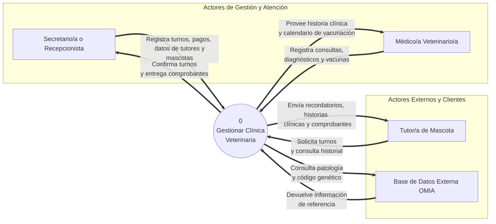
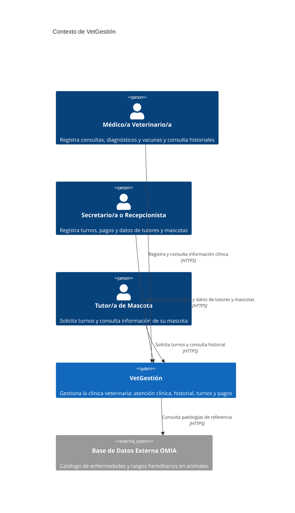
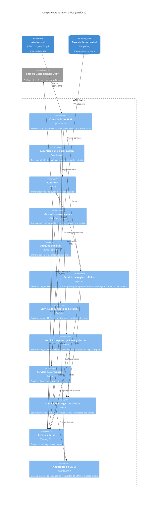
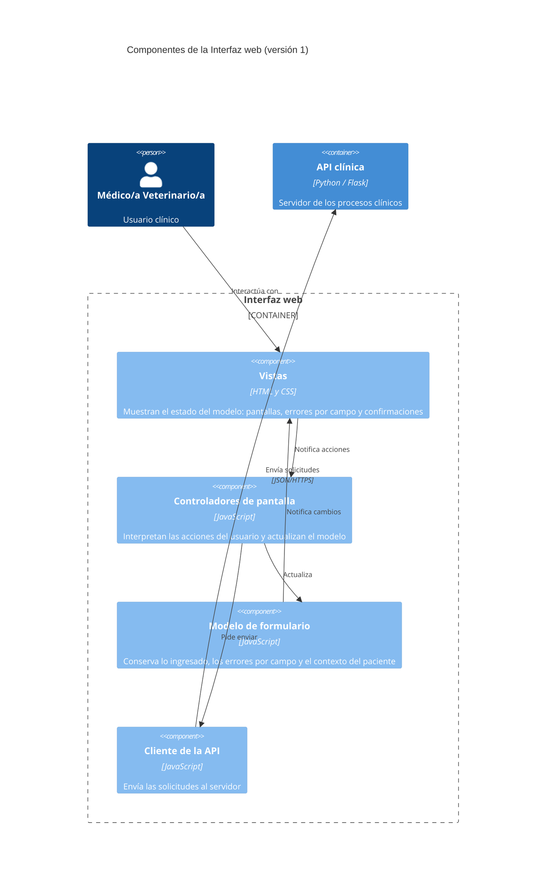
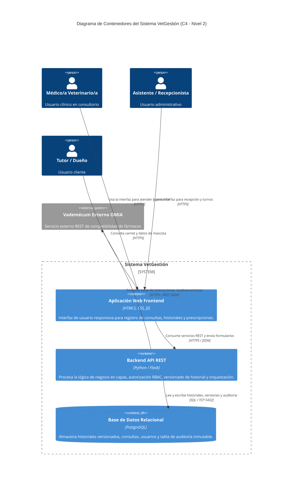
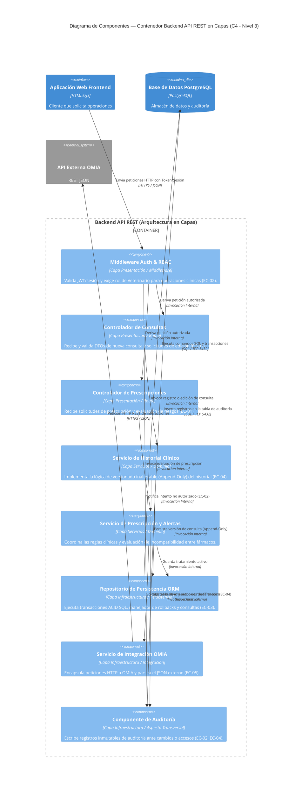

# Especificación de Arquitectura — Sistema de Gestión Clínica Veterinaria 

## 1. Introducción

### 1.1 Propósito
El propósito de este documento es especificar la arquitectura de software del **Sistema de Gestión Clínica Veterinaria (VetGestión)**. La arquitectura aquí descripta establece la estructura global del sistema, la división en contenedores y componentes, la selección de estilos y patrones arquitectónicos, las tácticas para satisfacer los requerimientos no funcionales (atributos de calidad) y las decisiones de diseño fundamentales que condicionan el desarrollo.

### 1.2 Alcance
La guía indica que la arquitectura se define para el o los procesos elegidos en el TP1 (trabajo práctico 1) y que el resto del sistema se representa como caja negra. El proceso elegido es **Gestión Clínica e Historial** (`docs/requirements/RF.md` y `slices.md`; RF: requerimiento funcional). En el DFD (diagrama de flujo de datos) de Nivel 1 del TP1 (`docs/architecture/diagrama-de-contexto-dfd.md`) corresponde a los procesos 2 y 4. En la tabla, CU significa caso de uso, HU historia de usuario y OMIA *Online Mendelian Inheritance in Animals* (catálogo de enfermedades y rasgos hereditarios en animales):

| Proceso del DFD Nivel 1 | ¿En alcance? | Tratamiento en la arquitectura | Requerimientos |
|---|---|---|---|
| 1. Gestionar Turnos y Pacientes | No | Caja negra: contenedor «Aplicación administrativa» | Fuera del proceso elegido |
| 2. Registrar Atención Clínica | **Sí** | Se detalla: «Interfaz web» y «API clínica» | RF-01 a RF-08, RF-10 a RF-12 · CU-01, CU-02, CU-03 · HU-01, HU-02, HU-03 |
| 3. Gestionar Pagos | No | Caja negra: contenedor «Aplicación administrativa» | Fuera del proceso elegido |
| 4. Consultar Referencia OMIA | **Sí** | Componente «Adaptador de OMIA» dentro de la API clínica y sistema externo OMIA | RF-09 · CU-01, slice A3 |

### 1.3 Audiencia
Este documento está diseñado para los siguientes roles organizacionales y técnicos:
- **Arquitectos de Software y Líderes Técnicos:** Para evaluar la coherencia de las decisiones de diseño estructural, el equilibrio entre atributos de calidad y la evolución futura del sistema.
- **Desarrolladores (Frontend y Backend):** Como especificación normativa de la división en capas, responsabilidades de componentes, contratos de API y reglas de dependencia.
- **Equipo de Operaciones / DevOps:** Para comprender la topología de contenedores, la estrategia de persistencia, réplicas WAL y procedimientos de restauración.
- **Equipo de Calidad (QA / Testing):** Para diseñar casos de prueba de integración y verificar la cobertura de los escenarios de atributo de calidad (EC-01 a EC-05).
- **Evaluadores y Docentes:** Para auditar el proceso de derivación desde los atributos de calidad hasta los diagramas C4 y decisiones de arquitectura.

### 1.4 Siglas y Acrónimos
Las siglas se aclaran la primera vez que se usan y se reúnen en el glosario (sección 11). Las principales: **TP** (trabajo práctico), **RF** (requerimiento funcional), **CU** (caso de uso), **HU** (historia de usuario), **EC** (escenario de calidad), **DA** (decisión de arquitectura), **DFD** (diagrama de flujo de datos), **C4** (modelo de documentación en cuatro niveles: contexto, contenedores, componentes y código), **OMIA** (*Online Mendelian Inheritance in Animals*: catálogo de rasgos y enfermedades hereditarias en animales).

---

## 2. Restricciones

Las siguientes restricciones limitan y condicionan las decisiones arquitectónicas del proyecto:

### 2.1 Restricciones Técnicas
- **R1 (Navegador y Dispositivos):** El cliente web debe funcionar en navegadores modernos (Chrome, Firefox, Edge, Safari) sin requerir plug-ins adicionales y ser operable desde tablets de consultorio.
- **R2 (Tecnología Backend y Persistencia):** El servidor debe implementarse en Python utilizando el framework Flask para la API REST, y PostgreSQL como motor de base de datos relacional.
- **R3 (Sistemas Externos):** la consulta a OMIA es de solo lectura (RF-09). No se asume una API de integración estable.

### 2.2 Restricciones del Equipo y Tecnología
- **R4 (Tamaño y Experiencia del Equipo):** Proyecto desarrollado por un equipo reducido (3 integrantes) con alta familiaridad en arquitecturas web tradicionales (Cliente-Servidor / Capas) y tiempo acotado.
- **R5 (Simplicidad Operativa):** Se descartan soluciones con alta sobrecarga de configuración o indirección excesiva (como microservicios o patrones de indirección compleja) para evitar sobreingeniería y garantizar la mantenibilidad del código.

### 2.3 Restricciones de Tiempo y Entorno
- **R6 (Ciclo de Entrega):** La arquitectura debe completarse y ser demostrable dentro del plazo del cuatrimestre.
- **R7 (Entorno de Despliegue):** El despliegue inicial se realiza en un servidor único o contenedorizado con Docker, sin infraestructura distribuida multi-región.

### 2.4 Restricciones de Proceso
- **R8(Ciclo de Vida)**: Se ha seleccionado un ciclo de vida incremental, así los módulos se entregarán por etapas, pudiendo agregar módulos sin reescribir los anteriores

### 2.5 Restricciones Legales y Éticas
- **R9 (Protección de Datos)**: Se exige confidencialidad de los datos personales de los tutores bajo las Leyes argentinas y el código de ética de la IEEE/ACR

---

## 3. Contexto

E### 3.1 Diagrama de contexto del TP1 (DFD Nivel 0)

Se reproduce sin cambios el diagrama de `docs/architecture/diagrama-de-contexto-dfd.md`:

### 3.2 El mismo contexto en notación C4 (nivel 1)

Mismos actores y mismo sistema externo, con los mismos nombres:

### 3.3 Coherencia con el DFD del TP1

| Elemento del DFD Nivel 0 | Elemento C4 | Observación |
|---|---|---|
| Proceso 0 «Gestionar Clínica Veterinaria» | Sistema «VetGestión» | El proceso único del DFD es el sistema completo |
| Secretario/a o Recepcionista | Persona con el mismo nombre | Igual |
| Médico/a Veterinario/a | Persona con el mismo nombre | Igual |
| Tutor/a de Mascota | Persona con el mismo nombre | Igual |
| Base de Datos Externa OMIA | Sistema externo con el mismo nombre | Igual |
| Flujos de respuesta del sistema (confirmaciones, historia clínica, recordatorios) | No se dibujan | En C4 solo se dibuja la flecha de quien inicia la comunicación (secc. 4.6 de la guía) |

---

## 4. Drivers Arquitectónicos

### 4.1 Escenarios del TP2 con identificador

Cada escenario de `docs/requirements/quality-scenarios.md` recibe un identificador `EC-xx` (EC: escenario de calidad). En ISO/IEC 25010:2023 el atributo elegido es la subcaracterística; la columna «Atributo (libro)» aplica la Tabla 1 de la guía, que lo relaciona con los atributos de Bass, Clements y Kazman.

| ID | Escenario del TP2 | Subcaracterística ISO/IEC 25010:2023 (característica) | Atributo (libro) | Medida de la respuesta |
|---|---|---|---|---|
| `EC-01` | 1.1 Registro de una consulta en una urgencia clínica | Operabilidad (Capacidad de interacción) | Usabilidad | ≤ 45 s y ≤ 8 interacciones; 0 pérdidas de datos ante un error de validación |
| `EC-02` | 2.1 Petición de modificación clínica que saltea la interfaz | Integridad (Seguridad de la información) | Seguridad | 100 % de peticiones no autorizadas rechazadas; 0 registros modificados; evento registrado en ≤ 1 s |
| `EC-03` | 3.1 Caída de la base de datos en plena jornada | Capacidad de recuperación (Fiabilidad) | Disponibilidad | RTO ≤ 4 h; RPO ≤ 15 min; 0 registros huérfanos; restauración de prueba por etapa |
| `EC-04` | 4.1 Corrección de una entrada histórica | Responsabilidad (Seguridad de la información) | Seguridad | 100 % de las ediciones reconstruibles; 0 ediciones sin motivo; auditoría inalterable |
| `EC-05` | 5.1 OMIA cambia su formato o debe reemplazarse | Modificabilidad (Mantenibilidad) | Modificabilidad | ≤ 2 días y 1 persona; 0 módulos modificados fuera del adaptador; regresión de CU-01 sin cambios |

RTO (*recovery time objective*) es el tiempo máximo tolerable para restablecer el servicio; RPO (*recovery point objective*) es la máxima pérdida de datos confirmados tolerable, medida en tiempo.

### 4.2 Criterio para decidir si un escenario es driver

Un escenario es un **driver arquitectónico** si su cumplimiento obliga a decidir sobre la estructura. Se aplican tres preguntas:

1. ¿Condiciona la elección del **estilo** del sistema?
2. ¿Obliga a dividir o crear **contenedores o componentes**?
3. ¿Obliga a incorporar un **mecanismo** estructural (transacciones, copias, un adaptador, una separación de permisos)?

Un escenario que se resuelve dentro de un solo componente o solo en la interfaz de usuario, sin afectar la estructura, no es un driver.

| ID | ¿Estilo? | ¿Contenedores o componentes? | ¿Mecanismo? | Conclusión | Nivel de decisión que condiciona |
|---|---|---|---|---|---|
| `EC-01` | No | Sí: un componente cliente que conserve el estado del formulario y un contrato de errores por campo entre la interfaz y el servidor | No | **Driver** | Patrón (MVC en la interfaz web) |
| `EC-02` | Sí: control centralizado en el servidor (cliente-servidor) | Sí: componente de autorización; la base no accesible desde el cliente | Sí: separación de acceso | **Driver** | Estilo y aspecto transversal |
| `EC-03` | Sí: repositorio (transacciones sobre un almacén central) | Sí: contenedor «Almacén de respaldos» y componentes de excepciones y salud | Sí: transacciones, copias, restauración | **Driver** | Estilo y contenedor |
| `EC-04` | Sí: repositorio (permisos y auditoría centralizados) | Sí: componente de auditoría | Sí: historial versionado y esquema de auditoría separado | **Driver** | Estilo, modelo de datos y aspecto transversal |
| `EC-05` | No | Sí: componente adaptador y regla de dependencias | Sí: encapsulamiento de la integración | **Driver** | Patrón (capas) |

**Qué quedó afuera de esta clasificación.** Dentro de `EC-01`, lo que corresponde solo a la interfaz (orden de los campos, teclado numérico, colores, textos de error) pertenece al TP2 y no es un driver. Los cinco escenarios son drivers, pero con distinto nivel de impacto: `EC-02`, `EC-03` y `EC-04` condicionan el estilo; `EC-01` y `EC-05` condicionan patrones dentro de un contenedor.

### 4.3 Qué mira la arquitectura además de los escenarios

| Fuente | Qué aporta |
|---|---|
| RF y HU del TP1 | RF-08 («validación exclusiva de rol») y HU-02 («de su autoría») fijan qué debe autorizar el servidor; HU-01 («sin perder la información cargada») respalda `EC-01`; HU-03 y CU-03 definen el servicio de alertas |
| Restricciones (sección 2) | R4 y R5 inclinan hacia cliente-servidor con capas y descartan microservicios; R9 pide poder agregar la aplicación administrativa sin tocar el clínico |
| DFD Nivel 1 | Los procesos 1, 2, 3 y 4 se relacionan solo a través de almacenes de datos (D1 a D4), sin flujos directos entre procesos: es la base del estilo repositorio |

### 4.4 Prioridad entre drivers

Criterio del grupo: cuando dos drivers entran en conflicto, se prioriza la **integridad y trazabilidad de los datos clínicos** (`EC-02`, `EC-03`, `EC-04`) sobre la comodidad de carga (`EC-01`) y sobre la facilidad de cambio (`EC-05`). La razón es que un dato clínico corrompido o sin autoría no se puede reconstruir después, mientras que una carga incómoda o un cambio que cuesta un día más sí se pueden corregir.

| ID | Importancia para el negocio | Dificultad técnica | Comentario |
|---|---|---|---|
| `EC-03` | Alta | Alta | Requiere un contenedor nuevo y práctica operativa |
| `EC-04` | Alta | Media | Afecta el modelo de datos |
| `EC-02` | Alta | Media | Es un mecanismo conocido, pero debe valer en todas las operaciones |
| `EC-05` | Media | Media | Riesgo técnico declarado en el SRS |
| `EC-01` | Media | Baja | Gran parte se resuelve en la interfaz |

---

## 5. Estrategia de Solución

### 5.1 Tácticas por driver

Una **táctica** es una decisión de diseño elemental que influye en el logro de la respuesta de un escenario de calidad (Bass et al.). Las de las tablas siguientes salen de la Tabla 2 de la guía; cuando se usa una que no está allí, se aclara. Una táctica es una decisión, no una tecnología.

#### EC-01 — Operabilidad (atributo del libro: Usabilidad)

| Grupo | Táctica seleccionada | Cómo contribuye a la medida | Dónde se implementa |
|---|---|---|---|
| Iniciativa del sistema | Mantener modelos de tarea, de usuario y del sistema | El cliente conserva lo ingresado y el contexto del paciente (por ejemplo, el último peso); ante un error de validación no se pierde nada → «0 pérdidas de datos» | Modelo de formulario |
| Controlar la demanda (atributo Desempeño, usada aquí por su efecto en el tiempo de carga) | Reducir sobrecarga | El servidor valida todos los campos en una sola pasada y devuelve todos los errores juntos, en lugar de uno por vez → menos interacciones y menos tiempo | Validación de registros clínicos |

| Táctica descartada | Motivo |
|---|---|
| Cancelar | Aporta control, pero no contribuye a la medida; ya está resuelta como decisión de interfaz en el TP2 (botón «Cancelar») sin impacto estructural |
| Deshacer | No hay un requerimiento de revertir un guardado: la corrección se hace con una edición versionada (RF-08) |
| Pausar y reanudar | «Completar después» se logra editando una entrada ya guardada (RF-08), no con borradores persistidos en el servidor, que agregarían estado y complejidad |
| Agregar (acciones sobre varios elementos) | Ninguna HU pide operar sobre varios elementos a la vez |
| Acotar tiempos de ejecución | La medida es el tiempo humano de carga, no el tiempo de ejecución del sistema; fijar un máximo de ejecución no acerca el valor esperado |
| Introducir concurrencia / Aumentar recursos | No hay demanda que lo justifique: hay un usuario clínico por consulta |

#### EC-02 — Integridad (atributo del libro: Seguridad)

| Grupo | Táctica seleccionada | Cómo contribuye a la medida | Dónde se implementa |
|---|---|---|---|
| Resistir ataques | Identificar, autenticar y autorizar actores | Cada operación de escritura se atribuye a un usuario autenticado y el servidor verifica rol y autoría antes de ejecutarla → 100 % de rechazos | Autenticación y autorización |
| Resistir ataques | Limitar acceso | La base de datos solo es accesible desde los contenedores servidor: no hay camino para modificar datos que evite la verificación → «0 registros modificados» | Base de datos central |
| Resistir ataques | Limitar exposición | Hacia afuera solo se expone la interfaz HTTPS del sistema, no la base ni los respaldos | Despliegue (TP4) |
| Resistir ataques | Cifrar datos | HTTPS protege credenciales y sesión; sin eso un tercero podría suplantar un rol clínico | Relaciones entre contenedores |
| Recuperarse | Registro de auditoría | Cada rechazo genera un evento con usuario, acción y recurso en ≤ 1 s | Auditoría |

| Táctica descartada | Motivo |
|---|---|
| Detectar intrusión, Detectar negación de servicio, Revocar acceso, Informar actores | La medida se refiere a una petición individual, no a patrones de ataque repetidos. El registro de auditoría deja la base para sumarlas en un incremento posterior; hoy exigirían un componente de análisis y alertas fuera de R4 y R5 |
| Separar entidades (zonas de red) | Lo esencial se obtiene con «Limitar acceso»; la separación por redes se define en el despliegue (TP4) |

#### EC-03 — Capacidad de recuperación (atributo del libro: Disponibilidad)

| Grupo | Táctica seleccionada | Cómo contribuye a la medida | Dónde se implementa |
|---|---|---|---|
| Detectar fallos | Detección de excepciones | Un fallo de conexión o de consulta se reconoce como tal y activa el modo degradado | Gestión de excepciones |
| Detectar fallos | Ping y eco | Una ruta de estado comprueba que la base responde; acorta el tiempo hasta detectar la caída, que cuenta dentro del RTO | Chequeo de salud |
| Recuperarse | Redundancia de repuesto | Copia base más archivo continuo del registro de transacciones en un almacén aparte; ante la falla se levanta una instancia de reemplazo y se restaura al instante previo → RPO ≤ 15 min y RTO ≤ 4 h | Almacén de respaldos |
| Prevenir fallos | Transacciones | Cada operación clínica (consulta, peso, vacunas) se guarda completa o no se guarda → «0 registros huérfanos» | Acceso a datos |
| Recuperarse | Rollback | Si un paso falla, la transacción se deshace y no quedan datos parciales | Acceso a datos |
| Recuperarse | Manejo de excepciones | Los fallos de la base se traducen en una respuesta controlada y comprensible | Gestión de excepciones |
| Recuperarse | Degradación controlada | Con la base caída se informa mantenimiento y no se aceptan escrituras que se perderían; la interfaz conserva lo cargado (`EC-01`) | Gestión de excepciones y Modelo de formulario |
| Detectar fallos | Comprobación de consistencia posterior a la restauración (*sanity checking* en Bass et al.; no figura en la Tabla 2) | Tras restaurar se verifican claves e integridad de las cadenas de versiones → «0 registros huérfanos» | Procedimiento de restauración y Acceso a datos |

| Táctica descartada | Motivo |
|---|---|
| Redundancia activa o pasiva (réplica en caliente con conmutación automática) | Un RTO de 4 h no la exige; duplicaría infraestructura y operación (R5, R7) |
| Latido y Monitoreo continuo | No hay un proceso separado que emita latidos; «Ping y eco» alcanza para detectar |
| Reintento | No resuelve una falla total de la base, solo las pasajeras |

#### EC-04 — Responsabilidad (atributo del libro: Seguridad)

| Grupo | Táctica seleccionada | Cómo contribuye a la medida | Dónde se implementa |
|---|---|---|---|
| Recuperarse | Registro de auditoría | Cada corrección guarda autor, fecha y hora, versión previa, versión nueva y motivo → 100 % reconstruibles | Auditoría |
| Resistir ataques | Identificar, autenticar y autorizar actores | Cada acción se atribuye a una cuenta individual y solo el autor veterinario corrige (RF-08) | Autenticación y autorización |
| Resistir ataques | Separar entidades | La auditoría vive en un esquema aparte, con permisos de solo inserción para la aplicación → no se puede editar ni borrar desde la aplicación | Base de datos central |
| **Propia del grupo** (no está en la Tabla 2) | Versionado inmutable: solo se agregan versiones | Una corrección crea una versión nueva enlazada a la anterior y nunca sobrescribe → «conserva la versión original» | Servicio de registro clínico y Acceso a datos |
| Prevenir fallos (atributo Disponibilidad) | Transacciones | La versión nueva y el registro de auditoría se confirman juntos: no hay corrección sin rastro ni rastro sin corrección | Acceso a datos |

| Táctica descartada | Motivo |
|---|---|
| Firma digital con certificado por registro | Costo y complejidad desproporcionados para el equipo (R4); el escenario no la pide |
| Cifrar la auditoría en reposo con clave separada | Es una protección válida, pero el escenario exige inalterabilidad, no confidencialidad; se difiere |
| Enviar los registros a un servicio externo de logs | Sumaría un contenedor sin que ningún escenario lo exija |

#### EC-05 — Modificabilidad (atributo del libro: Modificabilidad)

| Grupo | Táctica seleccionada | Cómo contribuye a la medida | Dónde se implementa |
|---|---|---|---|
| Reducir acoplamiento | Encapsular | El adaptador expone una interfaz estable («buscar patología») y oculta formato y protocolo de OMIA → un cambio de formato no sale del adaptador | Adaptador de OMIA |
| Reducir acoplamiento | Usar un intermediario | El adaptador media entre el servicio de referencias y OMIA | Adaptador de OMIA |
| Reducir acoplamiento | Restringir dependencias | Solo el adaptador conoce el cliente y el formato de OMIA; los servicios no importan nada de OMIA → «0 módulos fuera del adaptador» | Reglas de dependencia de las capas |
| Aumentar cohesión | Dividir módulos | La integración es un módulo separado del servicio de referencias | Adaptador de OMIA |
| Capacidad de prueba (otro atributo) | Abstraer fuentes de datos | Los servicios se prueban con un adaptador simulado, de modo que la regresión de CU-01 no depende de OMIA | Servicio de referencias |

| Táctica descartada | Motivo |
|---|---|
| Diferir el enlace (plug-ins, parametrización) | Hay un único proveedor; reemplazar OMIA equivale a escribir otro adaptador con la misma interfaz (≤ 2 días). Un mecanismo de plug-ins costaría más de lo que ahorra |
| Abstraer servicios comunes | No hay otra integración externa que comparta funciones |
| Redistribuir responsabilidades | No hay una función mal ubicada que corregir |

---

### 5.2 Estilos Arquitectónicos

### 5.2 Estilos arquitectónicos (decisión global)

Un **estilo** es un conjunto de principios que da un marco abstracto para una familia de sistemas: define el vocabulario de componentes y conectores y las restricciones sobre cómo se combinan (Shaw y Garlan). Responde a «¿cómo se organiza el sistema en su conjunto?» y se hace visible sobre todo en la vista de contenedores.

#### 5.2.1 Estilos evaluados

| Estilo | ¿Adoptado? | Motivo |
|---|---|---|
| Cliente-servidor | **Sí: estilo base** | `EC-02` pide control centralizado de la autorización en el servidor; R1, R2, R4 y R5 favorecen una estructura con pocas piezas que el equipo ya conoce |
| Repositorio | **Sí: estilo adicional, solo para la zona de datos** | `EC-03` (transacciones sobre un almacén central) y `EC-04` (permisos y auditoría centralizados). Además, en el DFD Nivel 1 los procesos solo se comunican a través de almacenes de datos, y R9 pide agregar la aplicación administrativa sin tocar el clínico |
| Tuberías y filtros | No | El sistema no es un flujo de transformación de datos en etapas. La cadena de verificaciones de una petición dentro de la API es un mecanismo del framework, no el estilo del sistema; declararlo sería combinar por acumulación |
| Orientada a eventos | No | Ningún escenario exige tareas lentas, picos de carga ni procesamiento diferido. La interrupción de red al guardar (CU-01, slice E1) se resuelve con una transacción atómica y con la conservación de lo cargado en el cliente |
| Microservicios | No | R4 y R5; ningún escenario exige escalar o desplegar por separado, y `EC-05` se resuelve con encapsulamiento. Sumaría complejidad operativa y consistencia entre bases |
| Monolítica | No se declara | La API clínica se despliega como una sola unidad, pero eso es una consecuencia y no un objetivo; su estructura interna se rige por el patrón de capas |
| Microkernel, SOA y entre pares (*peer-to-peer*) | No | No hay núcleo con extensiones, ni bus de integración, ni nodos iguales |

SOA es arquitectura orientada a servicios.

#### 5.2.2 Estilo base: cliente-servidor

- **Principio:** el servidor presta servicios a clientes que los solicitan.
- **Dónde aplica:** a todo el sistema. El cliente es la «Interfaz web»; los servidores son la «API clínica» y el «Aplicación administrativa».
- **Qué mejora:** seguridad (control centralizado, `EC-02`), simplicidad de operación y de prueba (`EC-05`).
- **Qué sacrifica:** el servidor es un punto único de falla; la carga se centraliza; el cliente depende de la red.
- **Comprobación de restricciones (Tabla 4 de la guía), sobre la vista de contenedores v1:**

| Restricción o regla del estilo | ¿Se cumple? | Evidencia en el diagrama |
|---|---|---|
| Los clientes no se comunican entre sí | Sí | Hay un único cliente |
| El servidor no inicia la comunicación con el cliente | Sí | Ninguna flecha va del servidor a la interfaz |
| El cliente no accede directamente a la base de datos | Sí | La interfaz web solo se conecta con las dos aplicaciones servidor |
| El cliente inicia siempre la comunicación | Sí | Todas las flechas salen de la interfaz hacia los servidores |
| El servidor expone una interfaz definida | Sí | La API clínica expone una interfaz REST con datos JSON |
| La lógica y los datos compartidos viven en el servidor | Sí | Las reglas están en la API clínica y los datos en la base central |

#### 5.2.3 Estilo adicional: repositorio

- **Principio:** los datos compartidos viven en un almacén central que varias aplicaciones consultan y actualizan, y las aplicaciones solo se comunican entre sí a través de ese almacén.
- **Dónde aplica:** solo a la **zona de datos**: la «Base de datos central» y las dos aplicaciones que la usan, «API clínica» y «Aplicación administrativa».
- **Por qué responde a escenarios:** `EC-03` y `EC-04` necesitan un único lugar donde se apliquen transacciones, permisos y auditoría. Las dos aplicaciones comparten datos reales (el proceso 2 lee los pacientes y los turnos que escribe el proceso 1, según el DFD Nivel 1), y el almacén central evita que se llamen directamente.
- **Qué mejora:** consistencia e integridad (transacciones), permisos y auditoría en un único punto, y desacople entre módulos, lo que permite agregar la aplicación administrativa en otra etapa (R9).
- **Qué sacrifica:** el almacén es un punto único de falla; el esquema de datos acopla a quienes lo usan; la base puede volverse un cuello de botella al escalar.
- **Cómo se conectan las zonas:** el estilo cliente-servidor y el repositorio se conectan por la conexión SQL de cada servidor a la base. Es el único punto de integración entre las dos aplicaciones servidor.
- **No confundir** con el «patrón repositorio» de diseño (clases que encapsulan consultas): acá se habla del estilo, es decir, de un almacén central compartido.
- **Comprobación de restricciones (Tabla 4):**

| Restricción o regla del estilo | ¿Se cumple? | Evidencia en el diagrama |
|---|---|---|
| Las aplicaciones no se comunican directamente entre sí | Sí | No hay flecha entre «API clínica» y «Aplicación administrativa» |
| El almacén es la fuente única de los datos | Sí | El «Almacén de respaldos» es una copia pasiva, no una fuente |
| El acceso concurrente se controla (transacciones) | Sí | `EC-03`: transacciones en «Acceso a datos» |
| El esquema de datos es conocido por todos los que lo usan | Sí, a documentar | Modelo de dominio del TP1 (`modelo_de_dominio_inicial.md`) |

#### 5.2.4 Primera versión de la vista de contenedores

Los archivos estáticos de la interfaz web los sirve el mismo servidor web que expone la API (detalle de despliegue: TP4). Cada contenedor que existe por una táctica o un estilo se rastrea a una decisión: «Almacén de respaldos» (`DA-05`), «Base de datos central» (`DA-04`) y «Aplicación administrativa» (`DA-04`). El catálogo definitivo y la verificación de las reglas 4.4, 4.6 y 4.7 son parte de la Parte B.

---

### 5.3 Patrones arquitectónicos (decisión local)

#### 5.3.1 Patrones evaluados por contenedor

| Contenedor | Patrón | ¿Adoptado? | Motivo |
|---|---|---|---|
| API clínica | Capas | **Sí** | `EC-02` (control en la capa de servicios), `EC-05` (restringir dependencias y encapsular), capacidad de prueba; es lo que el equipo ya domina (R4) |
| API clínica | Hexagonal | No | Mejora la prueba y el aislamiento de OMIA, pero agrega puertos y adaptadores para un único proveedor (sobreingeniería, Tabla 5). `EC-05` se logra con encapsulamiento dentro de capas |
| API clínica | CQRS | No | No hay lecturas y escrituras con necesidades de escala distintas; la consistencia eventual entre modelos contradice la trazabilidad de `EC-04` |
| API clínica | Broker | No | No hay cola ni tareas diferidas (ver 5.2.1) |
| Interfaz web | MVC | **Sí** | `EC-01`: separar vista, modelo y controlador permite que el modelo conserve el estado ante errores |
| Interfaz web | MVVM | No | Requiere un mecanismo de enlace de datos propio de un framework de interfaz, con más complejidad y depuración más difícil; el equipo trabaja con HTML y Python |
| Aplicación administrativa, Base de datos central, Almacén de respaldos | Ninguno en este TP | — | Caja negra o almacenes sin lógica propia |
| (cualquiera) | Pizarra, Serverless | No | No hay problema sin algoritmo cerrado ni escalado variable que lo justifique |

MVC es Modelo-Vista-Controlador; MVVM, Modelo-Vista-Modelo de Vista; CQRS, separación de comandos y consultas.

#### 5.3.2 Capas en la API clínica

Se usan tres capas, más aspectos transversales:

| Capa | Responsabilidad | Componentes |
|---|---|---|
| Presentación | Recibir solicitudes y devolver respuestas JSON | Controladores REST |
| Servicios | Reglas de los procesos clínicos | Servicio de registro clínico, Servicio de consulta de historial, Servicio de prescripciones y alertas, Servicio de referencias, Validación de registros clínicos |
| Datos e integración | Acceso a la base y al sistema externo | Acceso a datos, Adaptador de OMIA |

La guía menciona una capa de dominio separada. Aquí la lógica de dominio (versionado, alertas) vive en la capa de servicios, porque el dominio es chico y una capa más agregaría indirección sin ganar nada (R5). Es un sacrificio consciente de modificabilidad a cambio de simplicidad.

**Comprobación de restricciones (Tabla 6):**

| Restricción o regla | ¿Se cumple? | Evidencia |
|---|---|---|
| Una capa no depende de las superiores | Sí | Ninguna flecha sube |
| Cada capa usa solo a la inmediatamente inferior | Sí | Controladores → Servicios → Acceso a datos y Adaptador de OMIA; no se saltea ninguna capa |
| Cada capa tiene una responsabilidad | Sí | Ver tabla anterior |
| Todas las flechas entre capas van hacia abajo | Sí | Los aspectos transversales son usados desde cualquier capa y no forman parte de la jerarquía |

#### 5.3.3 MVC en la Interfaz web

| Rol MVC | Componente | Responsabilidad |
|---|---|---|
| Vista | Vistas | Muestra el estado del modelo: pantallas, errores por campo y confirmaciones |
| Controlador | Controladores de pantalla | Interpreta las acciones del usuario y actualiza el modelo |
| Modelo | Modelo de formulario | Conserva lo ingresado, los errores y el contexto del paciente |
| Apoyo | Cliente de la API | Envía las solicitudes al servidor |

| Restricción o regla (Tabla 6) | ¿Se cumple? | Evidencia |
|---|---|---|
| El modelo no conoce a la vista ni al controlador | Sí | El modelo solo notifica cambios |
| La vista no modifica el modelo directamente | Sí | La vista notifica acciones al controlador |
| El controlador interpreta acciones y actualiza el modelo | Sí | Flecha «Actualiza» |

#### 5.3.4 Primera versión de la vista de componentes

**API clínica:**

La «Gestión de excepciones» actúa de forma global sobre las respuestas de todos los controladores (es un manejador del framework); por eso no se dibuja una flecha desde cada componente.

**Interfaz web:**

**Trazabilidad de componentes** (ningún componente queda huérfano):

| Componente | Contenedor | Se rastrea a |
|---|---|---|
| Vistas | Interfaz web | Pantallas del TP2 para HU-01, HU-02 y HU-03 · `DA-02` |
| Controladores de pantalla | Interfaz web | HU-01, HU-02, HU-03 · `DA-02` |
| Modelo de formulario | Interfaz web | HU-01 («sin perder la información cargada») · `EC-01` · `DA-02` |
| Cliente de la API | Interfaz web | Comunicación cliente-servidor · `DA-01` |
| Controladores REST | API clínica | Interfaz de todos los CU · `DA-01` |
| Autenticación y autorización | API clínica | RF-08, precondición de CU-01 · `EC-02` · `DA-03` |
| Auditoría | API clínica | `EC-04`, `EC-02` · `DA-06` |
| Gestión de excepciones | API clínica | CU-01 slice E1 · `EC-03` · `DA-05` |
| Chequeo de salud | API clínica | `EC-03` · `DA-05` |
| Servicio de registro clínico | API clínica | RF-01 a RF-05, RF-08 · HU-01, HU-02 · `DA-06` |
| Servicio de consulta de historial | API clínica | RF-07, RF-12 · CU-02 |
| Servicio de prescripciones y alertas | API clínica | RF-06 · HU-03 · `DA-08` |
| Servicio de referencias | API clínica | RF-09 · CU-01 slice A3 |
| Validación de registros clínicos | API clínica | RF-10, RF-11 · HU-01 · `EC-01` |
| Acceso a datos | API clínica | Todos los procesos · `EC-03`, `EC-04` · `DA-04` |
| Adaptador de OMIA | API clínica | RF-09 · `EC-05` · `DA-07` |
---

### 5.4 Aspectos transversales

Son decisiones que atraviesan varias partes del sistema y no pertenecen a una sola. En la vista de componentes se dibujan como componentes propios que usan los demás. Se analizaron los seis que menciona la guía:

| Aspecto | Decisión | Motivo | Dónde se ve |
|---|---|---|---|
| Autenticación y autorización | **Adoptado** | `EC-02` y `EC-04`; RF-08 exige validación por rol y HU-02 pide autoría. El mecanismo concreto (sesión o token firmado) se define en el TP4 y no cambia la estructura | Componente «Autenticación y autorización» |
| Auditoría | **Adoptado** | `EC-04` (correcciones) y `EC-02` (intentos rechazados) | Componente «Auditoría» y esquema de auditoría en la base |
| Gestión de excepciones | **Adoptado** | `EC-03` (degradación controlada) y `EC-01` (respuestas de error por campo) | Componente «Gestión de excepciones» |
| Instrumentación | **Adoptado en versión mínima** (estado de la base y registro de eventos) | `EC-03`: detectar rápido la caída forma parte del RTO. Se descarta un sistema de monitoreo con paneles y alertas (R4, R5) | Componente «Chequeo de salud» |
| Interoperabilidad | **Adoptado como convención**, sin componente propio | Táctica «Respetar estándares de comunicación»: REST, JSON y HTTPS entre contenedores; da contrato estable a `EC-05` | Rótulos de las relaciones entre contenedores |
| Notificaciones | **Descartado** | Ninguna HU ni RF del proceso elegido exige avisar fuera de la pantalla (la alerta de HU-03 es visual). Los recordatorios del DFD pertenecen a los procesos 1 y 3. Se retoma en el incremento administrativo y requerirá un servicio de correo externo | — |
---

### 5.5 Verificación

#### 5.5.1 Tabla de cobertura

| Driver | Cómo lo cubre la arquitectura | Qué sacrifica | Estado |
|---|---|---|---|
| `EC-01` | «Modelo de formulario» conserva lo ingresado y «Validación de registros clínicos» devuelve todos los errores por campo en una respuesta (`DA-02`) | Parte de la validación queda duplicada (controles básicos en el cliente y validación autoritativa en el servidor); hay que rehacer como HTML estático y JavaScript las plantillas del TP2. El tiempo de 45 s depende además del diseño de pantalla del TP2 y se comprueba con pruebas de uso | Cubierto |
| `EC-02` | Toda escritura pasa por «Autenticación y autorización» en el servidor, y la base es inaccesible desde fuera (`DA-03`) | Latencia de milisegundos por verificación; el servidor es punto único de falla; hay que gestionar usuarios y roles, que no figuran como proceso en el DFD | Cubierto |
| `EC-03` | Transacciones, «Almacén de respaldos» con restauración a un instante previo, «Gestión de excepciones» y «Chequeo de salud» (`DA-04`, `DA-05`) | Hasta 4 h sin servicio (no hay conmutación automática); costo de almacenamiento; tarea operativa de probar la restauración en cada etapa; la base es punto único de falla | Cubierto, con sacrificio asumido |
| `EC-04` | Historial solo-agregar, auditoría en esquema separado y misma transacción (`DA-06`) | La base crece con cada versión; obtener el «estado vigente» exige elegir la última versión (vista o índice) | Cubierto |
| `EC-05` | «Adaptador de OMIA» detrás de una interfaz estable y reglas de dependencia de las capas (`DA-07`, `DA-08`) | Mapeo de datos entre el formato de OMIA y el modelo propio; sin plug-ins, reemplazar OMIA requiere escribir un adaptador; la regla «0 módulos fuera del adaptador» exige disciplina de revisión | Cubierto |

#### 5.5.2 Conflictos entre tácticas de escenarios distintos

| Conflicto | Escenarios | Análisis | Resolución |
|---|---|---|---|
| El versionado de `EC-04` agranda la base, y con ello los respaldos y el tiempo de restauración de `EC-03` | `EC-04` y `EC-03` | Cada corrección suma filas; el RTO de 4 h es holgado para el volumen de una clínica | Se acepta; se revisa el volumen en la prueba de restauración de cada etapa |
| Si la base está caída (`EC-03`), no se pueden registrar en ella los intentos rechazados de `EC-02` | `EC-02` y `EC-03` | La auditoría vive en la propia base | Registro de respaldo en un archivo local de solo agregar, que se concilia al volver la base; con la base caída el límite de ≤ 1 s no se garantiza (sacrificio asumido) |
| La auditoría en la misma transacción que la escritura (`EC-04`) suma una inserción por operación | `EC-04` y `EC-01` | Costo de milisegundos frente a una medida de 45 s | Se acepta |
| La verificación de permisos en cada petición (`EC-02`) suma latencia | `EC-02` y `EC-01` | Mismo orden de magnitud que el anterior | Se acepta |
| Validar en el cliente y en el servidor duplica reglas (`EC-01`), lo que cuesta modificabilidad (`EC-05`) | `EC-01` y `EC-05` | Cada regla duplicada hay que mantenerla en dos lugares | El servidor es la autoridad; el cliente solo hace controles básicos (campo obligatorio, número) |
| El versionado (`EC-04`) contradice la redacción de HU-02, que dice «actualiza el registro» | `EC-04` y HU-02 | Para el usuario el efecto es el mismo: ve la entrada corregida con el indicador de modificada | Se interpreta «actualizar» como «agregar una versión nueva»; se recomienda ajustar la redacción de HU-02 |

Por la regla de prioridad (4.4), cuando el conflicto es real prevalecen la integridad y la trazabilidad.

#### 5.5.3 Riesgos arquitectónicos

| ID | Riesgo | Mitigación |
|---|---|---|
| RA-1 | La base compartida acopla a la API clínica y a la aplicación administrativa: un cambio de esquema rompe al otro | Cada aplicación es dueña de sus tablas; los cambios de esquema se acuerdan y se hacen con migraciones |
| RA-2 | OMIA puede no ofrecer una API estable (R3) | Adaptador aislado y consulta opcional, fuera del camino crítico; confirmar la forma de acceso antes del TP4 |
| RA-3 | `DA-02` obliga a rehacer las pantallas del TP2 como HTML estático con JavaScript | Reutilizar el diseño visual; si el grupo prefiere mantener plantillas del servidor, ver la alternativa A en `DA-02` |
| RA-4 | Configurar el archivo continuo del registro de transacciones y la restauración exige práctica operativa | Probar la restauración al menos una vez por etapa (`EC-03`) |
| RA-5 | Dos aplicaciones servidor con su propia autenticación pueden divergir | Una única tabla de usuarios y roles en la base central, usada por ambas |
---

## 6. Vista de Contenedores (C4 - Nivel 2)

### 6.1 Diagrama de Contenedores

### 6.2 Catálogo de Contenedores

| Contenedor | Tecnología | Responsabilidad |
| :--- | :--- | :--- |
| **Aplicación Web Frontend** | HTML5, CSS3, JavaScript | Renderizar la interfaz de usuario, validar campos locales, conservar estado de borradores y presentar alertas. |
| **Backend API REST** | Python / Flask | Centralizar la seguridad (RBAC), coordinar la arquitectura en capas, orquestar el versionado de atenciones y consultar OMIA. |
| **Base de Datos Relacional** | PostgreSQL | Garantizar la persistencia inalterable (append-only) de consultas, aplicar transacciones ACID y resguardar la auditoría. |

### 6.3 Catálogo de Relaciones entre Contenedores

| Origen | Destino | Qué se comunica | Protocolo |
| :--- | :--- | :--- | :--- |
| Usuarios (Vet/Sec/Tutor) | Aplicación Web Frontend | Clics, carga de formularios y visualización de pantallas | HTTPS |
| Aplicación Web Frontend | Backend API REST | Solicitudes de consulta, edición e historial | HTTPS / REST JSON |
| Backend API REST | Base de Datos Relacional | Consultas SQL, inserción de versiones e inserción en auditoría | SQL / TCP Port 5432 |
| Backend API REST | Vademécum OMIA | Consulta de compatibilidad de fármacos | HTTPS / REST JSON |

---

## 7. Vista de Componentes (C4 - Nivel 3)

Hacemos zoom sobre el contenedor principal que implementa los procesos elegidos: **Backend API REST**, organizado bajo una **Arquitectura en Capas**.

### 7.1 Diagrama de Componentes del Backend API REST

### 7.2 Catálogo de Componentes del Backend API REST

| Componente | Capa | Responsabilidad |
| :--- | :--- | :--- |
| **Middleware Auth & RBAC** | Presentación | Intercepta todas las peticiones, valida JWT y verifica si el rol es `Veterinario` antes de permitir operaciones de modificación (EC-02). |
| **Controlador de Consultas** | Presentación | Recibe las peticiones HTTP de la UI, valida DTOs de entrada y retorna respuestas con referencias de error (`#id`) (EC-01). |
| **Controlador de Prescripciones** | Presentación | Recibe datos de fármacos a prescribir y reenvía las solicitudes de alerta a la capa de servicios. |
| **Servicio de Historial Clínico** | Servicios / Dominio | Ejecuta la regla del historial inalterable: no sobrescribe, sino que asigna un nuevo ID y enlaza la versión previa con motivo obligatorio (EC-04). |
| **Servicio de Prescripción y Alertas** | Servicios / Dominio | Evalúa las incompatibilidades médicas combinando datos locales con las respuestas de OMIA. |
| **Repositorio de Persistencia ORM** | Infraestructura | Abstrae la base de datos PostgreSQL, ejecuta bloques transaccionales ACID y gestiona el versionado (EC-03). |
| **Servicio de Integración OMIA** | Infraestructura | Encapsula las llamadas HTTP externas a la API de OMIA y traduce los formatos JSON para proteger al dominio de cambios en el proveedor (EC-05). |
| **Componente de Auditoría** | Aspecto Transversal | Registra automáticamente en la tabla de auditoría inmutable todo evento de edición, intento de acceso no autorizado o acción crítica (EC-02, EC-04). |

### 7.3 Catálogo de Relaciones entre Componentes

| Origen | Destino | Qué se comunica | Tipo / Protocolo |
| :--- | :--- | :--- | :--- |
| Aplicación Web Frontend | Middleware Auth & RBAC | Solicitud HTTP con token de sesión | HTTPS / JSON |
| Middleware Auth & RBAC | Controladores | Redirección de petición una vez autorizada | Invocación Interna |
| Controladores | Servicios de Dominio | Invocación de operaciones de negocio con DTOs validados | Invocación Interna |
| Servicio Prescripción | Servicio Integración OMIA | Consulta de compatibilidad enviando códigos de fármacos | Invocación Interna |
| Servicio Integración OMIA | API Externa OMIA | Petición REST de tabla de interacciones | HTTPS / REST JSON |
| Servicios de Dominio | Repositorio Persistencia | Guardado de versiones y consultas SQL | Invocación Interna |
| Repositorio Persistencia | Base de Datos PostgreSQL | Sentencias SQL transaccionales | SQL / TCP 5432 |
| Componente Auditoría | Base de Datos PostgreSQL | Inserción de logs en tabla de auditoría | SQL / TCP 5432 |

---

## 8. Historias de Usuario sobre las Vistas

A continuación se demuestra la ejecución de las Historias de Usuario principales del TP1 a través de los contenedores y componentes de la arquitectura:

### 8.1 HU-01: Manejo de Datos Obligatorios Incompletos o Inválidos
- **Given (Dado que):** El/la veterinario/a está en la `Aplicación Web Frontend` registrando una nueva consulta y deja el peso en blanco o con formato texto.
- **When (Cuando):** Selecciona la opción "Guardar Consulta".
- **Then (Entonces):**
  1. El cliente valida localmente los tipos de datos básicos.
  2. Si pasa la UI, se envía el DTO al `Controlador de Consultas` vía HTTPS.
  3. El controlador detecta el campo faltante, interrumpe el procesamiento antes de invocar a la capa de servicios y responde HTTP 400 Bad Request con la lista de errores.
  4. La `Aplicación Web Frontend` captura la respuesta y muestra el banner con enlaces `#id` al campo inválido, **conservando intactos todos los datos tipeados** por el usuario.

### 8.2 HU-02: Edición de Entradas Previas en el Historial Clínico
- **Given (Dado que):** Un/a veterinario/a requiere corregir el diagnóstico de una atención previa y el usuario logueado es el autor original (RF-08).
- **When (Cuando):** Ingresa la modificación, escribe el motivo obligatorio y presiona "Confirmar Edición".
- **Then (Entonces):**
  1. La petición llega al `Middleware Auth & RBAC`, que verifica que el token corresponda al rol de `Veterinario`.
  2. Pasa al `Controlador de Consultas` y de allí al `Servicio de Historial Clínico`.
  3. El servicio verifica la regla de negocio: no ejecuta un `UPDATE`, sino que crea un nuevo registro con el diagnóstico actualizado, asigna un nuevo ID y referencia la versión previa.
  4. Invoca al `Componente de Auditoría` para registrar el autor, timestamp, motivo e IDs en la tabla inmutable.
  5. El `Repositorio de Persistencia ORM` ejecuta todo dentro de una transacción SQL ACID en `PostgreSQL`.

### 8.3 HU-03: Notificación de Alerta por Interacción Medicamentosa
- **Given (Dado que):** El/la veterinario/a selecciona un fármaco (ej. *Meloxicam*) para un paciente que ya tiene un tratamiento activo registrado (*Prednisolona*).
- **When (Cuando):** Solicita prescribir el medicamento.
- **Then (Entonces):**
  1. La solicitud llega al `Controlador de Prescripciones` e invoca al `Servicio de Prescripción y Alertas`.
  2. El servicio llama al `Servicio de Integración OMIA` en la capa de infraestructura.
  3. `ServicioIntegracionOMIA` realiza la consulta HTTPS REST a la API de `OMIA`.
  4. `OMIA` retorna el JSON con la incompatibilidad de Nivel Crítico.
  5. El servicio detecta la alerta y retorna una respuesta de advertencia hacia la `Aplicación Web Frontend`, desplegando el modal de color coral que exige ingresar una justificación profesional antes de autorizar el guardado.

---

## 9. Decisiones de arquitectura

### DA-01 — Cliente-servidor como estilo base, con el servidor organizado en capas

- **Escenario que la motiva:** `EC-02` (control centralizado de la autorización) y `EC-05` (capas); restricciones R1, R2, R4, R5.
- **Contexto:** hay que elegir la estructura general del sistema. El equipo es de tres personas, tiene un cuatrimestre y domina aplicaciones web cliente-servidor.
- **Decisión:**
  - Tácticas: identificar, autenticar y autorizar actores (control centralizado); restringir dependencias.
  - Estilo: cliente-servidor como base, para todo el sistema.
  - Patrón: capas dentro de la API clínica.
- **Alternativas consideradas:**
  - Microservicios — descartada: ningún escenario exige escalar o desplegar por separado y suman complejidad operativa (R4, R5).
  - Orientada a eventos como base — descartada: no hay tareas lentas ni picos que la justifiquen.
- **Consecuencias:**
  - A favor: control centralizado de seguridad; pocas piezas que operar; fácil de hacer evolucionar con la incorporación de nuevos contenedores.
  - En contra: el servidor es punto único de falla; la carga se centraliza.
- **Elementos afectados:** «Interfaz web», «API clínica» y «Aplicación administrativa».

### DA-02 — Interfaz web liviana con patrón MVC y errores de validación por campo

- **Escenario que la motiva:** `EC-01` (HU-01: «sin perder la información cargada»; CU-01, slice E1).
- **Contexto:** el veterinario carga datos con urgencia; un error de validación no puede borrar lo ingresado ni obligar a corregir de a un error por vez.
- **Decisión:**
  - Tácticas: mantener modelos de tarea, de usuario y del sistema; reducir sobrecarga.
  - Estilo: cliente-servidor (el cliente inicia siempre; el servidor expone una interfaz REST definida).
  - Patrón: MVC en la «Interfaz web». La validación autoritativa está en el servidor, que responde con todos los errores por campo.
- **Alternativas consideradas:**
  - **A. Páginas generadas en el servidor con plantillas (la forma de los maquetados del TP2)** — descartada por ahora, es la alternativa más fuerte: reutiliza el trabajo del TP2 y evita duplicar validaciones. Se descarta porque mezcla presentación y servicios en un mismo proceso y porque el estilo pide que el servidor exponga una interfaz definida y reutilizable por los demás clientes (la aplicación administrativa y un futuro acceso del tutor). **Esta es la decisión que más conviene que el grupo discuta y confirme.**
  - B. Aplicación de una página con un framework de enlace de datos (MVVM) — descartada: curva de aprendizaje y complejidad desproporcionadas para el equipo (R4).
  - C. Guardado automático continuo de borradores en el servidor — descartada: agrega estado en el servidor y complejidad sin un escenario que lo exija.
- **Consecuencias:**
  - A favor: no se pierde lo cargado ante un error; el servidor es la única autoridad de validación.
  - En contra: controles básicos duplicados en el cliente; hay que rehacer las plantillas del TP2 como HTML estático con JavaScript.
- **Elementos afectados:** «Vistas», «Controladores de pantalla», «Modelo de formulario» y «Cliente de la API» (Interfaz web); «Validación de registros clínicos» y «Controladores REST» (API clínica).

### DA-03 — Autorización centralizada en el servidor, por rol y por recurso

- **Escenario que la motiva:** `EC-02`; RF-08 y HU-02.
- **Contexto:** ocultar un botón en la interfaz no impide que un usuario con rol limitado envíe una petición directa al servidor.
- **Decisión:**
  - Tácticas: identificar, autenticar y autorizar actores; limitar acceso; limitar exposición; cifrar datos; registro de auditoría de los rechazos.
  - Estilo: cliente-servidor (control centralizado).
  - Patrón: capas; la verificación se ejecuta antes de cualquier servicio y se implementa como aspecto transversal.
- **Alternativas consideradas:**
  - Autorizar solo en la interfaz — descartada: se elude con una petición directa.
  - Autorizar dentro de la base de datos (reglas o procedimientos almacenados) — descartada como mecanismo principal: acopla la seguridad al motor y complica las pruebas; se usan los permisos de la base solo como defensa adicional para la auditoría (`DA-06`).
  - Un intermediario de acceso (*gateway*) dedicado — descartada: un contenedor más sin un escenario que lo exija (R5).
- **Consecuencias:**
  - A favor: 100 % de las peticiones no autorizadas rechazadas en un único punto.
  - En contra: latencia de milisegundos por petición; hay que gestionar usuarios y roles (no figuran como proceso en el DFD).
- **Elementos afectados:** «Autenticación y autorización», «Controladores REST», «Auditoría», «Base de datos central».

### DA-04 — Base de datos central compartida con transacciones (estilo repositorio) y aplicación administrativa como caja negra

- **Escenario que la motiva:** `EC-03` y `EC-04`; R9 y DFD Nivel 1.
- **Contexto:** los procesos del DFD se relacionan solo por almacenes de datos y hay que poder agregar la aplicación administrativa en otra etapa sin tocar el clínico. Se necesita un único lugar donde se apliquen transacciones, permisos y auditoría.
- **Decisión:**
  - Tácticas: transacciones; rollback; limitar acceso.
  - Estilo: repositorio, aplicado solo a la zona de datos.
  - Patrón: ninguno en este contenedor. Dentro de la API clínica, «Acceso a datos» ejecuta las transacciones.
- **Alternativas consideradas:**
  - Una base por módulo — descartada: ningún escenario exige aislar los datos, duplicaría la información de pacientes y complicaría la consistencia.
  - Que la API clínica y la aplicación administrativa se llamen directamente — descartada: rompe el estilo repositorio y los acopla.
  - Una base sin transacciones completas — descartada: no garantiza «0 registros huérfanos».
- **Consecuencias:**
  - A favor: consistencia e integridad; módulos desacoplados; se puede agregar el administrativo después.
  - En contra: punto único de falla; acoplamiento por esquema compartido; el esquema debe estar documentado y acordado.
- **Elementos afectados:** «Base de datos central», «Aplicación administrativa», «Acceso a datos».

### DA-05 — Respaldos con restauración a un instante previo y degradación controlada

- **Escenario que la motiva:** `EC-03`.
- **Contexto:** la base puede caer o corromperse en plena jornada y una consulta no se puede volver a hacer. La clínica no tiene sistema alternativo.
- **Decisión:**
  - Tácticas: redundancia de repuesto (copia base más archivo continuo del registro de transacciones); detección de excepciones; ping y eco; manejo de excepciones; degradación controlada; comprobación de consistencia posterior a la restauración.
  - Estilo: repositorio (el almacén de respaldos es una copia pasiva del almacén central).
  - Patrón: ninguno; la «Gestión de excepciones» y el «Chequeo de salud» son aspectos transversales de la API clínica.
- **Alternativas consideradas:**
  - Réplica en caliente con conmutación automática — descartada: un RTO de 4 h no la exige y duplica infraestructura (R5, R7).
  - Respaldo completo nocturno solamente — descartada: el RPO sería de hasta 24 h, contra un objetivo de 15 min.
  - Sin degradación controlada — descartada: mostraría errores confusos y el usuario podría creer que se guardó lo que no se guardó.
- **Consecuencias:**
  - A favor: RPO ≤ 15 min y 0 registros huérfanos tras verificar; aviso claro de mantenimiento.
  - En contra: hasta 4 h sin servicio; costo de almacenamiento; la restauración debe probarse en cada etapa.
- **Elementos afectados:** «Almacén de respaldos», «Base de datos central», «Gestión de excepciones», «Chequeo de salud», «Modelo de formulario».

### DA-06 — Historial versionado inmutable y auditoría en esquema separado

- **Escenario que la motiva:** `EC-04` (también `EC-02`).
- **Contexto:** la historia clínica tiene valor profesional; poder editarla sin rastro equivale a poder reescribirla.
- **Decisión:**
  - Tácticas: registro de auditoría; separar entidades; identificar y autorizar actores; versionado inmutable (propia del grupo); transacciones.
  - Estilo: repositorio (permisos y auditoría centralizados).
  - Patrón: aspecto transversal «Auditoría» usado por el «Servicio de registro clínico». La versión nueva y el registro de auditoría se confirman en la misma transacción.
- **Alternativas consideradas:**
  - Sobrescribir el registro y guardar una copia aparte — descartada: la copia puede perderse o alterarse y no hay cadena de versiones.
  - Firma digital por registro — descartada: costo desproporcionado (R4).
  - Auditoría en un servicio externo — descartada: sumaría un contenedor sin escenario que lo exija.
- **Consecuencias:**
  - A favor: 100 % de las ediciones reconstruibles; la aplicación no puede editar ni borrar la auditoría.
  - En contra: la base crece con cada versión; consultar el estado vigente exige elegir la última versión.
  - Impacto en el TP1: el modelo de dominio debería reflejar versiones enlazadas de las entradas clínicas y un registro de auditoría.
- **Elementos afectados:** «Servicio de registro clínico», «Auditoría», «Acceso a datos», «Base de datos central».

### DA-07 — Integración con OMIA encapsulada en un adaptador

- **Escenario que la motiva:** `EC-05`; RF-09.
- **Contexto:** OMIA es un servicio de terceros cuyo formato o disponibilidad puede cambiar sin control del equipo (R3). La consulta es opcional y de solo lectura.
- **Decisión:**
  - Tácticas: encapsular; usar un intermediario; restringir dependencias; dividir módulos; abstraer fuentes de datos (para pruebas).
  - Estilo: cliente-servidor (la API clínica actúa como cliente de OMIA).
  - Patrón: capas; el «Adaptador de OMIA» está en la capa de datos e integración, detrás de una interfaz estable.
- **Alternativas consideradas:**
  - Patrón hexagonal con puertos y adaptadores — descartada: agrega interfaces para un único proveedor (sobreingeniería); el encapsulamiento dentro de capas logra la medida.
  - Llamar a OMIA directamente desde los servicios — descartada: propagaría el formato externo al dominio.
  - Plug-ins o configuración del proveedor — descartada: hay un único proveedor.
- **Consecuencias:**
  - A favor: un cambio de OMIA se resuelve tocando un solo módulo, en ≤ 2 días; la regresión de CU-01 no depende de OMIA.
  - En contra: hay que mapear la respuesta externa al modelo propio.
- **Elementos afectados:** «Servicio de referencias», «Adaptador de OMIA» y el sistema externo OMIA.

### DA-08 — Alertas de interacción con reglas propias; OMIA solo como referencia

- **Escenario que la motiva:** `EC-05` (acotar la dependencia externa); HU-03 y CU-03, slice A1.
- **Contexto:** CU-03 pide que el sistema valide «reglas de negocio» sobre la medicación activa del paciente, mientras que OMIA es un catálogo de rasgos y enfermedades hereditarias, sin datos de interacciones entre fármacos. Una función de seguridad clínica no debe depender de un servicio externo que no se controla.
- **Decisión:**
  - Tácticas: encapsular; restringir dependencias.
  - Estilo: cliente-servidor; datos de las reglas en la base central.
  - Patrón: capas; el «Servicio de prescripciones y alertas» evalúa las reglas leyendo la medicación activa y una tabla de reglas de interacción propia.
- **Alternativas consideradas:**
  - Validar las interacciones consultando OMIA — descartada: OMIA no contiene esa información y haría depender la alerta de un servicio ajeno.
  - Un vademécum externo de interacciones — descartada: fuera del alcance del TP1 (sin API definida) y sumaría otro sistema externo.
- **Consecuencias:**
  - A favor: la alerta funciona aunque OMIA falle; OMIA queda como consulta opcional (RF-09).
  - En contra: el equipo debe mantener las reglas de interacción; el modelo de dominio necesita una entidad para ellas.
- **Elementos afectados:** «Servicio de prescripciones y alertas», «Acceso a datos», «Base de datos central».

---

### 10.1 Escenario → táctica → estilo o patrón → decisión → elemento C4

Los nombres de los elementos coinciden con los de las vistas v1. Esta tabla se cierra en la Parte B, cuando las vistas queden verificadas.

| Escenario (TP2) | Atributo (Tabla 1) | Tácticas | Estilo o patrón | Decisión | Elemento C4 |
|---|---|---|---|---|---|
| `EC-01` | Usabilidad | Mantener modelos de tarea, de usuario y del sistema; reducir sobrecarga | Patrón MVC (interfaz web); estilo cliente-servidor | `DA-02` | Interfaz web: Vistas, Controladores de pantalla, Modelo de formulario, Cliente de la API · API clínica: Validación de registros clínicos |
| `EC-02` | Seguridad | Identificar, autenticar y autorizar; limitar acceso; limitar exposición; cifrar datos; registro de auditoría | Estilo cliente-servidor (control centralizado); patrón capas; aspecto transversal | `DA-01`, `DA-03` | API clínica: Autenticación y autorización, Controladores REST, Auditoría · Base de datos central (acceso restringido) |
| `EC-03` | Disponibilidad | Detección de excepciones; ping y eco; redundancia de repuesto; transacciones; rollback; manejo de excepciones; degradación controlada; comprobación de consistencia | Estilo repositorio; aspectos transversales | `DA-04`, `DA-05` | Base de datos central · Almacén de respaldos · API clínica: Acceso a datos, Gestión de excepciones, Chequeo de salud |
| `EC-04` | Seguridad | Registro de auditoría; autenticar y autorizar; separar entidades; versionado inmutable (propia); transacciones | Estilo repositorio; aspecto transversal «Auditoría» | `DA-04`, `DA-06` | API clínica: Servicio de registro clínico, Auditoría, Acceso a datos · Base de datos central (esquema de auditoría) |
| `EC-05` | Modificabilidad | Encapsular; usar un intermediario; restringir dependencias; dividir módulos; abstraer fuentes de datos | Patrón capas | `DA-07`, `DA-08` | API clínica: Servicio de referencias, Adaptador de OMIA, Servicio de prescripciones y alertas |

Todo driver llega a al menos un contenedor o componente, y cada driver tiene al menos una decisión (`EC-01`: DA-02; `EC-02`: DA-03; `EC-03`: DA-05; `EC-04`: DA-06; `EC-05`: DA-07).

### 10.2 Trazabilidad de Historias de Usuario a Elementos C4

| Historia de Usuario (TP1) | Contenedores Involucrados | Componentes Clave del Backend |
| :--- | :--- | :--- |
| **HU-01** (Validación de Consulta) | `Aplicación Web Frontend`, `Backend API REST` | `Controlador de Consultas`, `Servicio Historial`, `PersistenciaRepo` |
| **HU-02** (Edición de Historial) | `Aplicación Web Frontend`, `Backend API REST`, `PostgreSQL` | `Middleware Auth & RBAC`, `Servicio Historial`, `AuditLogger`, `PersistenciaRepo` |
| **HU-03** (Alerta de Interacción) | `Aplicación Web Frontend`, `Backend API REST`, `OMIA` | `Controlador Prescripción`, `Servicio Prescripcion`, `ServicioIntegracionOMIA` |

---

## 11. Glosario y Bibliografía

### 11.1 Glosario

| Término | Significado |
|---|---|
| ACID | Propiedades de una transacción: atomicidad, consistencia, aislamiento y durabilidad |
| API | Interfaz de programación de aplicaciones: las operaciones que un programa ofrece a otros |
| Adaptador | Pieza que traduce lo que ofrece un sistema externo al modelo propio |
| C4 | Modelo de documentación de arquitectura en cuatro niveles: contexto, contenedores, componentes y código |
| CQRS | Separación de responsabilidades entre comandos (escrituras) y consultas (lecturas) |
| DA | Decisión de arquitectura |
| DFD | Diagrama de flujo de datos |
| Driver arquitectónico | Escenario de calidad cuyo cumplimiento condiciona la estructura del sistema |
| EC | Escenario de calidad |
| Estilo | Marco abstracto que organiza todo un sistema (por ejemplo, cliente-servidor) |
| HTTPS | HTTP (protocolo de la web) sobre una conexión cifrada |
| HU / CU / RF | Historia de usuario / caso de uso / requerimiento funcional |
| JSON | Formato de texto para intercambiar datos estructurados |
| MVC / MVVM | Modelo-Vista-Controlador / Modelo-Vista-Modelo de Vista |
| OMIA | *Online Mendelian Inheritance in Animals*: catálogo de rasgos y enfermedades hereditarias en animales |
| Paciente | En RF, HU y casos de uso, la mascota atendida; en el modelo de dominio del TP1 se llama «Mascota» (conviene unificar el término) |
| Patrón | Solución reutilizable a un problema recurrente dentro de un contenedor |
| REST | Estilo de diseño de APIs sobre HTTP, donde cada recurso tiene una dirección y se usan operaciones estándar |
| RTO / RPO | Tiempo máximo tolerable para restablecer el servicio / máxima pérdida de datos confirmados tolerable |
| SOA | Arquitectura orientada a servicios |
| SQL | Lenguaje para consultar y modificar bases de datos relacionales |
| Táctica | Decisión de diseño elemental que influye en la respuesta de un escenario de calidad |
| TP | Trabajo práctico |

### 11.2 Bibliografía
1. **Bass, L., Clements, P., & Kazman, R. (2021).** *Software Architecture in Practice* (4th ed.). Addison-Wesley Professional.
2. **Brown, S. (2020).** *The C4 Model for Visualising Software Architecture*. Structurizr.
3. **ISO/IEC/IEEE 25010:2023.** *Systems and software engineering — Systems and software Quality Requirements and Evaluation (SQuaRE) — Product quality model*.
4. **Fowler, M. (2002).** *Patterns of Enterprise Application Architecture*. Addison-Wesley.
