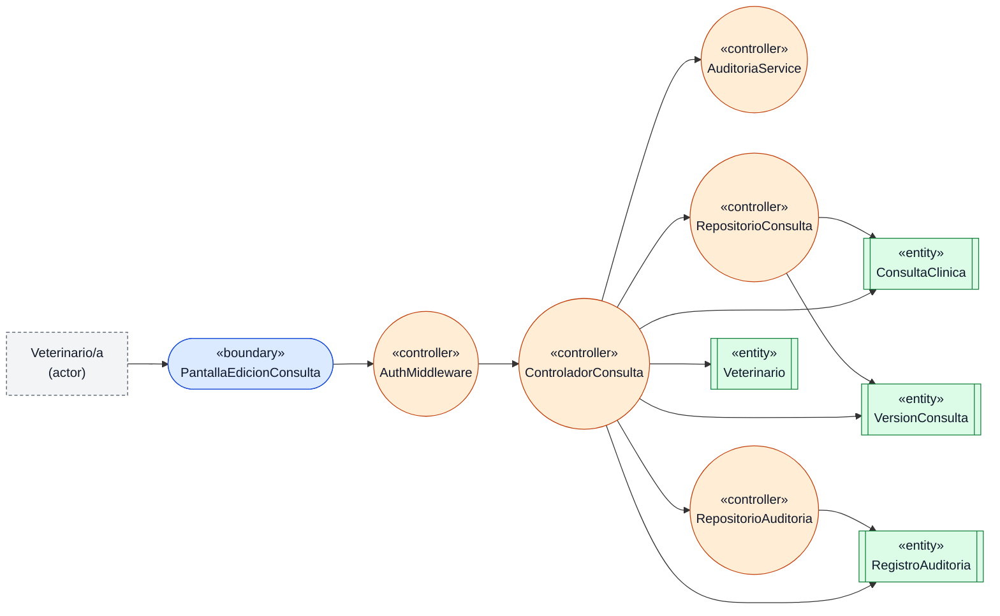
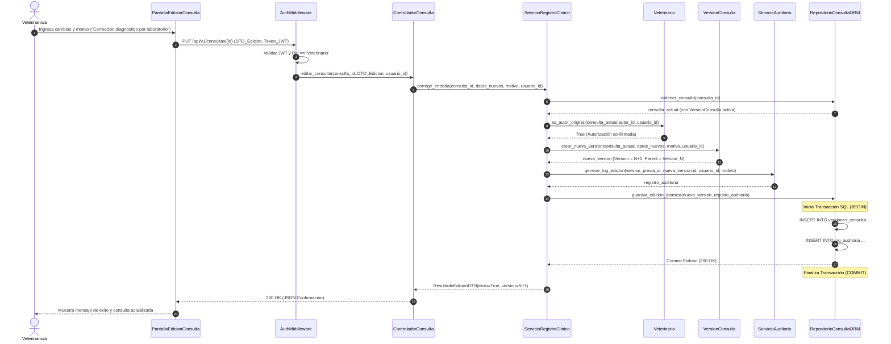
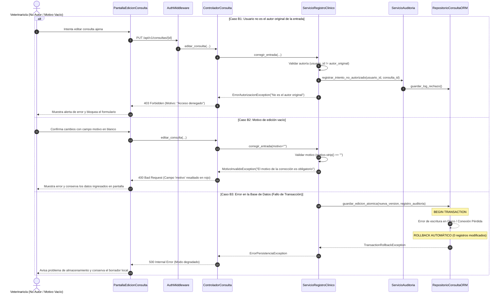
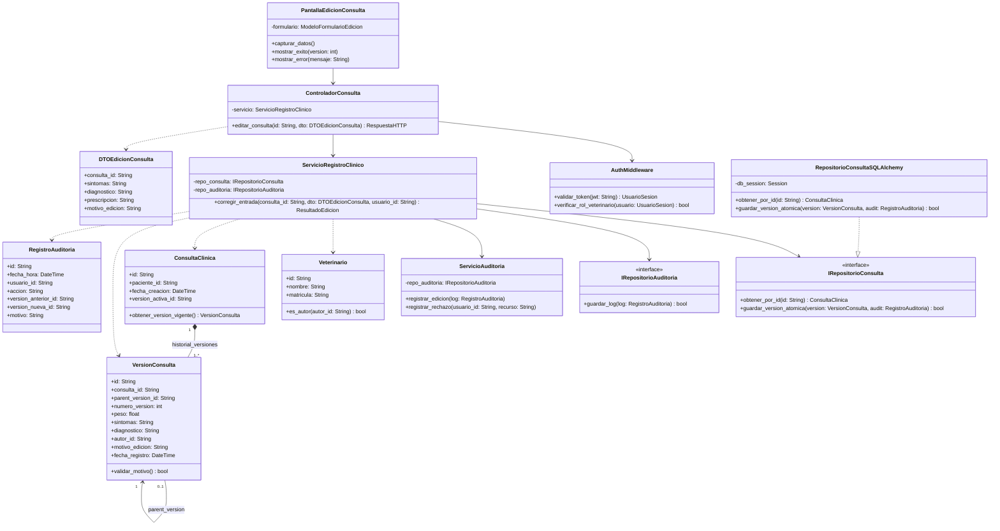

# Documento de Diseño Detallado — TP4 (Parte A)
**Asignatura:** Ingeniería del Software 2026 — Trabajo Práctico 4  
**Proceso:** Gestión Clínica e Historial  
**Historia de Usuario:** HU-02 — Edición de Entradas Previas del Historial Clínico  

---

## 1. Introducción

### 1.1 Propósito
El propósito de este documento es especificar el **Diseño Detallado** para la historia de usuario **HU-02 ("Edición de entradas previas del historial clínico")**, perteneciente al proceso central de **Gestión Clínica e Historial**.
**Relevancia de Dominio:** A diferencia de un alta simple de datos, la HU-02 exige lógica de dominio compleja: validación de autoría, inalterabilidad legal de registros clínicos, versionado de entidades mediante enlaces jerárquicos y persistencia atómica transaccional con bitácora de auditoría.

A partir de la arquitectura ya definida, se detallan las tres dimensiones de la HU (funcionalidad, estructura y calidad), los modelos de análisis (diagrama de robustez), los modelos dinámicos (diagramas de secuencia), el modelo estático (diagrama de clases con criterios GRASP) y las matrices de trazabilidad y verificación de coherencia.

---

### 1.2 Historia de Usuario Elegida: HU-02
- **Identificador:** HU-02 (derivada de CU-01 "Registrar Atención y Evolución Clínica", Slice A2).
- **Nombre:** Edición de entradas previas del historial clínico.
- **Enunciado:**
  > **Como** médico/a veterinario/a,  
  > **quiero** corregir una entrada previa de la historia clínica que haya registrado de mi autoría,  
  > **para** mantener la información clínica actualizada sin perder la trazabilidad de los cambios.

---

### 1.3 Criterios de Aceptación (Given-When-Then)
1. **Flujo de Éxito (Edición y Versionado):**
   - **Given:** El/la veterinario/a inició sesión y seleccionó una entrada de la historia clínica de su autoría.
   - **When:** Modifica la información de la entrada, ingresa el motivo de la corrección y confirma la operación.
   - **Then:** El sistema verifica que el usuario tenga permisos para realizar la corrección y que sea el autor original de la entrada; valida que el motivo no esté vacío; conserva la versión original y crea una nueva versión vinculada con la anterior.
   - **And:** El sistema registra en la auditoría el autor de la corrección, la fecha y hora, la versión anterior, la nueva versión y el motivo informado.
   - **And:** La nueva versión y el registro de auditoría se guardan en una única transacción. Si la operación falla, no se confirma ninguno de los dos cambios.
   - **And:** El historial muestra la entrada como modificada, sin eliminar ni sobrescribir la versión original.

2. **Flujos de Rechazo:**
   - **And (Rechazo por falta de motivo o autorización):** Si el motivo está vacío o el usuario no es el autor original / carece de permisos de rol clínico, la operación se rechaza, se registra el intento fallido en auditoría y no se modifica el historial.
---

### 1.4 Siglas y Acrónimos
- **ACID:** Atomicidad, Consistencia, Aislamiento y Durabilidad (Atomicity, Consistency, Isolation, Durability).
- **API:** Interfaz de Programación de Aplicaciones (Application Programming Interface).
- **C4:** Modelo de arquitectura Contexto, Contenedores, Componentes y Código.
- **DA:** Decisión de Arquitectura.
- **DTO:** Objeto de Transferencia de Datos (Data Transfer Object).
- **EC:** Escenario de Calidad.
- **GRASP:** Patrones de Software Generales para Asignación de Responsabilidades (General Responsibility Assignment Software Patterns).
- **GWT:** Esquema Given-When-Then para Criterios de Aceptación.
- **HU:** Historia de Usuario.
- **MVC:** Modelo-Vista-Controlador.
- **ORM:** Mapeo Objeto-Relacional (Object-Relational Mapping).
- **RBAC:** Control de Acceso Basado en Roles (Role-Based Access Control).
- **REST:** Transferencia de Estado Representacional (Representational State Transfer).

---

## 2. Relación con la Arquitectura

### 2.1 Tabla de Coherencia con el TP3

| Dimensión | Contenido de la HU-02 | Referencia TP3 |
| :--- | :--- | :--- |
| **Funcionalidad** | Edición corregida de entrada clínica previa; validación de autoría y motivo obligatorio; creación de nueva versión y registro en auditoría. | CU-01 Slice A2, RF-08, RF-01 a RF-05. |
| **Estructura** | Contenedores `Interfaz Web` y `Backend API REST`. Capas: Presentación (`ControladorConsulta`), Servicios (`ServicioRegistroClinico`), Datos (`RepositorioConsultaSQLAlchemy`, `RepositorioAuditoriaSQLAlchemy`). | `arquitectura.md` (Secc. 6 y 7). |
| **Calidad** | **EC-04** (Responsabilidad / Auditoría): 100% de ediciones reconstruibles. **EC-02** (Integridad): rechazo de accesos no autorizados. **EC-03** (Recuperación): transacciones atómicas. | `quality-scenarios.md`, `arquitectura.md` (Secc. 4). |
| **Tácticas & Decisiones** | Táctica *Registro de Auditoría* + *Versionado Inmutable* + *Transacciones SQL*. Respaldado por **DA-06**, **DA-03** y **DA-02**. | `arquitectura.md` (Secc. 5 y 9). |
| **Dominio** | Entidades `Veterinario`, `ConsultaClinica`, `VersionConsulta` y `RegistroAuditoria`. | `modelo_de_dominio_inicial.md`. |
| **Verificación** | Pruebas de integración atómicas: simulación de edición válida, rechazo por autor ajeno, rechazo por motivo vacío y rollback por error de persistencia. | `arquitectura.md` (Secc. 5.5). |

---

### 2.2 Componentes y Capas Atravesadas

```
[ Contenedor: Interfaz Web ]
  └── Capa Presentación Cliente: VistaHistoriaClinica -> ControladorPantallaEdicion -> ModeloFormularioEdicion

[ Contenedor: Backend API REST ]
  ├── Capa Presentación HTTP: AuthMiddleware -> ConsultaController (Flask Route)
  ├── Capa Servicios (Lógica): ServicioRegistroClinico -> ValidacionRegistroClinico
  └── Capa Datos e Integración: RepositorioConsultaORM -> RepositorioAuditoriaORM

[ Contenedor: Base de Datos PostgreSQL ]
  └── Tablas: consultas_versionadas, log_auditoria
```

---

## 3. Diseño de la HU

### 3.1 Entidades del Modelo de Dominio Intervinientes

Entidades involucradas en HU-02:

| Entidad del Modelo (TP1) | ¿Interviene? | Qué usa la HU-02 de ella | Tipo de Operación |
| :--- | :--- | :--- | :--- |
| **Veterinario** | **Sí** | Identificador de usuario, rol clínico y verificación de autoría de la consulta original. | Consulta |
| **ConsultaClinica** | **Sí** | Identificador único de atención clínica, paciente asociado y puntero a la versión activa vigente. | Consulta y Modificación (puntero a versión) |
| **VersionConsulta** | **Sí** | Datos clínicos (peso, síntomas, diagnóstico, prescripción), número de versión, versión padre, autor y motivo de edición. | **Crea** (nueva versión inmutable) |
| **RegistroAuditoria** | **Sí** | Evento de edición/rechazo, ID de versión previa, ID de versión nueva, usuario, timestamp y motivo. | **Crea** (inserción append-only) |
| **Paciente / Mascotas** | **Sí** | Identificador y validación de contexto para recuperar la historia clínica. | Consulta |
| **Tutor / Dueño** | No | Los datos del tutor no intervienen en el flujo de edición clínica. | — |
| **Turno / Pago** | No | Módulo administrativo fuera del alcance de la HU-02. | — |

**Actualización al Modelo de Dominio del TP1:** Para soportar el requerimiento de versionado inmutable (**DA-06**), la entidad `ConsultaClinica` se descompone en una cabecera (`ConsultaClinica`) y una lista de versiones inmutables (`VersionConsulta`), enlazadas mediante `parent_version_id`.

---

### 3.2 Análisis Tridimensional

```
                             ┌──────────────────────────────────────────────────────────┐
                             │               ANÁLISIS TRIDIMENSIONAL HU-02              │
                             └────────────────────────────┬─────────────────────────────┘
                                                          │
         ┌────────────────────────────────────────────────┼────────────────────────────────────────┐
         │                                                │                                        │
         ▼                                                ▼                                        ▼
┌────────────────────────────────┐            ┌────────────────────────────────┐       ┌────────────────────────────────┐
│   DIMENSIÓN FUNCIONALIDAD      │            │     DIMENSIÓN ESTRUCTURA       │       │      DIMENSIÓN CALIDAD         │
├────────────────────────────────┤            ├────────────────────────────────┤       ├────────────────────────────────┤
│ • Criterio 1: Edición válida   │            │ • Frontera: PantallaEdicion    │       │ • EC-04 (Responsabilidad):     │
│   crea versión vinculada y     │            │ • Control: ControladorConsulta │       │   100% ediciones auditables    │
│   guarda motivo obligatorio.   │            │   + AuthMiddleware             │       │   con autor, fecha y motivo.   │
│ • Criterio 2: Rechazo por      │            │ • Servicios: ServicioRegistro  │       │ • EC-02 (Integridad):          │
│   motivo vacío o autoría       │            │   Clinico + AuditoriaService   │       │   Verificación estricta de     │
│   inválida sin alterar datos.  │            │ • Dominio: VersionConsulta +   │       │   autoría y rol en backend.    │
│ • Criterio 3: Inalterabilidad  │            │   RegistroAuditoria            │       │ • EC-03 (Recuperación):        │
│   de versiones previas.        │            │ • Persistencia: Repositorios   │       │   Transacción SQL atómica.     │
└────────────────────────────────┘            └────────────────────────────────┘       └────────────────────────────────┘
```

---

### 3.3 Diagrama de Robustez

El diagrama de robustez (ICONIX / Jacobson) analiza la lógica de la HU-02 verificando las reglas de conexión: los actores solo interactúan con pantallas (boundaries), las pantallas solo llaman a controladores (controllers), los controladores coordinan y acceden a las entidades (entities), y las entidades no se acceden directamente desde las fronteras.



---

### 3.4 Ubicación de Reglas de Negocio

| Regla de Negocio | Dónde Vive (Capa / Elemento) | Justificación GRASP / Arquitectura |
| :--- | :--- | :--- |
| **RN-01: Verificación de Autoría** | `ServicioRegistroClinico` / `Veterinario` | **Experto en Información**: El servicio verifica que el `usuario_id` autenticado coincida exactamente con el `autor_id` de la última versión activa de la consulta. |
| **RN-02: Motivo Obligatorio No Vacío** | `VersionConsulta` (Entidad de Dominio) | **Alta Cohesión / Validador de Dominio**: La entidad rechaza su propia construcción si el string de `motivo_edicion` es nulo o contiene solo espacios. |
| **RN-03: Inalterabilidad y Versionado Enlazado** | `VersionConsulta` / `ConsultaClinica` | **Information Expert**: La versión previa no se modifica. Se crea una instancia con `numero_version = version_anterior + 1` y `parent_version_id = version_anterior.id`. |
| **RN-04: Transaccionalidad Atómica (Atomicity)** | `AccesoADatosORM` (`UnitOfWork`) | **DA-03 / EC-03**: La inserción de la nueva `VersionConsulta` y del `RegistroAuditoria` se ejecutan dentro del mismo bloque `BEGIN TRANSACTION ... COMMIT`. Si falla la auditoría, se ejecuta `ROLLBACK`. |
| **RN-05: Sanitización e Inmutable de Auditoría** | `ServicioAuditoria` | **Seguridad / Separación de Entidades**: El log de auditoría se guarda en una tabla append-only inaccesible para modificaciones por API. |

---

### 3.5 Diagramas de Secuencia

#### Secuencia A: Camino de Éxito (Edición Versionada Atómica con Auditoría)



---

#### Secuencia B: Caminos de Rechazo (Autoría Inválida / Motivo Vacío / Rollback)



---

### 3.6 Asignación de Responsabilidades (Criterios GRASP)

| Responsabilidad | Clase Asignada | Criterio GRASP Aplicado | Justificación de Diseño |
| :--- | :--- | :--- | :--- |
| **Verificar token y rol de usuario** | `AuthMiddleware` | **Protector de Variaciones / Low Coupling** | Aísla la verificación HTTP/JWT de la lógica clínica. |
| **Coordinar el flujo de edición** | `ControladorConsulta` | **Controller (Controlador)** | Recibe DTOs HTTP, delega al servicio y retorna respuestas JSON. |
| **Orquestar el versionado y auditoría** | `ServicioRegistroClinico` | **High Cohesion (Alta Cohesión)** | Concentra la lógica de aplicación sin acoplarse a frameworks de persistencia. |
| **Validar que el motivo no esté vacío** | `VersionConsulta` | **Information Expert (Experto)** | La propia clase conoce el estado de sus atributos y valida su consistencia. |
| **Crear la versión N+1 enlazada** | `VersionConsulta` | **Creator (Creador)** | Conoce los atributos de la versión previa (`parent_version_id`) y genera el nuevo número de versión. |
| **Garantizar la atomicidad SQL** | `RepositorioConsultaORM` | **Pure Fabrication (Fabricación Pura)** | Abstrae el manejo de `session.commit()` y `session.rollback()` de SQLAlchemy. |

---

## 4. Modelo de Clases

### 4.1 Diagrama de Clases (Mermaid)



---

### 4.2 Detalle de Clases, Interfaces y DTOs

1. **`PantallaEdicionConsulta` (UI / Boundary):** Formulario web que captura los cambios y preserva el estado en cliente si ocurre un fallo.
2. **`ControladorConsulta` (API Controller):** Recibe las solicitudes HTTP PUT, convierte los datos en DTOs e invoca la capa de servicio.
3. **`ServicioRegistroClinico` (Application Service):** Contiene la regla de orquestación de la edición de entradas clínicas.
4. **`VersionConsulta` (Domain Entity):** Representa el estado inmutable de una consulta en la versión $N$. Garantiza que `motivo_edicion` no esté vacío.
5. **`IRepositorioConsulta` (Puerto / Interfaz):** Abstrae la persistencia física, definiendo el contrato para guardados atómicos.
6. **`RepositorioConsultaSQLAlchemy` (Adaptador ORM):** Implementa el contrato SQL gestionando las transacciones ACID con `commit` y `rollback`.

---

## 5. Justificación del Diseño

### 5.1 Criterios GRASP Aplicados

- **Information Expert (Experto en Información):**
  - Asignado a `VersionConsulta` para validar sus propios atributos (`motivo_edicion`) y calcular el siguiente `numero_version`.
  - Asignado a `Veterinario` para validar la coincidencia de autoría entre el token y el registro.
- **Creator (Creador):**
  - `ServicioRegistroClinico` crea las instancias de `VersionConsulta` y `RegistroAuditoria` porque tiene los datos necesarios reunidos.
- **Controller (Controlador):**
  - `ControladorConsulta` actúa como primer punto de entrada no-UI para coordinar la ejecución del caso de uso.
- **Low Coupling (Bajo Acoplamiento):**
  - La capa de servicios depende de interfaces abstractas (`IRepositorioConsulta`), lo que permite intercambiar SQLAlchemy por repositorios en memoria durante los tests unitarios.
- **High Cohesion (Alta Cohesión):**
  - Las funciones de auditoría se delegan a `ServicioAuditoria`, evitando contaminar la clase de negocio con detalles del log.
- **Polymorphism / Indirection (Polimorfismo e Indirección):**
  - El uso de interfaces de repositorio desacopla el dominio de la infraestructura de base de datos relacional.

---

### 5.2 Decisiones Locales y Patrones de Diseño

1. **Patrón DTO (Data Transfer Object):** `DTOEdicionConsulta` desacopla la estructura JSON que envía el cliente web de los objetos del dominio.
2. **Patrón Append-Only Versioning:** Para responder a **EC-04 (DA-06)**, no se utiliza la sentencia SQL `UPDATE` sobre los datos clínicos de la consulta; únicamente se ejecutan `INSERT` de nuevas versiones.
3. **Patrón Unit of Work (vía ORM Session):** Garantiza que la escritura de la versión y el log de auditoría compartan la misma transacción atómica de base de datos (**EC-03 / DA-03**).

---

## 6. Coherencia y Trazabilidad

### 6.1 Tabla de Verificación de Coherencia

| Verificación | ¿Se cumple? | Evidencia en el Documento |
| :--- | :---: | :--- |
| **1. Cada participante de la secuencia pertenece a un componente C4** | **Sí** | `AuthMiddleware` $
ightarrow$ Auth/RBAC; `ControladorConsulta` $
ightarrow$ Controladores REST; `ServicioRegistroClinico` $
ightarrow$ Servicio Registro; `RepositorioORM` $
ightarrow$ Acceso a Datos. |
| **2. Mensajes inter-componentes existen en catálogo TP3** | **Sí** | `PUT /api/v1/consultas` (HTTPS/JSON); Invocación interna entre Servicios; `INSERT/SQL` hacia PostgreSQL. |
| **3. Respeta restricciones del estilo y patrones del TP3** | **Sí** | Respeta la arquitectura en **Capas** (las dependencias van solo hacia abajo, sin saltos) y el estilo **Repositorio**. |
| **4. Táctica de calidad aparece como operación explícita** | **Sí** | Táctica *Auditoría* y *Versionado Inmutable* en paso 7 de Secuencia A (`generar_log_edicion`) y paso 9 (`guardar_version_atomica`). |
| **5. Entidades del diagrama de robustez están en el modelo TP1** | **Sí** | `Veterinario`, `ConsultaClinica`, `VersionConsulta` y `RegistroAuditoria` figuran en el modelo del TP1 y Secc. 3.1. |
| **6. Medida del escenario se verifica con pruebas** | **Sí** | Medida de **EC-04** (100% de ediciones reconstruibles) verificada mediante pruebas unitarias e integración en Parte C. |

---

### 6.2 Matriz de Trazabilidad Completa

| Historia de Usuario | Escenario de Calidad | Decisión Arquitectura | Componente C4 (TP3) | Clases de Diseño (TP4) | Archivo de Código (src/) | Caso de Prueba (tests/) |
| :--- | :--- | :--- | :--- | :--- | :--- | :--- |
| **HU-02** (Edición de entrada) | **EC-04** (Responsabilidad) | **DA-06** (Append-Only) | `ServicioRegistroClinico` | `VersionConsulta`, `ServicioRegistroClinico` | `src/domain/version_consulta.py`, `src/services/registro_service.py` | `tests/test_versionado.py::test_crear_version_correcta` |
| **HU-02** (Edición de entrada) | **EC-02** (Integridad) | **DA-02** (RBAC Backend) | `AuthMiddleware` | `AuthMiddleware`, `Veterinario` | `src/middleware/auth.py` | `tests/test_auth.py::test_rechazo_usuario_no_autor` |
| **HU-02** (Edición de entrada) | **EC-03** (Recuperación) | **DA-03** (Transacciones) | `AccesoADatosORM` | `RepositorioConsultaSQLAlchemy` | `src/repositories/consulta_repository.py` | `tests/test_persistencia.py::test_rollback_por_error_auditoria` |
| **HU-02** (Edición de entrada) | **EC-01** (Operabilidad) | **DA-01** (Estado en UI) | `ModeloFormulario` | `PantallaEdicionConsulta`, `DTOEdicionConsulta` | `src/static/js/formulario_edicion.js` | `tests/test_ui.py::test_conservar_borrador_ante_error` |
