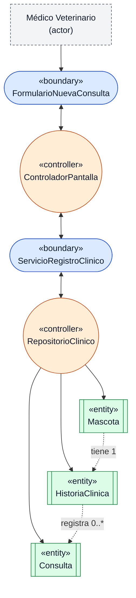
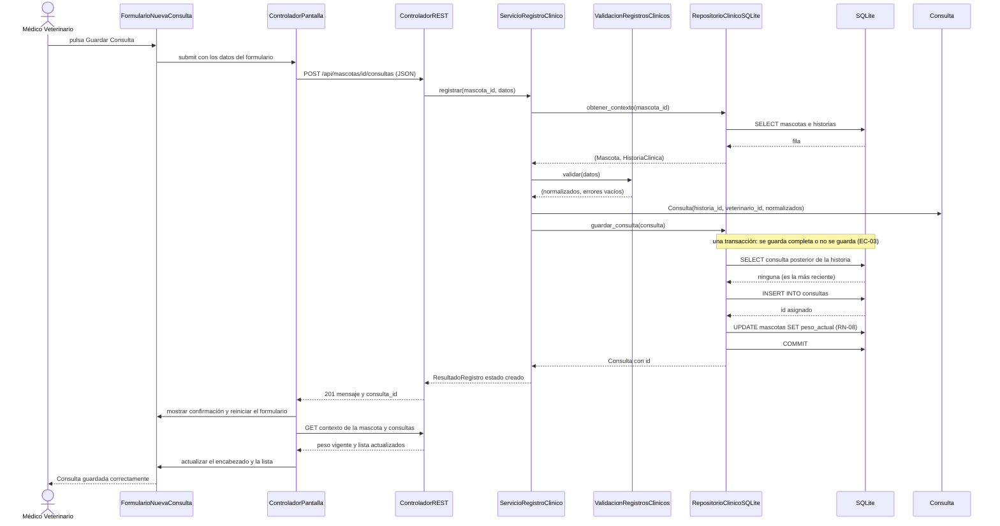
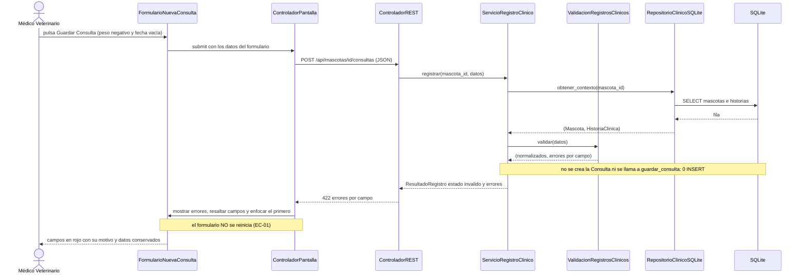
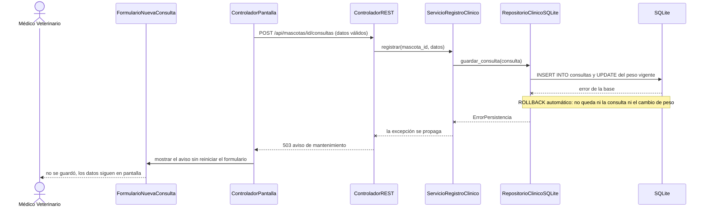
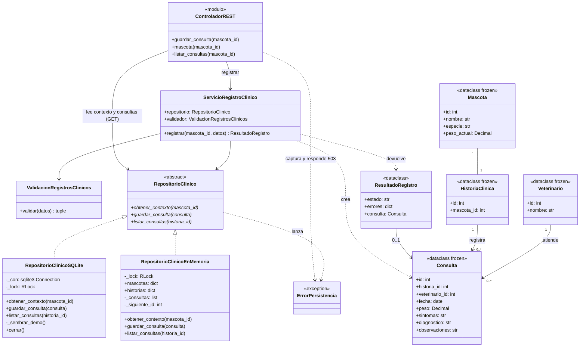

# Documento de Diseño Detallado — TP4

**Asignatura:** Ingeniería del Software 2026 — Trabajo Práctico 4
**Proyecto:** VetGestión — proceso «Gestión Clínica e Historial»
**Historia de usuario (HU):** HU-01 — Manejo de datos obligatorios incompletos o con formato inválido

---

## 1. Introducción

### 1.1 Propósito

Este documento especifica el diseño detallado, la implementación y las pruebas de la historia de usuario **HU-01**. Parte de la arquitectura del TP3 (`arquitectura.md`) y de los requerimientos del TP1 (`slices.md`, `RF.md`) y baja hasta clases, código y pruebas automatizadas.

### 1.2 HU elegida

- **Identificador:** HU-01. Deriva de CU-01 (Registrar Atención y Evolución Clínica), slice A1. Realiza RF-10 y RF-11.
- **Enunciado:** como médico/a veterinario/a, quiero recibir una notificación precisa cuando intento guardar una consulta con campos obligatorios vacíos o datos con formato inválido, para poder corregirlos y asegurar la integridad de la historia clínica sin perder la información cargada.

### 1.3 Por qué se eligió esta HU

HU-01 cumple las tres condiciones de la consigna y, además, es relevante para el proyecto:

| Condición de la consigna | Cómo se cumple |
|---|---|
| Asociada a al menos un escenario de calidad | `EC-01` (Operabilidad): «0 pérdidas de datos ante un error de validación». También toca `EC-03` por el guardado atómico |
| Atraviesa la estructura elegida | Pasa por 8 componentes del TP3 (4 de la interfaz web, con MVC, y 4 de la API clínica, con capas) y por la base de datos central |
| Una decisión de arquitectura la afecta | `DA-02` (interfaz MVC con errores de validación por campo) y `DA-04`/`DA-05` (guardado transaccional) |

Relevancia para el proyecto: es la **puerta de entrada de todo dato clínico**. Si la consulta se acepta con una fecha vacía o un peso negativo, esos datos contaminan la evolución del peso (RF-12) y el historial (RF-07). Además concentra la regla de negocio más repetida del sistema (validar y devolver todos los errores juntos), que el TP3 prevé reutilizar en prescripciones (HU-03).

### 1.4 Siglas

TP: trabajo práctico. HU: historia de usuario. CU: caso de uso. RF: requerimiento funcional. EC: escenario de calidad. DA: decisión de arquitectura. RN: regla de negocio. CP: caso de prueba. CA: criterio de aceptación. MVC: Modelo-Vista-Controlador. GRASP: *General Responsibility Assignment Software Patterns*. API: interfaz de programación de aplicaciones. HTTP/HTTPS: protocolo de la web, sin/con cifrado. REST: estilo de API sobre HTTP. JSON: formato de texto para intercambiar datos. HTML/CSS: lenguajes de las pantallas. SQL: lenguaje de bases relacionales. V(G): complejidad ciclomática. Más en la sección 9.

---

## 2. Relación con la arquitectura

### 2.1 Tabla de coherencia con el TP3

| Dimensión | Contenido |
|---|---|
| **Funcionalidad** | HU-01, de CU-01 slice A1. RF-10: validar formatos y rangos antes de confirmar el almacenamiento. RF-11: informar el campo y el motivo de cada error |
| **Estructura** | Estilo cliente-servidor, con MVC en la interfaz web y capas en la API clínica. Componentes que atraviesa: *Vistas*, *Controladores de pantalla*, *Modelo de formulario*, *Cliente de la API* (interfaz web); *Controladores REST*, *Servicio de registro clínico*, *Validación de registros clínicos*, *Acceso a datos* (API clínica); *Base de datos central*. Componente principal: **Validación de registros clínicos** (capa de servicios) |
| **Calidad** | `EC-01` Operabilidad: tácticas *mantener modelos de tarea, de usuario y del sistema* y *reducir sobrecarga*, respaldadas por `DA-02`. `EC-03` Capacidad de recuperación, solo en la parte de la táctica *transacciones/rollback* (`DA-04`, `DA-05`): una consulta se guarda completa o no se guarda |
| **Dominio** | Entidades que intervienen: `Veterinario`, `Mascota`, `HistoriaClinica`, `Consulta` (sección 3.2) |
| **Verificación** | Para la HU: ingresar peso negativo y/o fecha vacía y comprobar rechazo, campo identificado con su motivo, 0 registros guardados y datos conservados (`CP-05`, `CP-15`, `CP-26`, `CP-55`, `CP-56` y prueba manual `M-01`). Para `EC-01`: errores informados juntos (`CP-14`, `CP-30`, `CP-56`) y 0 pérdidas de datos (`M-01`). La medida de tiempo (≤ 45 s y ≤ 8 interacciones) no es verificable con una prueba unitaria: se mide con una prueba de uso (`M-04`) |

### 2.2 Diferencias entre la implementación y el TP3

Al bajar al código aparecieron diferencias con el TP3. No son errores del grupo: se documentan aquí y deben reflejarse en `arquitectura.md`.

| # | TP3 (`arquitectura.md`) | Implementación de la HU | Motivo y resolución |
|---|---|---|---|
| D1 | «Base de datos central» es PostgreSQL (`DA-04`) | SQLite detrás de la interfaz `RepositorioClinico` | La consigna del TP4 deja libre la persistencia y SQLite no requiere servidor. Pasar a PostgreSQL implica escribir otra implementación del puerto (sección 6.3) sin tocar servicio ni controlador. **Pendiente en el TP3:** aclarar que en el TP4 se usa SQLite |
| D2 | «Autenticación y autorización» verifica el rol antes de cada operación (`DA-03`) | Simulada: el servicio asigna siempre el veterinario 1 | La consigna deja fuera la autenticación real. El rechazo por permisos pertenece a `EC-02`, no a HU-01 |
| D3 | «Gestión de excepciones» es un componente aparte que traduce los fallos | Lo hace el propio controlador REST: captura `ErrorPersistencia` y responde 503 | Un solo caso de fallo en esta HU; un componente aparte sería indirección sin beneficio (R5 del TP3) |
| D4 | El catálogo 7.1.3 solo tiene la relación «Servicio de registro clínico → Acceso a datos: Guarda versiones» | El servicio también **lee** el contexto del paciente (mascota e historia) antes de validar | **Se agrega al catálogo:** «Servicio de registro clínico → Acceso a datos: Lee el contexto del paciente». «Guarda versiones» corresponde a HU-02; para HU-01 es «Guarda la consulta» |
| D5 | Capas estrictas: *Controladores REST → Servicios → Acceso a datos* | Los `GET` (contexto de la mascota y listado de consultas) leen del repositorio sin pasar por un servicio | El «Servicio de consulta de historial» pertenece a CU-02, fuera del alcance de HU-01. Al implementar CU-02, esos `GET` pasan por ese servicio |
| D6 | `DA-02` prevé «controles básicos duplicados en el cliente» | El cliente no valida nada (`novalidate`, sin reglas en `hu01.js`) | Se priorizó una sola autoridad de validación. El sacrificio de duplicar reglas del TP3 (sección 5.5.2) se evita. **Pendiente:** el grupo aceptó el hallazgo H5 del TP2 (marcar los campos `required`); no está aplicado en `nueva_consulta.html`, y para que funcione habría que quitar `novalidate` |

---

## 3. Diseño de la HU

### 3.1 Enunciado y criterios de aceptación

> **Given:** el veterinario está completando el formulario de nueva consulta y escribe un valor negativo en el campo de peso o deja la fecha en blanco.
> **When:** presiona el botón «Guardar Consulta».
> **Then:** el sistema rechaza el almacenamiento, resalta en rojo el campo con error y muestra un mensaje indicando con precisión el motivo del fallo.

Para trazar las pruebas, el criterio se descompone en: **CA-1** peso negativo → rechazo; **CA-2** fecha en blanco → rechazo; **CA-3** el rechazo no almacena nada, identifica el campo con su motivo y lo resalta; y el camino de éxito que da sentido a «corregirlos» (CU-01, pasos 5 a 7).

### 3.2 Entidades del modelo de dominio

Entidades de `modelo_de_dominio_inicial.md` analizadas:

| Entidad del TP1 | ¿Interviene? | Qué usa la HU de ella | La HU la… |
|---|---|---|---|
| `Usuario` | Indirectamente | Identidad del profesional, a través de `Veterinario` | Consulta |
| `Veterinario` | Sí | Profesional que registra la consulta (fijo en el TP4) | Referencia |
| `Mascota` | Sí | Identifica al paciente; aporta el peso anterior que se muestra en pantalla y su peso vigente se actualiza con la consulta más reciente | Consulta y **modifica** (peso vigente) |
| `HistoriaClinica` | Sí | Historial al que se asocia la consulta | Consulta |
| `Consulta` | Sí | Fecha, peso, síntomas, diagnóstico y observaciones que se validan y guardan | **Crea** |
| `Secretaria`, `DuenioMascota`, `Vacuna`, `AplicacionVacuna`, `Turno`, `Prescripcion`, `ReaccionAdversaRegistrada`, `Pago`, `PatologiaReferencia` | No | Ninguna: la HU no gestiona agenda, tutores, vacunas, tratamientos, pagos ni consulta a OMIA | — |

**Cambios al modelo de dominio del TP1 (a aplicar en `modelo_de_dominio_inicial.md`).** La HU necesita datos que el modelo no tiene o nombra distinto:

| Entidad | Cambio | Motivo |
|---|---|---|
| `Consulta` | Agregar `peso` y `observaciones`; el atributo `motivo` pasa a llamarse `sintomas` («Síntomas y motivo» en pantalla) | RF-01 y RF-02. El peso debe validarse y registrarse en la consulta |
| `Consulta` | `tratamiento` no se usa en HU-01 | Pertenece a prescripciones (HU-03) |
| `Mascota` | Agregar `pesoActual` | La pantalla muestra «Peso anterior» como referencia (`EC-01`) |
| `Veterinario` | Se usa `nombre` (heredado de `Usuario`); `matricula` no interviene | — |
| `HistoriaClinica` | `fechaCreacion` no interviene | — |

### 3.3 Análisis tridimensional

| Elemento | Funcionalidad | Estructura | Calidad |
|---|---|---|---|
| CA-1 peso negativo | Se rechaza el guardado y se informa «El peso debe ser un número mayor a 0 (en kg)» | `Validación de registros clínicos` aplica la regla; `Servicio de registro clínico` corta el flujo | Operabilidad: el motivo es preciso y está junto al campo |
| CA-2 fecha en blanco | Se rechaza y se informa «Indicá la fecha de la consulta» | Ídem | Ídem |
| CA-3 resaltado y mensaje | El campo se pinta en rojo y se muestra su motivo | `Vistas` (HTML/CSS) y `Controladores de pantalla` (`mostrarErrores`) | Operabilidad: foco en el primer campo con error y mensajes asociados con `aria-describedby` |
| Camino de éxito | La consulta se guarda con un identificador, aparece en la lista y el peso vigente de la mascota pasa a ser el de la consulta más reciente (CU-01, paso 6) | `Controladores REST` → `Servicio` → `Acceso a datos` → `Base de datos central` | `EC-03`: se guarda completa o no se guarda (transacción) |
| `EC-01` Operabilidad | — | `Modelo de formulario`: el formulario no se borra en un rechazo. `Validación`: todos los errores en una sola pasada | **Condiciona decisiones:** `DA-02` (conservar el estado en el cliente; errores por campo en una respuesta) |
| `EC-03` Capacidad de recuperación | — | `Acceso a datos` ejecuta una transacción; `Controladores REST` traducen la caída de la base a un aviso | La falla de la base no deja datos parciales ni un error sin explicación (503) |
| `EC-02` Integridad (autorización) | Fuera de la HU | Fuera del alcance: autenticación simulada (D2) | — |

### 3.4 Diagrama de robustez

Leyenda: círculo punteado = actor; óvalo azul = *boundary* (frontera); círculo naranja = *control*; rectángulo verde = *entity* (entidad). Las flechas dobles indican conversación en ambos sentidos.




**Criterio de simplificación:** el diagrama de robustez representa los elementos principales que intervienen en HU-01, sin mostrar el protocolo HTTP ni las operaciones internas de la API.

`ControladorPantalla` coordina la interacción con el formulario y presenta los errores de validación.

La frontera `ServicioRegistroClinico` representa conceptualmente el acceso a la API clínica. En la implementación, el servicio de registro y el validador son componentes internos del servidor.

`RepositorioClinico` representa el acceso a los datos de las mascotas, sus historias clínicas y consultas.

La relación entre `HistoriaClinica` y `Consulta` se representa para indicar que una historia clínica puede registrar múltiples consultas.

El diagrama es una abstracción del funcionamiento. Los diagramas de secuencia y de clases muestran las operaciones técnicas reales.


**Ubicación de las reglas de negocio**

| Regla | Dónde vive | Justificación |
|---|---|---|
| **RN-01** La fecha es obligatoria y debe ser una fecha válida | `ValidacionRegistrosClinicos` | RF-10; una sola autoridad de validación (`DA-02`) |
| **RN-02** El peso debe ser un número mayor que 0; se acepta coma decimal | `ValidacionRegistrosClinicos` | RF-10 |
| **RN-03** Los síntomas y el diagnóstico son obligatorios | `ValidacionRegistrosClinicos` | RF-10 (campos obligatorios del registro clínico) |
| **RN-04** La fecha no puede ser posterior a hoy | `ValidacionRegistrosClinicos` | Decisión de diseño: una atención registrada no puede ser futura. Interpreta «fechas válidas» de RF-10 |
| **RN-05** Cada error identifica el campo y su motivo; se informan todos juntos | `ValidacionRegistrosClinicos` | RF-11 y táctica *reducir sobrecarga* de `EC-01` |
| **RN-06** Si hay errores no se invoca la persistencia | `ServicioRegistroClinico` | Coordina el caso de uso; evita que un dato inválido llegue al repositorio |
| **RN-07** Ante un rechazo no se borra lo ingresado | `ControladorPantalla` (`hu01.js`) | Táctica *mantener modelos* de `EC-01`: el formulario solo se reinicia tras un guardado exitoso |
| **RN-08** El peso vigente de la mascota es el de su consulta más reciente por fecha; una consulta atrasada no lo pisa | `RepositorioClinico` | CU-01 paso 6. Tiene que ser atómico con el guardado de la consulta (`EC-03`), por eso se ejecuta dentro de la misma transacción. Es una regla de negocio en la capa de datos: ver 5.3 |

Ninguna regla de validación vive en la pantalla (RN-01 a RN-06 y RN-08 se aplican en el servidor; RN-07 solo conserva lo ingresado): el HTML tiene `novalidate` y `hu01.js` solo muestra lo que informa la API.

**Asignación de cada elemento a un componente del TP3**

El componente «Controladores REST» (`src/api/controladores.py`, `app.py`) no tiene elemento propio en la robustez, por lo dicho arriba; su rol se verifica en las secuencias y en la tabla 3.6.

| Elemento del diagrama | Componente del TP3 | Capa o rol | Archivo |
|---|---|---|---|
| `FormularioNuevaConsulta` | Vistas | Interfaz web — Vista MVC | `templates/nueva_consulta.html` |
| `ControladorPantalla` | Controladores de pantalla, Modelo de formulario y Cliente de la API | Interfaz web — Controlador MVC | `static/hu01.js` |
| `ServicioRegistroClinico` | API clínica: Controladores REST, Servicio de registro clínico y Validación de registros clínicos | Boundary de la API en la robustez simplificada | `src/api/controladores.py`, `src/aplicacion/servicio_registro.py`, `src/aplicacion/validacion.py` |
| `RepositorioClinico` | Acceso a datos | Datos e integración | `src/infraestructura/repositorios.py` |
| `Mascota` | Modelo de dominio | Entidad | `src/dominio/entidades.py` |
| `HistoriaClinica` | Modelo de dominio | Entidad | `src/dominio/entidades.py` |
| `Consulta` | Modelo de dominio | Entidad | `src/dominio/entidades.py` |

### 3.5 Diagramas de secuencia
Los diagramas de secuencia detallan el funcionamiento interno de la API clínica que se representa de forma simplificada en la robustez.

Por eso incluyen `ControladorREST`, `ValidacionRegistrosClinicos`, `RepositorioClinicoSQLite` y SQLite.

Se presentan los recorridos de registro exitoso, rechazo por datos inválidos y falla de persistencia. Los dos primeros corresponden directamente al comportamiento de HU-01.


#### 3.5.1 Secuencia A — Guardado exitoso



#### 3.5.2 Secuencia B — Rechazo por datos inválidos (criterio de aceptación)

Cubre las dos causas del criterio (peso negativo y fecha en blanco) y cualquier otro campo inválido: la validación recorre todos los campos y los informa juntos, de modo que no hay una secuencia distinta por causa.



#### 3.5.3 Secuencia C — Falla de la base al guardar (`EC-03`)

No la exige el criterio de aceptación de HU-01; cubre la táctica *transacciones y rollback* de `EC-03` (`DA-04`, `DA-05`).



#### 3.5.4 Otros caminos del controlador

| Situación | Respuesta | Quién decide |
|---|---|---|
| El cuerpo no es un objeto JSON | 400 | `ControladorREST` |
| La mascota no existe | 404 (se resuelve antes de validar) | `ServicioRegistroClinico` informa `no_encontrado`; `ControladorREST` traduce |

#### 3.5.5 Cómo se ven las tácticas de calidad

| Táctica (escenario) | Operación o mensaje que la muestra | Evidencia |
|---|---|---|
| *Mantener modelos de tarea, de usuario y del sistema* (`EC-01`, `DA-02`) | En el rechazo, `ControladorPantalla` muestra los errores y **no** reinicia el formulario; solo lo reinicia tras un 201 | 0 pérdidas de datos (`M-01`); el servidor además no guarda nada (`CP-26`, `CP-55`) |
| *Reducir sobrecarga* (`EC-01`) | Una sola llamada `validar(datos)` devuelve **todos** los errores | `CP-14`, `CP-30`, `CP-56` |
| *Transacciones y rollback* (`EC-03`, `DA-04`) | `guardar_consulta` ejecuta el `INSERT` y el `UPDATE` del peso vigente dentro de una transacción; ante un fallo se deshacen los dos | `CP-46`, `CP-47` |
| *Degradación controlada* (`EC-03`, `DA-05`) | Ante `ErrorPersistencia`, el controlador responde 503 con un aviso y el formulario conserva lo cargado | `CP-59`, `M-05` |

**Verificación contra el catálogo de relaciones del TP3.** Cada mensaje entre componentes distintos existe en el catálogo 7.1.3 / 7.2.3 de `arquitectura.md`, con las excepciones D4 y D5 de la sección 2.2: Vistas → Controladores de pantalla («Notifica acciones»); Controladores de pantalla → Cliente de la API («Pide enviar»); Cliente de la API → Controladores REST («Envía solicitudes», JSON/HTTPS); Controladores REST → Servicio de registro clínico («Invoca»); Servicio → Validación («Valida»); Servicio → Acceso a datos; Acceso a datos → Base de datos central («Lee y escribe», SQL).

### 3.6 Asignación de responsabilidades (GRASP)

| Responsabilidad | Quién | Criterio GRASP | Por qué |
|---|---|---|---|
| Captar los datos y mostrar errores resaltados o la confirmación | `FormularioNuevaConsulta` | Bajo acoplamiento | Solo conoce al controlador de pantalla; no decide qué es inválido |
| Enviar el formulario, conservar lo ingresado y mostrar errores | `ControladorPantalla` | Controlador | Recibe el evento de la pantalla y lo coordina; implementa el *Modelo de formulario* de `EC-01` |
| Traducir HTTP/JSON a una llamada de caso de uso y armar la respuesta (201, 400, 404, 422, 503) | `ControladorREST` | Controlador | Es la entrada de la API clínica; no contiene reglas de negocio |
| Coordinar el caso de uso: obtener el contexto, validar, crear y guardar la consulta | `ServicioRegistroClinico` | Controlador (de caso de uso) | Ordena los pasos y corta si hay errores (RN-06) |
| Crear la `Consulta` | `ServicioRegistroClinico` | Creador | Es quien tiene los datos de inicialización (los campos normalizados y el identificador de la historia) |
| Aplicar las reglas RN-01 a RN-05 y armar los errores por campo | `ValidacionRegistrosClinicos` | Fabricación pura y alta cohesión | No corresponde a un concepto del dominio; su única tarea es validar. El TP3 la define como componente reutilizable por prescripciones |
| Resumir el resultado (`creado`, `invalido`, `no_encontrado`) | `ResultadoRegistro` | Bajo acoplamiento | El servicio no depende de HTTP: devuelve un valor y el controlador lo traduce. El rechazo es un flujo esperado, no una excepción |
| Obtener el contexto y guardar consultas sin que el servicio sepa cómo | `RepositorioClinico` (interfaz) | Variaciones protegidas, polimorfismo, bajo acoplamiento | Aísla al servicio del motor de base de datos |
| Guardar la consulta y actualizar el peso vigente de la mascota en una sola transacción | `RepositorioClinico` | Experto en información | Es quien conoce los datos persistidos y puede garantizar que los dos cambios ocurran juntos o ninguno (RN-08, `EC-03`) |
| Persistir en SQLite y convertir `date` y `Decimal` ↔ `TEXT` | `RepositorioClinicoSQLite` | Fabricación pura | Concentra el conocimiento de SQL |
| Persistir en memoria (doble de prueba) | `RepositorioClinicoEnMemoria` | Polimorfismo | Misma interfaz; permite cambiar la implementación sin tocar el servicio |
| Señalar que la base falló | `ErrorPersistencia` | Variaciones protegidas | Evita que el servicio y el controlador conozcan `sqlite3` |
| Saber su historia clínica | `Mascota` y `HistoriaClinica` | Experto en información (limitado) | La relación 1 a 1 está en `HistoriaClinica.mascota_id` y en la tabla (`UNIQUE`) |

---

## 4. Modelo de clases

### 4.1 Diagrama obtenido del código



Las clases `ControladorPantalla` y `FormularioNuevaConsulta` no aparecen: son JavaScript y HTML (`hu01.js`, `nueva_consulta.html`), no clases de Python.

### 4.2 Validación contra la robustez y las secuencias

| # | Diferencia entre el diseño inicial y el código | Resolución |
|---|---|---|
| V1 | El diseño inicial separaba `RepositorioMascotas` y `RepositorioClinico`; el código tiene un único puerto `RepositorioClinico` | Se actualizó el diseño: un puerto con tres operaciones alcanza para la HU y mantiene alta cohesión |
| V2 | El diseño inicial usaba una excepción `DatosInvalidosError` y un contenedor `ErroresPorCampo`; el código devuelve `(normalizados, errores)` y un `ResultadoRegistro` con estado | Se actualizó el diseño: un dato inválido es un flujo esperado, no una excepción. Solo la falla de la base es excepcional (`ErrorPersistencia`) |
| V3 | El diseño inicial hacía que `HistoriaClinica` creara la consulta (Creador) | Se actualizó el diseño: la crea `ServicioRegistroClinico`, que tiene los datos de inicialización (tabla 3.6) |
| V4 | El diseño inicial decía que `Consulta` decidía si fecha y peso son válidos | Se actualizó el diseño: lo decide `ValidacionRegistrosClinicos` (componente del TP3). Ver sección 5.3 |
| V5 | El diseño inicial tenía `AutenticacionAutorizacion` y `GestionExcepciones` como participantes | Se quitaron de las secuencias: son los casos D2 y D3 de la sección 2.2 |
| V6 | El código no tiene una clase `ControladorREST`: son funciones dentro de `crear_api` | Se representa como módulo en el diagrama; en las secuencias es el participante «ControladorREST» |
| V10 | La robustez presenta una API simplificada, mientras que el código separa controlador REST, servicio y validador | Se utilizan distintos niveles de detalle. La robustez representa el recorrido conceptual y las secuencias muestran las operaciones reales de la implementación. |
| V7 | Los `GET` del controlador usan el repositorio directamente | Diferencia D5 de la sección 2.2 |
| V8 | El servicio lee el contexto antes de validar (un 404 prevalece sobre un 422) | Las secuencias A y B ya lo reflejan; relación D4 |
| V9 | El diseño anterior no mostraba que `guardar_consulta` también actualiza el peso vigente (CU-01, paso 6); el código lo hace en la misma transacción | Se actualizó la secuencia A, la regla RN-08 y la tabla GRASP. El encabezado de la pantalla se vuelve a consultar tras guardar |

Todo lo que aparece en el diagrama de clases tiene respaldo en las secuencias, con dos excepciones explicadas: `RepositorioClinicoEnMemoria`, que sustituye a `RepositorioClinicoSQLite` en las pruebas sin cambiar ninguna secuencia (sección 5.2), y `Veterinario`, que solo se referencia por su identificador porque la autenticación está simulada (D2).

---

## 5. Justificación del diseño

### 5.1 Responsabilidad por clase

Ver la tabla 3.6. La idea central: **el servicio coordina, la validación decide, el repositorio persiste, el controlador traduce**. Ninguna capa conoce los detalles de otra más allá de su interfaz.

### 5.2 Decisiones de diseño

| Decisión | Motivo |
|---|---|
| Interfaz `RepositorioClinico` con dos implementaciones | El controlador y el servicio no cambian al pasar de memoria a SQLite (o a PostgreSQL). Se demuestra con las pruebas de contrato `CP-32` a `CP-42`, que corren sobre las dos implementaciones |
| Inyección de dependencias por constructor (`ServicioRegistroClinico(repositorio, validador)` y `crear_app(repositorio)`) | Permite sustituir la persistencia y usar dobles en las pruebas sin parches |
| `ResultadoRegistro` en lugar de excepciones para los rechazos | Un rechazo por validación es el flujo habitual de la HU; el código del controlador queda lineal |
| `ErrorPersistencia` propia | Los niveles superiores no dependen de `sqlite3`; cambiar de motor no cambia los `except` |
| La validación devuelve todos los errores en una pasada | Táctica *reducir sobrecarga* de `EC-01` |
| Entidades como `dataclass(frozen=True)` | Inmutables: un dato validado no se altera después |
| Peso y fecha almacenados como `TEXT` en SQLite | Evita convertir el peso a punto flotante; ver 6.2 |
| El peso vigente se actualiza dentro de `guardar_consulta` | Garantiza que consulta y peso vigente cambian juntos o ninguno (`EC-03`) sin exponer transacciones al servicio |

### 5.3 Sacrificios asumidos

- **Entidades sin comportamiento.** Las entidades son contenedores de datos y las reglas viven en `ValidacionRegistrosClinicos`. Se asume porque el TP3 define la validación como un componente de la capa de servicios que `HU-03` (prescripciones) también usa; ponerla en `Consulta` obligaría a duplicarla. El costo es un dominio más «anémico». Alternativa descartada: que `Consulta` valide sus propios datos y la validación solo delegue.
- **Autenticación simulada** (D2): el servicio fija `veterinario_id = 1`. Es un acoplamiento a un valor fijo que desaparece al incorporar `EC-02`.
- **Una regla de negocio en la capa de datos** (RN-08): decidir cuál es la consulta más reciente y actualizar el peso vigente vive en el repositorio y se duplica en sus dos implementaciones (memoria y SQLite). Se acepta para conservar la atomicidad sin transacciones en el servicio; el costo es que una tercera implementación debe repetirla. Las pruebas de contrato `CP-39` a `CP-41` corren sobre ambas y detectan una implementación que no la cumpla.
- **Sin validación en el cliente** (D6): cada rechazo cuesta una ida y vuelta al servidor, a cambio de una sola autoridad.

### 5.4 Patrones de diseño

- **Repositorio** (*Repository*): resuelve el acceso a datos detrás de una interfaz de colección. En el diagrama: `RepositorioClinico` y sus dos implementaciones. No debe confundirse con el *estilo* repositorio del TP3 (almacén de datos compartido).
- **Inyección de dependencias:** descrita en 5.2.

---

## 6. Implementación

### 6.1 Estructura del código

```
app.py                                 punto de entrada (crear_app, rutas de pantalla)
requirements.txt                       Flask
requirements-test.txt                  pytest y pytest-cov
pytest.ini                             pythonpath = .
src/
  api/controladores.py                 ControladorREST (Blueprint /api)
  aplicacion/servicio_registro.py      ServicioRegistroClinico, ResultadoRegistro
  aplicacion/validacion.py             ValidacionRegistrosClinicos
  dominio/entidades.py                 Consulta, Mascota, HistoriaClinica, Veterinario
  infraestructura/repositorios.py      RepositorioClinico, ...SQLite, ...EnMemoria, ErrorPersistencia, _ESQUEMA
templates/nueva_consulta.html          Vista
static/hu01.css, static/hu01.js        estilos y controlador de pantalla
tests/                                 pruebas unitarias; test_hu01.py las corre todas con cobertura
data/vetgestion.db                     base SQLite (se crea sola; no se versiona)
```

### 6.2 Persistencia con SQLite

La persistencia usa **SQLite** detrás de la interfaz `RepositorioClinico`, mediante `RepositorioClinicoSQLite`. Al abrir la base, el repositorio ejecuta el esquema (`_ESQUEMA`, con `CREATE TABLE IF NOT EXISTS`) y, salvo que se pida lo contrario (`sembrar_demo=False`), carga los datos de demostración con `INSERT OR IGNORE`: es **idempotente**, de modo que al reiniciar no pisa los datos existentes ni vuelve a poner el peso de Luna en 6.8 (`CP-45`). Si la carpeta del archivo no existe, se crea.

| Tabla | Contenido inicial |
|---|---|
| `veterinarios` | 1 — Dra. Ana Ríos (profesional fijo de demostración) |
| `mascotas` | 1 — Luna (Perro, 6.8 kg); 2 — Toby (Gato, 4.1 kg) |
| `historias` | Una por mascota (1 → Luna, 2 → Toby) |
| `consultas` | Vacía: la completa la HU |

La relación 1 a 1 entre `Mascota` e `HistoriaClinica` se refleja con `UNIQUE` en `historias.mascota_id` (`CP-49`). Hay un índice sobre `consultas (historia_id, fecha DESC, id DESC)` para el listado.

**Las reglas de validación no se mueven a la base**: viven en `ValidacionRegistrosClinicos`. La base repite solo las más básicas como **última defensa** con `CHECK` (peso mayor que 0, síntomas y diagnóstico no vacíos) y con `NOT NULL` y claves foráneas. Si un dato inválido llegara hasta ahí, se rechaza y se informa como `ErrorPersistencia` en lugar de guardarse (`CP-47`).

| Atributo del dominio | Tipo en Python | SQLite (TP4) | PostgreSQL (TP3, `DA-04`) |
|---|---|---|---|
| `id` | `int` | `INTEGER` (autoincremental) | `INTEGER` / identidad |
| `nombre`, `especie`, `sintomas`, `diagnostico`, `observaciones` | `str` | `TEXT` | `TEXT` / `VARCHAR` |
| `fecha` | `date` | `TEXT` (ISO 8601, `AAAA-MM-DD`) | `DATE` |
| `peso`, `peso_actual` | `Decimal` | `TEXT` | `NUMERIC(6,2)` |

El peso se guarda como `TEXT` porque el tipo `NUMERIC` de SQLite lo convertiría a punto flotante y se perdería la exactitud decimal (`CP-36`). El repositorio convierte al escribir (`isoformat()`, `str`) y al leer (`date.fromisoformat`, `Decimal`), de modo que servicio, validación y entidades siguen usando `date` y `Decimal`.

**Transacción y peso vigente.** `guardar_consulta` abre un bloque `with conexión`: el módulo `sqlite3` confirma al salir y deshace si hay una excepción. Dentro de esa única transacción: (1) comprueba que la historia exista (si no, `ValueError`); (2) busca si hay una consulta de fecha **posterior**; (3) inserta la consulta; (4) si no había una posterior, actualiza `mascotas.peso_actual` con el peso de la consulta nueva (RN-08). Una consulta atrasada, entonces, no pisa el peso de una más nueva (`CP-40`). Cualquier `sqlite3.Error` se traduce a `ErrorPersistencia`, y el rollback deja intactos la consulta y el peso (`CP-46`).

**Una conexión compartida.** Flask atiende en hilos distintos; el repositorio usa una conexión (`check_same_thread=False`) serializada con un `RLock`. Las claves foráneas se activan con `PRAGMA foreign_keys = ON` en **cada conexión** (`CP-48`).

### 6.3 Cómo se reemplazan la persistencia y los servicios externos

- `crear_app(repositorio=None)` recibe el repositorio. Sin argumento usa `RepositorioClinicoSQLite` sobre el archivo de la variable `VETGESTION_DB` (por omisión, `data/vetgestion.db`). En las pruebas se inyecta uno en memoria, uno con fallas (`CP-59`) o uno SQLite descartable (`:memory:`).
- Para pasar a **PostgreSQL** se escribe otra implementación de `RepositorioClinico` que cumpla el mismo contrato (incluida RN-08) y el cambio de tipos de la tabla anterior; `ServicioRegistroClinico` y `ControladorREST` no se modifican. Las pruebas de contrato `CP-32` a `CP-42` sirven para comprobarla.
- HU-01 **no usa servicios externos** (OMIA no interviene), por lo que no hay nada que simular.

### 6.4 Cómo se ejecuta

```bash
pip install -r requirements.txt
python app.py                    # sirve http://127.0.0.1:5000/ (crea data/vetgestion.db la primera vez)
python -m pytest                 # todas las pruebas, sin cobertura
python tests/test_hu01.py        # todas las pruebas + cobertura de líneas y ramas en tests/cobertura/
```

`tests/test_hu01.py` no define pruebas: ejecuta todas las de la carpeta con `pytest-cov` y escribe `tests/cobertura/cobertura.txt` y `tests/cobertura/html/index.html`.

Demostración: abrir `/`, escribir un peso `-2`, borrar la fecha y pulsar «Guardar Consulta». Se muestran los errores bajo cada campo con borde rojo y se conserva todo lo cargado. Corregir y guardar: la consulta aparece en la lista, el encabezado muestra el nuevo peso vigente («Peso anterior» pasa a ser el de la consulta recién guardada, que es la referencia para la próxima) y **todo sigue ahí al reiniciar el servidor**.

---

## 7. Pruebas

### 7.1 Estrategia

- **Caja negra:** partición en clases de equivalencia y valores límite, derivadas de los criterios de aceptación (CA-1, CA-2, CA-3), de RF-10 y RF-11 y de los escenarios `EC-01` y `EC-03`.
- **Caja blanca:** un caso por camino independiente de cada operación de la HU (tabla 7.3).
- **Capas probadas:** validación, servicio, repositorios y controladores REST (con el cliente de pruebas de Flask). **No se prueba a través de la interfaz gráfica.**
- **Contrato de repositorios:** los casos `CP-32` a `CP-42` se ejecutan sobre `RepositorioClinicoEnMemoria` y `RepositorioClinicoSQLite`.
- Cada caso verifica un solo comportamiento y no depende de otro: cada prueba crea su propio repositorio.

### 7.2 Tabla de casos de prueba

Los identificadores `CP-xx` figuran en la documentación de cada prueba de `tests/` (y como `id` en las pruebas parametrizadas).

| ID | Técnica | Origen | Entrada y estado | Resultado esperado | Archivo |
|---|---|---|---|---|---|
| CP-01 | Caja negra (clase inválida) | CA-2, RF-10 | `fecha = ""` | Error solo en `fecha`, con mensaje | `test_validacion` |
| CP-02 | Caja negra | RF-10 | `fecha = "2026-02-31"` (inexistente) | Error en `fecha` | `test_validacion` |
| CP-03 | Valor límite | RF-10, RN-04 | `fecha` = mañana | Error en `fecha` | `test_validacion` |
| CP-04 | Caja negra | RF-10 | `fecha = "15/01/2026"` (no ISO) | Error en `fecha` | `test_validacion` |
| CP-05 | Caja negra | CA-1 | `peso = "-5"` | Error solo en `peso` | `test_validacion` |
| CP-06 | Valor límite | RF-10 | `peso = "0"` | Error en `peso` | `test_validacion` |
| CP-07 | Valor límite | RF-10 | `peso = "-0.01"` | Error en `peso` | `test_validacion` |
| CP-08 | Caja negra | RF-10 | `peso = "texto"` | Error en `peso` | `test_validacion` |
| CP-09 | Caja negra | RF-10 | `peso = "NaN"` | Error en `peso` | `test_validacion` |
| CP-10 | Caja negra | RF-10 | `peso = "Infinity"` | Error en `peso` | `test_validacion` |
| CP-11 | Caja negra | RF-10 | `peso = ""` | Error en `peso` | `test_validacion` |
| CP-12 | Caja negra | RF-10 | `sintomas = "   "` | Error en `sintomas` | `test_validacion` |
| CP-13 | Caja negra | RF-10 | `diagnostico = ""` | Error en `diagnostico` | `test_validacion` |
| CP-14 | Caja negra | `EC-01`, RF-11 | Campos ausentes (`{}`) y valores nulos | Cuatro errores en una sola respuesta | `test_validacion` |
| CP-15 | Caja negra | CA-1 y CA-2 | `fecha = ""` y `peso = "-5"` a la vez | Errores en `fecha` y `peso`, solo esos | `test_validacion` |
| CP-16 | Valor límite (válido) | RF-10 | `fecha` = hoy | Sin errores; fecha normalizada | `test_validacion` |
| CP-17 | Caja negra (válido) | RF-10 | `fecha` = ayer | Sin errores | `test_validacion` |
| CP-18 | Valor límite (válido) | RF-10 | `peso = "0,01"` | `Decimal("0.01")` | `test_validacion` |
| CP-19 | Caja negra (válido) | RF-10 | `peso = "5"` | `Decimal("5")` | `test_validacion` |
| CP-20 | Caja negra (válido) | RF-10 | `peso = " 5.2 "` | `Decimal("5.2")` | `test_validacion` |
| CP-21 | Caja negra (válido) | RF-10 | `peso = 5.2` (número JSON) | `Decimal("5.2")` | `test_validacion` |
| CP-22 | Caja negra (válido) | RF-10 | `sintomas = "  Fiebre  "` | `"Fiebre"` | `test_validacion` |
| CP-23 | Caja negra (válido) | RF-10 | `observaciones = "  Control  "` | `"Control"` | `test_validacion` |
| CP-24 | Caja negra | RF-01 | Sin `observaciones` | Sin errores; `observaciones = ""` | `test_validacion` |
| CP-25 | Caja negra | RF-11 | `peso = "-5"` | `peso` no figura entre los datos normalizados | `test_validacion` |
| CP-26 | Caja negra y blanca | CA-1, CA-2, RN-06 | Peso negativo y fecha vacía | `invalido`; 0 llamadas a `guardar_consulta`; 0 consultas | `test_servicio` |
| CP-27 | Caja blanca (éxito) | CU-01 pasos 5–7 | Datos válidos | `creado`; id 1; 1 llamada a guardar | `test_servicio` |
| CP-28 | Caja negra | Dominio | Datos válidos para la mascota 2 | Consulta en la historia 2, veterinario 1; historia 1 vacía | `test_servicio` |
| CP-29 | Caja blanca | CU-01 | Mascota 999, con datos válidos y con `{}` | `no_encontrado`; 0 llamadas a guardar | `test_servicio` |
| CP-30 | Caja negra | `EC-01` | `{}` | Cuatro errores en una sola respuesta | `test_servicio` |
| CP-31 | Caja negra | `EC-03` | Repositorio que falla al guardar | Se propaga `ErrorPersistencia` | `test_servicio` |
| CP-32 | Contrato (×2) | Dominio | Mascota 1 | Luna, Perro, 6.8; historia con `mascota_id` 1 | `test_repositorios` |
| CP-33 | Contrato (×2) | Dominio | Mascota 999 | `None` | `test_repositorios` |
| CP-34 | Contrato (×2) | Dominio | Historia 1 sin guardar | Lista vacía | `test_repositorios` |
| CP-35 | Contrato (×2) | RF-01 | Dos guardados | Ids 1 y 2 | `test_repositorios` |
| CP-36 | Contrato (×2) | RF-02 | Peso `0.10` | Se lee igual, con `date` y `Decimal`, sin pérdida de exactitud | `test_repositorios` |
| CP-37 | Contrato (×2) | Dominio | Una consulta en cada historia | Cada lista ve solo la suya | `test_repositorios` |
| CP-38 | Contrato (×2) | RF-07 | Tres consultas con fechas 5, 1 y 5 de noviembre | Orden: fecha descendente y, a igual fecha, la última guardada primero | `test_repositorios` |
| CP-39 | Contrato (×2), valor límite | RN-08, CU-01 paso 6 | Consulta del 21/11 con peso 5.84 | Peso vigente de Luna 5.84; el de Toby no cambia | `test_repositorios` |
| CP-40 | Contrato (×2) | RN-08 | Consulta del 21/11 (5.84) y luego una del 01/10 (7.00) | El peso vigente sigue en 5.84 | `test_repositorios` |
| CP-41 | Contrato (×2), valor límite | RN-08 | Dos consultas con la misma fecha | Gana la última guardada | `test_repositorios` |
| CP-42 | Contrato (×2) | Dominio | `historia_id = 999` | `ValueError`; 0 consultas; peso vigente intacto | `test_repositorios` |
| CP-43 | Caja negra | Implementación | Base nueva | Toby con su historia 2 | `test_repositorios` |
| CP-44 | Caja negra | Implementación | `sembrar_demo=False` | Sin mascotas (`None`) | `test_repositorios` |
| CP-45 | Caja negra | Persistencia | Guardar (peso 5.84), cerrar y reabrir el archivo | La consulta y el peso vigente siguen; la siembra no los pisa; el siguiente id es 2 | `test_repositorios` |
| CP-46 | Caja negra | `EC-03` | Veterinario inexistente (viola la clave foránea) con peso 9.99 | `ErrorPersistencia`; 0 consultas; peso vigente 6.8; la base sigue operativa | `test_repositorios` |
| CP-47 | Caja negra | `EC-03` | Peso 0, síntomas vacíos y síntomas nulos | `ErrorPersistencia` en cada uno (violan `CHECK`/`NOT NULL`); 0 consultas | `test_repositorios` |
| CP-48 | Caja negra | `EC-03` | Base reabierta; veterinario inexistente | `ErrorPersistencia` (claves foráneas activas) | `test_repositorios` |
| CP-49 | Caja negra | Dominio | Segunda historia para la mascota 1 | `IntegrityError` (`UNIQUE`, relación 1 a 1) | `test_repositorios` |
| CP-50 | Caja blanca | `EC-03` | Base cerrada; las tres operaciones | `ErrorPersistencia` en cada una | `test_repositorios` |
| CP-51 | Caja negra | Contrato REST | `GET /api/mascotas/1` | 200 con Luna, Perro, `"6.8"` | `test_api` |
| CP-52 | Caja blanca | Contrato REST | `GET` de contexto y consultas de la mascota 999 | 404 en ambos | `test_api` |
| CP-53 | Caja negra | CU-01 | `POST` con datos válidos y luego `GET` | 201 con `consulta_id` 1; el listado la incluye | `test_api` |
| CP-54 | Caja negra | RN-08 | `POST` de la consulta de hoy con peso 5.84 y luego `GET` del contexto | `peso_actual = "5.84"` | `test_api` |
| CP-55 | Caja negra | CA-1, CA-2, CA-3 | `POST` con peso `-5` y fecha vacía | 422; errores en `fecha` y `peso`; listado vacío | `test_api` |
| CP-56 | Caja negra | `EC-01` | `POST` con `{}` | 422; los cuatro errores en una respuesta | `test_api` |
| CP-57 | Caja blanca | Contrato REST | `POST` con texto plano y con una lista JSON | 400 en ambos | `test_api` |
| CP-58 | Caja blanca | Contrato REST | `POST` a la mascota 999 | 404 | `test_api` |
| CP-59 | Caja negra | `EC-03` | `POST` con la base caída | 503 con aviso de mantenimiento | `test_api` |
| CP-60 | Caja blanca | Pantalla | `GET /mascotas/1/nueva-consulta`, `/mascotas/999/...` y `/` | 200, 404 y 302 | `test_api` |
| CP-61 | Caja negra | Persistencia | `crear_app()` sin repositorio, con `VETGESTION_DB` | Usa el archivo SQLite; otra instancia ve la consulta | `test_api` |

**Pruebas manuales sobre la interfaz** (la consigna pide no probar a través de la interfaz gráfica con pruebas automatizadas; estas se ejecutan durante la demostración):

| ID | Origen | Procedimiento | Resultado esperado |
|---|---|---|---|
| M-01 | `EC-01`, RN-07 | Cargar todos los campos con peso `-2`, fecha vacía; guardar | Se conserva todo lo escrito, incluso observaciones |
| M-02 | CA-3 | Mismo caso | Los campos con error se ven con borde rojo y su mensaje debajo |
| M-03 | `EC-01` | Mismo caso | El foco queda en el primer campo con error |
| M-04 | `EC-01` | Un veterinario sin capacitación registra una consulta | ≤ 45 s y ≤ 8 interacciones, sin cambiar de pantalla |
| M-05 | `EC-03` | Eliminar el archivo de la base con el servidor en marcha y guardar | Aviso de mantenimiento y el formulario conserva los datos |
| M-06 | RN-08 | Guardar una consulta de hoy con peso 5.84 | Sin recargar la página, el encabezado pasa de «Peso anterior: 6.8 kg» a «5.84 kg» y la consulta aparece primera en la lista |

### 7.3 Complejidad ciclomática de las operaciones de la HU

V(G) = decisiones + 1. Se cuentan `if`, `for`, `except` y los operadores `and`/`or` dentro de una **condición**. No se cuentan los `or ""` usados como valor por defecto, que no alteran el flujo. Medido con un script sobre el árbol sintáctico del código.

| Operación | V(G) | Caminos independientes y casos que los cubren |
|---|---|---|
| `ValidacionRegistrosClinicos.validar` | **9** | P1 todo válido: CP-16 a CP-24 · P2 fecha vacía: CP-01 · P3 fecha inexistente o no ISO: CP-02, CP-04 · P4 fecha futura: CP-03 · P5 peso no numérico o vacío: CP-08, CP-11 · P6 peso no finito: CP-09, CP-10 · P7 peso ≤ 0: CP-05, CP-06, CP-07 · P8 texto obligatorio vacío: CP-12, CP-13 · P9 los dos textos inválidos en una pasada: CP-14 |
| `ServicioRegistroClinico.registrar` | 3 | Mascota inexistente: CP-29 · datos inválidos: CP-26, CP-30 · éxito: CP-27, CP-28 |
| `ControladorREST.guardar_consulta` | 5 | Cuerpo no objeto: CP-57 · `ErrorPersistencia`: CP-59 · no encontrado: CP-58 · inválido: CP-55, CP-56 · éxito: CP-53 |
| `ControladorREST.mascota` | 2 | Existe: CP-51 · no existe: CP-52 |
| `ControladorREST.listar_consultas` | 3 | No existe: CP-52 · lista vacía: CP-55 · lista con datos: CP-53 |
| `RepositorioClinicoSQLite.obtener_contexto` | 4 | Falla de la base: CP-50 · mascota inexistente (`m is None`): CP-33 · historia inexistente (`h is None`, base sin sembrar): CP-44 · existe: CP-32 |
| `RepositorioClinicoSQLite.guardar_consulta` | 4 | Falla de la base: CP-46, CP-47, CP-48, CP-50 · historia inexistente: CP-42 · hay consulta posterior (no actualiza el peso): CP-40 · no hay posterior (actualiza): CP-39, CP-41 |
| `RepositorioClinicoSQLite.listar_consultas` | 3 | Falla: CP-50 · sin filas: CP-34 · con filas: CP-36 a CP-38 |
| `RepositorioClinicoEnMemoria.guardar_consulta` (doble de prueba) | 7 | Los mismos casos de contrato CP-39 a CP-42, ejecutados sobre esta implementación |
| `app.formulario` / `app.inicio` | 2 / 1 | CP-60 |

En `validar`, el `for` recorre una tupla fija de dos campos: la rama «cero iteraciones» no existe, y P9 es el camino que ejerce las dos iteraciones con error.

### 7.4 Resultados y cobertura

**Ejecución:** 74 pruebas (61 casos `CP-xx`; algunos parametrizados o ejecutados sobre las dos implementaciones), todas pasan desde cero. Entorno de desarrollo: Python 3.12.3, Flask 3.1.3.

**Cobertura de líneas** (medida con el módulo `trace` de la biblioteca estándar):

| Archivo | Líneas ejecutables | Cubiertas |
|---|---|---|
| `app.py` | 27 | 26 |
| `src/api/controladores.py` | 43 | 43 |
| `src/aplicacion/servicio_registro.py` | 25 | 25 |
| `src/aplicacion/validacion.py` | 31 | 31 |
| `src/dominio/entidades.py` | 27 | 27 |
| `src/infraestructura/repositorios.py` | 120 | 120 |
| **Total** | **273** | **272 (99,6 %)** |

> La cobertura de **ramas** se obtiene con `python tests/test_hu01.py` (ver 6.4), que deja el reporte en `tests/cobertura/`. La tabla 7.3 muestra que cada decisión de las operaciones de la HU tiene casos en ambos sentidos.

**Análisis**

- **No cubierto:** una línea, `crear_app().run(port=5000, debug=True)` bajo `if __name__ == "__main__"`, que arranca el servidor y no tiene sentido ejecutar en una prueba. Tampoco se mide `hu01.js`: se verifica con las pruebas manuales `M-01` a `M-06`.
- **Lo que no es una prueba unitaria:** la medida de tiempo de `EC-01` (45 s, 8 interacciones) exige una prueba de uso (`M-04`).
- **Un defecto que las pruebas no veían.** Al usar el sistema se detectó que, tras guardar la consulta más nueva, el encabezado seguía mostrando el peso anterior. La causa era doble: el controlador de pantalla solo consultaba el contexto de la mascota al cargar la página, y no tras guardar. Se corrigió `hu01.js` (`cargarContexto` vuelve a pedir el contexto y la lista) y se agregaron `CP-39` a `CP-41` (regla RN-08 en ambos repositorios), `CP-54` (a través de la API) y `M-06` (la parte de la pantalla, que no se prueba de forma automatizada).
- **Pruebas que pasan pero verifican poco.** Para detectarlas se aplicaron 28 cambios deliberados al código («mutaciones»: invertir una comparación, cambiar un código HTTP, quitar un recorte de espacios, no actualizar el peso vigente, usar `INSERT OR IGNORE`, apagar las claves foráneas, etc.) y se comprobó que la suite falla con cada uno: **las 28 fueron detectadas**.
- **Validaciones sin umbral:** hoy el validador acepta `peso = "1e999"`, `fecha = "0001-01-01"` y formatos de fecha distintos de `AAAA-MM-DD` (por ejemplo `20261101` o `2026-W44-1`, que `date.fromisoformat` admite desde Python 3.11). No hay prueba que lo exija porque la regla no está definida; si el grupo fija un máximo de peso o una fecha mínima, hay que agregar los casos límite correspondientes.

---

## 8. Trazabilidad

### 8.1 HU-01 → componente C4 → clases → archivo → pruebas

| Componente C4 (TP3) | Clases o funciones | Archivo | Pruebas |
|---|---|---|---|
| Vistas | `FormularioNuevaConsulta` | `templates/nueva_consulta.html`, `static/hu01.css` | M-02, M-03 |
| Controladores de pantalla, Modelo de formulario y Cliente de la API | `submit`, `mostrarErrores`, `cargarPaciente`, `cargarConsultas`, `cargarContexto` | `static/hu01.js` | M-01, M-03, M-06; el contrato que consume: CP-53 a CP-56 |
| Controladores REST | `guardar_consulta`, `mascota`, `listar_consultas`, `formulario`, `inicio` | `src/api/controladores.py`, `app.py` | CP-51 a CP-61 |
| Servicio de registro clínico | `ServicioRegistroClinico`, `ResultadoRegistro` | `src/aplicacion/servicio_registro.py` | CP-26 a CP-31 |
| Validación de registros clínicos | `ValidacionRegistrosClinicos` | `src/aplicacion/validacion.py` | CP-01 a CP-25, CP-30 |
| Acceso a datos | `RepositorioClinico`, `RepositorioClinicoSQLite`, `RepositorioClinicoEnMemoria`, `ErrorPersistencia` | `src/infraestructura/repositorios.py` | CP-32 a CP-50 |
| Base de datos central | Tablas `veterinarios`, `mascotas`, `historias`, `consultas` (`_ESQUEMA`) | `src/infraestructura/repositorios.py`, `data/vetgestion.db` | CP-43 a CP-50 |
| Entidades de dominio | `Consulta`, `Mascota`, `HistoriaClinica`, `Veterinario` | `src/dominio/entidades.py` | CP-28, CP-32, CP-36 |
| Autenticación y autorización (simulada) | `veterinario_id = 1` en el servicio | `src/aplicacion/servicio_registro.py` | CP-28 |

### 8.2 Criterios de aceptación, escenarios y decisiones → pruebas

| Elemento | Pruebas que lo verifican |
|---|---|
| CA-1 peso negativo | CP-05, CP-06, CP-07, CP-15, CP-26, CP-55 |
| CA-2 fecha en blanco | CP-01, CP-15, CP-26, CP-55 |
| CA-3 campo identificado con su motivo | CP-01 a CP-13 (cada una verifica que el error es solo del campo y no está vacío), CP-55; resaltado en rojo: M-02 |
| RF-10 (formatos y rangos) | CP-01 a CP-13, CP-16 a CP-24 |
| RF-11 (campo y motivo) | CP-01 a CP-15, CP-25, CP-55 |
| RN-08 (peso vigente) | CP-39, CP-40, CP-41, CP-45, CP-54, M-06 |
| `EC-01` / `DA-02` (0 pérdidas, errores juntos) | CP-14, CP-30, CP-56, M-01, M-04 |
| `EC-03` / `DA-04`, `DA-05` (transacción, degradación) | CP-31, CP-46, CP-47, CP-48, CP-50, CP-59, M-05 |
| Persistencia en SQLite (`DA-04`, con la simplificación D1) | CP-36, CP-43, CP-45, CP-61 |

---

## 9. Glosario y bibliografía

### 9.1 Glosario

| Término | Significado |
|---|---|
| Boundary / control / entity | Frontera, control y entidad: las tres categorías de un diagrama de robustez |
| CA | Criterio de aceptación (Given-When-Then) |
| Caja negra / caja blanca | Pruebas derivadas del comportamiento esperado / de la estructura del código |
| Complejidad ciclomática V(G) | Cantidad de decisiones más uno; número de caminos independientes |
| Contrato (pruebas de) | Mismas pruebas ejecutadas sobre todas las implementaciones de una interfaz |
| DA, EC, HU, CU, RF | Decisión de arquitectura, escenario de calidad, historia de usuario, caso de uso, requerimiento funcional |
| GRASP | Criterios de asignación de responsabilidades (Experto, Creador, Controlador, Alta cohesión, Bajo acoplamiento, Fabricación pura, Polimorfismo, Variaciones protegidas) |
| Mutación (prueba de) | Cambio deliberado del código para comprobar que alguna prueba falla |
| Paciente / Mascota | En RF, HU y CU, la mascota atendida; en el modelo de dominio se llama `Mascota` |
| Repositorio | Interfaz que oculta cómo se guardan las entidades |
| RN | Regla de negocio |
| SQLite | Motor de base de datos relacional embebido en un archivo |

### 9.2 Bibliografía

1. Bass, L., Clements, P. y Kazman, R. (2021). *Software Architecture in Practice* (4.ª ed.). Addison-Wesley.
2. Larman, C. (2004). *Applying UML and Patterns* (3.ª ed.). Prentice Hall. Criterios GRASP.
3. Rosenberg, D. y Stephens, M. (2005). *Use Case Driven Object Modeling with UML*. Apress. Diagrama de robustez.
4. Fowler, M. (2002). *Patterns of Enterprise Application Architecture*. Addison-Wesley. Patrón Repositorio.
5. McCabe, T. (1976). A Complexity Measure. *IEEE Transactions on Software Engineering*, 2(4).
6. ISO/IEC/IEEE 25010:2023. *Product quality model*.
7. Documentación del grupo: `arquitectura.md` (TP3), `slices.md`, `RF.md`, `quality-scenarios.md`, `modelo_de_dominio_inicial.md` (TP1 y TP2).
