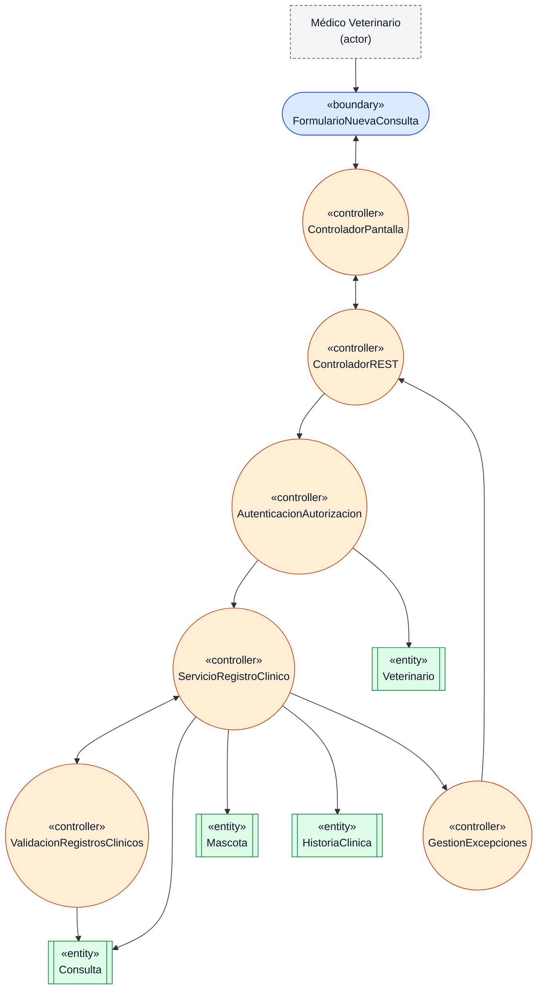
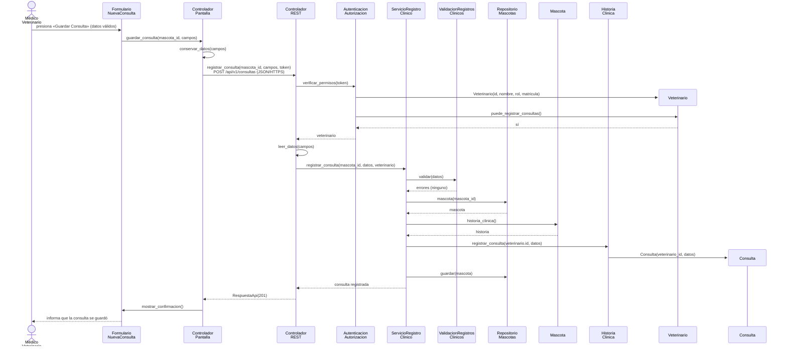
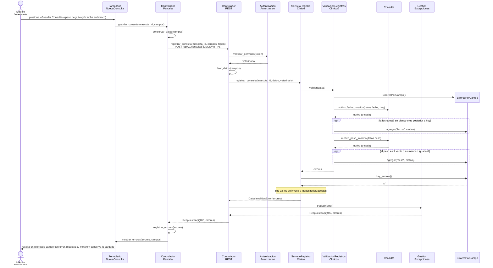

# Documento de Diseño Detallado — TP4 (Parte A)
**Asignatura:** Ingeniería del Software 2026 — Trabajo Práctico 4  
**Proceso:** Gestión Clínica e Historial  
**Historia de Usuario:** HU-02 — Edición de Entradas Previas del Historial Clínico  

---

## Parte A — Diseño detallado de la HU 

### Paso 1 — Ficha de la HU:  

### 1.1 Propósito
El propósito de este documento es especificar el **Diseño Detallado** para la historia de usuario **HU-01 ("Manejo de datos obligatorios incompletos o con formato inválido")**, perteneciente al proceso central de **Gestión Clínica e Historial**.
**Relevancia de Dominio:** HU-01 exige validación de autoría, completitud de registros clínicos, versionado de entidades mediante enlaces jerárquicos y persistencia atómica transaccional con bitácora de auditoría.

---

### 1.2 Historia de Usuario Elegida: HU-01
- **Identificador:** HU-01 (Deriva de: CU-01, slice A1 (RF-10 y RF-11)).
- **Nombre:** Manejo de datos obligatorios incompletos o con formato inválido.
- **Enunciado:**
  Como Médico Veterinario, quiero recibir una notificación precisa cuando intento guardar una consulta con campos obligatorios vacíos o datos con formato inválido, para poder corregirlos y asegurar la integridad de la historia clínica sin perder la información cargada.

---

### 1.3 Criterios de Aceptación (Given-When-Then)

Given: El veterinario está completando el formulario de nueva consulta y escribe un valor negativo en el campo de peso o deja la fecha en blanco.
When: El veterinario presiona el botón "Guardar Consulta".
Then: El sistema rechaza el almacenamiento, resalta en rojo el campo con error y muestra un mensaje indicando con precisión el motivo del fallo.

---

### 1.4 Tabla de Coherencia con el TP3

| Dimensión         | Contenido                                                                                                                                                                                                                                                                                                                                                                                                       |
| ----------------- | --------------------------------------------------------------------------------------------------------------------------------------------------------------------------------------------------------------------------------------------------------------------------------------------------------------------------------------------------------------------------------------------------------------- |
| **Funcionalidad** | HU-01, derivada de CU-01, slice A1; vinculada con RF-10 y RF-11\. Validar los datos antes de guardar, rechazar los inválidos e informar los errores.                                                                                                                                                                                                                                                            |
| **Estructura**    | Estilo cliente-servidor. Patrón MVC en la interfaz web y capas en la API clínica. Intervienen Vistas, Controladores de pantalla, Modelo de formulario, Cliente de la API, Controladores REST, Autenticación y autorización, Servicio de registro clínico, Validación de registros clínicos y Gestión de excepciones. Componente principal: Validación de registros clínicos, en la capa de servicios de la API. |
| **Calidad**       | EC-01: Operabilidad. Tácticas: mantener modelos de tarea, de usuario y del sistema; reducir sobrecarga. DA-02: interfaz MVC con conservación del formulario y devolución conjunta de errores por campo.                                                                                                                                                                                                         |
| **Dominio**       | Se utilizan Veterinario, Mascota, HistoriaClinica y Consulta para representar el profesional, el paciente, su historial y los datos de la consulta que se intenta registrar.                                                                                                                                                                                                                                    |
| **Verificación**  | Para la HU: ingresar peso negativo o fecha vacía y comprobar rechazo, mensaje específico, campo resaltado, ausencia de almacenamiento y conservación de datos. Para EC-01: comprobar 0 pérdidas de datos ante errores y medir el registro crítico en ≤ 45 segundos y ≤ 8 interacciones, con al menos 90 % de pruebas exitosas en las condiciones definidas por el escenario.                                    |

---

### 1.5 Entidades del Modelo de Dominio Intervinientes

Entidades involucradas en HU-01:

Entidad del TP1¿Interviene?Qué utiliza la HU de ellaLa HU la...**Usuario**IndirectamenteIdentidad y rol del usuario autenticado, mediante VeterinarioConsulta**Secretaria**NoNo participa en el registro clínico de esta HU—**Veterinario**SíProfesional que intenta registrar la consultaConsulta**DuenioMascota**NoLos datos del tutor no intervienen en la validación—**Mascota**SíIdentificación del paciente al que corresponde la consultaConsulta**HistoriaClinica**SíHistorial al que se asociaría la consultaConsulta (no modifica)**Consulta**SíFecha y demás datos clínicos, incluido el peso que debe validarseSe intenta crear (el guardado se rechaza)**Vacuna**NoNo se validan vacunas en este escenario—**AplicacionVacuna**NoNo se registra una aplicación de vacuna—**Turno**NoNo se gestiona la agenda—**Prescripcion**NoNo se registra una prescripción—**ReaccionAdversaRegistrada**NoNo se registra una reacción adversa—**Pago**NoNo corresponde al proceso de validación clínica—**PatologiaReferencia**NoNo se realiza una consulta a OMIA

---

## Paso 2 — Análisis tridimensional 

| Dimensión         | Elemento                     | Detalle                                                                                                                                                   |
| ----------------- | ---------------------------- | --------------------------------------------------------------------------------------------------------------------------------------------------------- |
| **Funcionalidad** | Criterio de aceptación HU-01 | Si se intenta guardar una consulta con peso negativo o fecha vacía, se rechaza el almacenamiento, se identifica el campo inválido y se muestra su motivo. |
| **Estructura**    | Frontera                     | Formulario de nueva consulta (Vistas de la interfaz web).                                                                                                 |
| **Estructura**    | Control                      | Controladores de pantalla, Controladores REST y Servicio de registro clínico coordinan el envío, la validación y la respuesta.                            |
| **Estructura**    | Dominio                      | Consulta contiene los datos a validar; Mascota, HistoriaClinica y Veterinario proporcionan el contexto del registro.                                      |
| **Estructura**    | Validación                   | Validación de registros clínicos, en la capa de servicios, evalúa los datos y produce errores específicos por campo.                                      |
| **Calidad**       | EC-01 — Operabilidad         | Conservar los datos ante el rechazo y devolver los errores juntos, evitando que el veterinario deba repetir la carga. Se aplica DA-02.                    |

---

### 2.1 Diagrama de Robustez

---

### 2.2 Ubicación de Reglas de Negocio

| Regla                                                                  | Responsable                                    | Justificación                                                            |
| ---------------------------------------------------------------------- | ---------------------------------------------- | ------------------------------------------------------------------------ |
| **RN-01:** La fecha obligatoria no puede estar vacía y debe ser válida | `ValidacionRegistrosClinicos`                  | Centraliza las validaciones autoritativas definidas por RF-10.           |
| **RN-02:** El peso debe ser un número positivo                         | `ValidacionRegistrosClinicos`                  | Verifica el rango permitido para el dato clínico.                        |
| **RN-03:** No se registra una consulta con datos inválidos             | `ServicioRegistroClinico`                      | Coordina el registro y evita invocar la persistencia cuando hay errores. |
| **RN-04:** Cada error debe identificar el campo y su motivo            | `ValidacionRegistrosClinicos`                  | Genera los errores por campo, conforme a RF-11.                          |
| **RN-05:** Los datos cargados deben conservarse ante el rechazo        | `ControladorPantalla` y `Modelo de formulario` | Conservan el estado del formulario, conforme a EC-01 y DA-02.            |

---

| Elemento del diagrama           | Componente del TP3                                                                | Capa o rol                                |
| ------------------------------- | --------------------------------------------------------------------------------- | ----------------------------------------- |
| **FormularioNuevaConsulta**     | `Vistas`                                                                          | Vista — MVC (Interfaz Web)                |
| **ControladorPantalla**         | `Controladores de pantalla`; utiliza `Modelo de formulario` y `Cliente de la API` | Controlador y apoyo — MVC (Interfaz Web)  |
| **ControladorREST**             | `Controladores REST`                                                              | Presentación — API Clínica                |
| **AutenticacionAutorizacion**   | `Autenticación y autorización`                                                    | Transversal — API Clínica                 |
| **ServicioRegistroClinico**     | `Servicio de registro clínico`                                                    | Servicios — API Clínica                   |
| **ValidacionRegistrosClinicos** | `Validación de registros clínicos`                                                | Servicios — API Clínica                   |
| **GestionExcepciones**          | `Gestión de excepciones`                                                          | Transversal — API Clínica                 |
| **Consulta**                    | `Validación de registros clínicos` / `Servicio de registro clínico`               | Entidad de dominio utilizada en servicios |
| **Mascota**                     | `Servicio de registro clínico`                                                    | Entidad de dominio                        |
| **HistoriaClinica**             | `Servicio de registro clínico`                                                    | Entidad de dominio                        |
| **Veterinario**                 | `Autenticación y autorización`                                                    | Entidad de dominio del profesional        |

---

### Paso 4. Diagramas de Secuencia

# Paso 4 — Diagramas de Secuencia y Asignación de Responsabilidades (HU-01)

## Contexto y Convenciones

* **Secuencia A: Camino Principal.** El veterinario ya corrigió y guarda con datos válidos (CU-01, pasos 5 a 7). Es el destino de la HU: «corregirlos» y poder guardar.
* **Secuencia B: Caminos de Rechazo.** Es el camino que pide el criterio de aceptación: peso negativo y/o fecha en blanco. Las dos causas son variantes pequeñas del mismo camino (se muestran con `opt`) y se informan juntas.
* **Seguridad (EC-02):** El rechazo por falta de permisos pertenece a EC-02 y RF-08, no es criterio de HU-01: en las dos secuencias se modela solo el caso habilitado.
* **Convenciones:** La flecha punteada con cruz (`--x`) es un error que el servicio señala; los mensajes entre componentes siguen el catálogo del TP3. `Modelo de formulario` y `Cliente de la API` se tratan como colaboradores internos de `ControladorPantalla`, tal como dice la tabla de correspondencia del Paso 3.

---

## 4.1 Secuencia A: Camino Principal (Flujo Exitoso)

---

## 4.2 Secuencia B: Caminos de Rechazo (Datos Inválidos)

---

## 4.3 Demostración de la Táctica de Calidad (EC-01 / DA-02)

| Táctica | Operación o mensaje que la muestra | Evidencia en el diseño |
| :--- | :--- | :--- |
| **Mantener modelos de tarea, de usuario y del sistema** (`Modelo de formulario`) | `conservar_datos(campos)` **antes** de enviar y `registrar_errores(errores)` al volver el rechazo | La pantalla se redibuja desde ese estado (`mostrar_errores(errores, campos)`) $\rightarrow$ **0 pérdidas de datos**. |
| **Reducir sobrecarga** (`ValidacionRegistrosClinicos`) | Una sola llamada `validar(datos)` recorre todos los campos y devuelve **todos** los errores juntos en un único `DatosInvalidosError` | Menos interacciones ida y vuelta entre cliente y servidor. |

---

## 4.4 Asignación de Responsabilidades (Criterios GRASP)

| Responsabilidad | Quién | Criterio GRASP | Por qué |
| :--- | :--- | :--- | :--- |
| **Captar los datos y mostrar errores resaltados o la confirmación** | `FormularioNuevaConsulta` | Bajo acoplamiento | Solo conoce al controlador de pantalla. No decide qué es inválido: resalta lo que le informan. |
| **Conservar lo ingresado y los errores, y coordinar el envío** | `ControladorPantalla` | Controlador | Recibe el evento de la pantalla y lo coordina; es el Modelo de formulario de `EC-01`. |
| **Interpretar el pedido (JSON $\rightarrow$ `DatosConsulta`) y armar la respuesta** | `ControladorREST` | Controlador | Es la entrada de la API clínica (capa Presentación). |
| **Identificar al usuario y verificar que puede registrar consultas** | `AutenticacionAutorizacion` | Creador | Tiene los datos del token para crear el `Veterinario`. |
| **Saber si el veterinario puede registrar consultas** | `Veterinario` | Experto en información | Conoce su rol. |
| **Coordinar el registro: validar, obtener la historia, registrar, guardar** | `ServicioRegistroClinico` | Controlador (del caso de uso) | Ordena los pasos; no valida ni decide reglas del dominio. Impide guardar si hay errores (RN-03). |
| **Recorrer todos los campos y juntar los errores por campo** | `ValidacionRegistrosClinicos` | Alta cohesión | Su única tarea es aplicar las reglas de RF-10 y armar los errores de RF-11 (RN-04); la reutiliza también el servicio de prescripciones (TP3). |
| **Decidir si una fecha y un peso son válidos** | `Consulta` | Experto en información | Sabe qué es una fecha de atención y un peso admisibles (RN-01, RN-02). |
| **Crear los errores y saber si hay alguno** | `ValidacionRegistrosClinicos` (crea) y `ErroresPorCampo` (`hay_errores`) | Creador y Experto | La validación los usa de forma directa; el contenedor conoce su contenido. |
| **Traducir el error en una respuesta controlada** | `GestionExcepciones` | Alta cohesión | Es el aspecto transversal del TP3; los servicios solo señalan. |
| **Obtener y guardar la mascota con su historia** | `RepositorioMascotas` | Alta cohesión y bajo acoplamiento | El servicio no sabe cómo se guarda. |
| **Saber cuál es su historia clínica** | `Mascota` | Experto en información | Tiene la relación 1 a 1 con su historia. |
| **Crear la consulta y agregarla a su historial** | `HistoriaClinica` | Creador | Contiene y «registra» consultas (modelo del TP1). |
